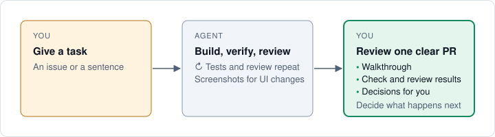

# Shaka

Shaka is a free, open-source skill for AI coding agents, including Claude Code,
Codex, Cursor, GitHub Copilot, OpenCode, and Pi.

You give a task. The agent builds, verifies, and reviews. You get a pull request
(PR) you can judge quickly.

[Watch the 52-second demo](https://www.youtube.com/watch?v=T6Fstx2fGJI) ·
[See a Shaka PR](https://github.com/shakacode/shaka/pull/667) ·
[Docs website](https://shaka.shakacode.com/)

<a id="why-use-it"></a>

## Why use Shaka?

Writing code is only part of the work. You still need to know whether it works,
what a reviewer found, and what needs your attention before merging.

Shaka asks your agent to test, get an independent review for substantial changes,
and finish the PR without repeated reminders. Each PR explains the change and
links the evidence: test results, review findings, and screenshots when relevant.
It also names what remains unverified. You can ask for revisions before merging.

Use that record to decide what happens next. During regular retrospectives, you
and your agents can examine results, token use, and timing to improve the PR
workflow, including automatic merges.

By default, you merge the PR. You can also approve the agent's merge or choose
[`auto`](docs/working-with-shaka.md#choose-a-merge-policy).
Even with `auto`, large or risky changes need your merge decision.



<a id="example-prompts"></a>
<a id="get-started"></a>
<a id="requirements"></a>
<a id="start-with-a-small-task"></a>
<a id="what-you-need"></a>

## Try it

You don't need to study the docs first. Ask your coding agent to install Shaka:

```text
Install Shaka from https://github.com/shakacode/shaka
```

Then give it a small task:

```text
$shaka Fix search when the query contains an apostrophe. Go
```

Use `$shaka` in Codex and `/shaka` in Claude Code, Cursor, GitHub Copilot, or OpenCode.
For Pi, load the installed skill. See [other coding agents](docs/coding-agents.md).
Your agent checks setup and tells you if
anything is missing.

Read the PR, ask for revisions if needed, and decide whether to merge.

Prefer to install it manually? Follow [manual installation](docs/manual-installation.md).
New to pull requests? Try [Shaka in pictures](docs/shaka-in-pictures.md).

## For open-source repositories

To reduce prompt-injection risk, Shaka ignores comments from untrusted authors.
Maintainers can choose whose comments the agent reads.
See [review safety](docs/workflow.md#trust-model).

## Make it work for your team

Shaka uses your coding agent and your repository's checks. You can configure
local AI reviewer models, efforts, and prompts for each project. You can also
choose its merge preference. Shaka itself is free; you pay for the agents and
services you use.

[ShakaCode](https://www.shakacode.com) can help customize the Shaka skill to
improve your development team's efficiency.

[Book a 30-minute call with Justin Gordon](https://meetings.hubspot.com/justingordon/30-minute-consultation)
to see a demo, ask how Shaka works, or get a walkthrough of
[forking Shaka and changing it](docs/fork-and-hack.md) for your team.

<a id="documentation"></a>

## When you want more detail

Ask your agent how to use Shaka, or open the [documentation](docs/README.md).
[Start here](docs/getting-started.md) walks through your first task.

[Contributing](CONTRIBUTING.md) · [MIT license](LICENSE)

## Names and logos

The MIT license covers the code and documentation. It does not grant rights to
use the Shaka or ShakaCode names or logos. ShakaCode is a registered trademark of
ShakaCode LLC in the United States. You may say that your work uses or is based on
Shaka. Give a fork or product its own name, so it does not appear to come from
ShakaCode.
