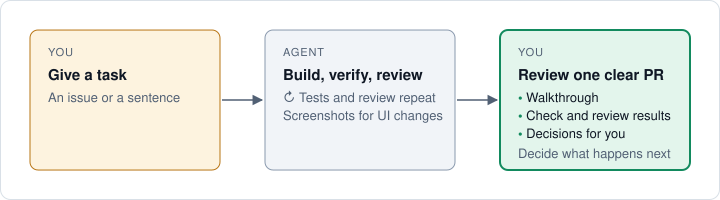

# Shaka

**Read the guides at [shaka.shakacode.com](https://shaka.shakacode.com/)**

Shaka is a free, open-source skill for AI coding agents, including Claude Code,
Codex, Cursor, GitHub Copilot, OpenCode, and Pi.

Give your agent a task. You get a pull request (PR) with proof: test results and
an independent review of substantial changes. The PR also names anything still
unverified.


[Watch the 52-second demo](https://www.youtube.com/watch?v=T6Fstx2fGJI) ·
[**Book a live demo**](https://meetings.hubspot.com/justingordon/30-minute-consultation)

<a id="why-use-it"></a>

## Why use Shaka?

Writing code is only part of the work. You still need to know whether it works,
what a reviewer found, and what needs your attention before merging.

Shaka asks your agent to test, get an independent review for substantial changes,
and finish the PR without repeated reminders. Each PR explains the change and
links the evidence: test results, review findings, and screenshots when relevant.
It also names what remains unverified. You can ask for revisions before merging.

Use that record to decide what happens next. During regular retrospectives, you
and your agents can examine results, token use, and timing to improve the PR
workflow, including automatic merges.

By default, you merge the PR. You can also approve the agent's merge or choose
[`auto`](docs/working-with-shaka.md#choose-a-merge-policy).
Even with `auto`, large or risky changes need your merge decision.



<a id="mostly-ruby"></a>

### Mostly Ruby, so your agent reads less

Shaka is mostly tested Ruby code, not instructions. Ruby validates settings,
filters untrusted comments, collects evidence, and checks merge conditions. The
agent runs these commands without reading their code and works from their short
output. Its instructions focus on judgment calls. Writing these checks as
instructions would cost tokens on every task; as code, they run the same way each time.

| Measured in November 2026 | Size |
| --- | --- |
| Ruby code in the installed skill | 84% of its lines: about 45,000 lines in 485 files |
| Instructions the agent reads at the start of every task | About 12,400 words |
| Procedures the agent loads only when needed, such as review | 42 files, about 51,000 words in total |
| Tests for that Ruby, kept in this repository | About 76,000 lines |

See [how these numbers were measured](docs/architecture.md#most-of-shaka-is-ruby).

<a id="example-prompts"></a>
<a id="get-started"></a>
<a id="requirements"></a>
<a id="start-with-a-small-task"></a>
<a id="what-you-need"></a>

## Try it

You don't need to study the docs first. Ask your coding agent to install Shaka:

```text
Install Shaka from https://github.com/shakacode/shaka
Use the latest published stable release if available
```

Then give it a small task:

```text
$shaka Fix search when the query contains an apostrophe
Set up Shaka just for me if needed. Ask me before merging. Go
```

Use `$shaka` in Codex and `/shaka` in Claude Code, Cursor, GitHub Copilot, or OpenCode.
For Pi, load the installed skill. See [other coding agents](docs/coding-agents.md).
Your agent uses shared project settings when they exist. Otherwise, individual
setup keeps your settings in your local copy of the project.

Before coding, the agent recommends a model and effort. If your coding agent uses
different settings, or the agent can't tell which it uses, it waits for your reply.
To keep your current settings and start right away, end the task with `Go`
(without naming a model or effort).
See [why the agent asks](docs/faq.md#why-did-the-agent-stop-to-ask-about-model-and-effort).

Read the PR, ask for revisions if needed, and decide whether to merge.

Prefer to install it manually? Follow [manual installation](docs/manual-installation.md).
New to pull requests? Try [Shaka in pictures](docs/shaka-in-pictures.md).
Already using Shaka? See [upgrade and configuration compatibility](docs/migration.md).

## Book a live demo

Want to see Shaka on a real task, or fit it to how your team works?
[Book a 30-minute call with Justin Gordon](https://meetings.hubspot.com/justingordon/30-minute-consultation),
ShakaCode's founder, for a demo, answers about how Shaka works, or a walkthrough of
[forking Shaka and changing it](docs/fork-and-hack.md).

## For open-source repositories

To reduce prompt-injection risk, Shaka ignores comments from untrusted authors.
Maintainers can choose whose comments the agent reads.
See [review safety](docs/workflow.md#trust-model).

## Make it work for your team

Shaka uses your coding agent and your repository's checks. You can configure
local AI reviewer models, efforts, and prompts for each project. You can also
choose its merge preference. Shaka itself is free; you pay for the agents and
services you use.

[ShakaCode](https://www.shakacode.com) can help customize the Shaka skill to
improve your development team's efficiency.

<a id="documentation"></a>

## When you want more detail

Ask your agent how to use Shaka, or open the [documentation](docs/README.md).
[Start here](docs/getting-started.md) walks through your first task.

[Contributing](CONTRIBUTING.md) · [MIT license](LICENSE)

## Names and logos

The MIT license covers the code and documentation. It does not grant rights to
use the Shaka or ShakaCode names or logos. ShakaCode is a registered trademark of
ShakaCode LLC in the United States. You may say that your work uses or is based on
Shaka. Give a fork or product its own name, so it does not appear to come from
ShakaCode.
