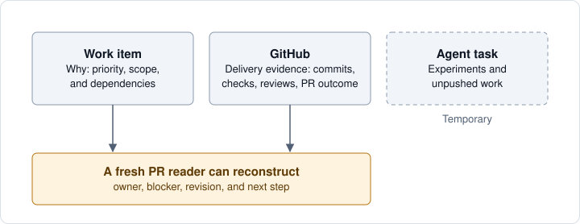

# How Shaka is built

Shaka is a small set of instructions on top of tested Ruby. Your agent follows
the instructions for decisions that need judgment and runs Ruby commands for
everything repeatable. Each task's record lives where you already look: the work
item and GitHub.

<a id="put-repeatable-checks-in-code"></a>

## Most of Shaka is Ruby

Ruby validates settings, filters untrusted comments, collects evidence, and
checks merge conditions. Your agent runs these commands and works from their
short output; it never needs to read their code. That has three effects:

- A check behaves the same way on every task, instead of depending on how an
  agent reads a rule that day.
- Tests prove each check. The Ruby has about 76,000 lines of tests under
  `test/`, which stay out of the installed skill.
- Your agent spends its tokens on your task, not on reading rules.

Measured in November 2026, the installed `skills/shaka` directory held:

| Content | Lines | Size |
| --- | --- | --- |
| Ruby (485 files) | 44,942 (84%) | 1.74 MB (77%) |
| Markdown procedures and prompts (52 files) | 5,942 (11%) | 0.36 MB (16%) |
| YAML workflow, settings, and data (5 files) | 2,311 (4%) | 0.16 MB (7%) |

Your agent reads little of that text, and only when it needs it:

| Text | Who reads it, and when | Words |
| --- | --- | --- |
| `SKILL.md` and the workflow `shaka workflow` prints | Your agent, at the start of every task | About 12,400 |
| 42 procedures, such as review and retrospective | Your agent, each one only when it applies | About 51,000 in total |
| 8 reviewer and checkpoint prompts | Reviewer models, which Ruby sends them to | About 1,500 |
| Enforcement records, defaults, and model rates (YAML) | Ruby only | About 8,500 |
| These guides under `docs/` | People; they are not part of the installed skill | About 49,000 |

Words and bytes show size, not tokens; each model counts tokens differently. To
check the instruction size yourself, ask your agent:

```text
Run bin/report-instruction-growth in my Shaka checkout and summarize the word counts
```

To count tokens as well, ask:

```text
Run bin/report-instruction-growth --tokens in my Shaka checkout and summarize the token changes
```

The `--tokens` option uses Claude Code and Codex with the accounts they are
already signed in to, so it needs no API keys. Each tool answers a one-line
prompt with and without `SKILL.md` plus the rendered workflow, from your working
copy and from its merge base. The difference is what that text costs. Like any
session in those tools, this sends the text to Anthropic and OpenAI.

Count only text you trust, such as your own branch or `main`. Codex keeps some
tools during the count, so instructions in someone else's branch could make it
act before the report marks the count `UNKNOWN`.

A count uses part of your plan's quota, so run it now and then, such as before
a release, rather than on every change. Claude's counts vary by about 50 tokens
from run to run, so a change of a few words may not show. The models are under
`runtime.instruction_tokens` in Shaka's `defaults.yml`. A tool that is missing
or signed out, or that tries to act on the text instead of answering, shows
`UNKNOWN` and the reason, and the report still succeeds. Without `--tokens`, the
report runs neither tool.

<a id="keep-facts-where-people-look-for-them"></a>

## Where Shaka keeps facts

One agent task carries each task to its outcome: usually a reviewed pull request
(PR), sometimes a plan or a review only. Shaka keeps no tracking system of its
own; each fact lives where people already look for it:

- The work item holds why the work exists: priority, scope, and dependencies.
  For a task you start from a description, the PR holds that context.
- GitHub holds delivery evidence: commits, checks, reviews, and the PR outcome.
- The agent's chat holds experiments and unpushed work. That context is temporary.



Anyone who opens the PR later can tell its owner, blocker, revision, and next
step from the work item and GitHub alone. An unfinished PR also carries a short
[recovery note](working-with-shaka.md#resume-unfinished-work) so someone else
can continue the work.
