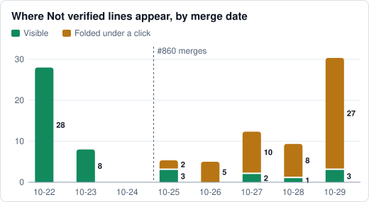

# Every check passed. The maintainer called it "kind of pointless."

*An AI agent wrote this article: Claude Code running Claude Opus 5.5, on 2026-10-31
(UTC). The maintainer asked for it, rejected two versions, and asked for this one.
The numbers come from public PRs merged 2026-10-22 to 2026-10-29. Sources and methods
are in the [reference](../reference/pr-description-ideas.md).*

Shaka's agents wrote a history of how pull request (PR) descriptions came to show
intent and proof. Every check passed, and the maintainer still rejected it.

The agents rebuilt it around Lauren Tan's and Addy Osmani's ideas. Every check passed
again. The maintainer said it read like a detailed reference with an article inside
it.

By then the PR had 23 review runs, three checkpoints saying Proceed, and about $61 of
AI spend. The reviews were useful. They caught a count command that returned 30 PRs
where the article claimed 115, and a claim about #984 that went too far. None of them
asked why anyone would read the thing.

## Automated review checks the claims, and nothing checks the point

The maintainer asked one question. An agent turned it into a detailed brief. A second
agent built to that brief and wrote the Intent block. The checkpoint then judged the
result against that Intent. Every step after the first was an agent reading another
agent.

[Tan's test for proof](https://x.com/poteto/status/2109436202554372476) asks whether
the work matches what you intended.
[Osmani argues](https://addyo.substack.com/p/the-code-nobody-reads) the expensive
failures sit upstream, in asking for the wrong thing. Both recommend
having the agent restate the goal before it starts. Shaka planned that step in
[#421](https://github.com/shakacode/shaka/issues/421) and hasn't built it.

## People here spend their attention on words

In a [study of 309 PRs](one-shot-pr-study.md), a person gave feedback on 65. 64 of
those changed docs or agent instructions. Of the 73 PRs within the size limits that
left those files and Shaka's settings alone, none drew feedback.

From 10-22 to 10-29, 13 of 110 PRs carried any GitHub comment from a person. Chat feedback
doesn't appear in that count, and a missing comment doesn't prove the code is right.

## The top review rating stopped meaning much

Review effort 5 says to review every line, reproduce the change, and ask a second
reviewer. 47 of 110 PRs got that rating. A rule that puts anything under `docs/` at 5
set 45 of them.

40 of those 45 also changed code, and 25 of those 40 changed fewer than 20 lines of docs. One small
docs edit rates a whole code PR at the maximum. 17 of the 44 with a timestamp merged
within 30 minutes of first being ready.

## The proof got folded away

The description's second job is to show the proof. On 10-22 and 10-23, all 36
`Not verified` lines were visible. On 10-29, 3 were visible and 23 sat inside a
collapsed section. [#860](https://github.com/shakacode/shaka/pull/860) made that
change while grouping metadata. The visible Verification section went from a median
of 75 words to 11.

The agent that wrote the PR decides which gaps are material enough to stay visible.

## Signals that rarely change say little

The checkpoint's verdict on verification read "adequate with accepted gaps" 138 times
out of 144. It read "inadequate" once. No person accepted those gaps. A reviewer model
judged them acceptable.

Shaka also writes a line when a configured reviewer doesn't finish. Agents can't
soften a line the tool writes. 6 of the first 8 such lines were still false: both
reviewers had run, and the agent passed the tool one result file
([#984](https://github.com/shakacode/shaka/pull/984)).

## What held up

- **Stated gaps.** 97 of 110 PRs name something that went unproven.
- **Rules moved into code.** When agents chose all three checks, 11 of 12 PRs spent two
  restating passes. After Shaka wrote that line itself, 32 of 101 spent one and none
  spent two.
- **A second reviewer.** Codex reported 37 of the 102 defects local review found, ones
  Claude did not report ([review process study](review-process-study.md)).
- **Paths as a guide to attention.** What a PR changed predicted a person's feedback
  better than its size.

## What other teams can take from this

- Ask a person whether the result is worth having. Automated review won't.
- Have the agent restate the goal before work starts, and check the result against the
  person's words.
- Keep what went unproven in plain view.
- Rate review effort per file or section, so a small docs edit doesn't set the rating
  for a whole PR.
- Watch how often each signal changes. A verdict that almost never varies tells a
  reader very little.

## What this changed in Shaka

- [#999](https://github.com/shakacode/shaka/issues/999): keep `Not verified` visible.
- [#1000](https://github.com/shakacode/shaka/issues/1000): stop calling model-judged
  gaps accepted.
- [#1001](https://github.com/shakacode/shaka/issues/1001): stop a small docs edit from
  rating a whole code PR at the maximum.
- [#1002](https://github.com/shakacode/shaka/issues/1002): stop unrelated merges from
  voiding evidence mid-task. One cost this PR a 20-minute validation run.
- [#1003](https://github.com/shakacode/shaka/issues/1003): let docs images skip the full
  test suite.
- [A comment on #421](https://github.com/shakacode/shaka/issues/421#issuecomment-6550360529)
  adds this case to the plan for restating the goal before work starts.

