# Do pull requests still matter in the age of agents?

When your coding agents work, how do you know what changed, what was tested, and whether it’s ready to accept? A pull request gives you and your team a place to ask those questions and keeps the answers with the code.

Already use Git and pull requests? [Jump to what changes when agents write the code](#why-use-prs-when-agents-can-make-commits).

## Three authors write a book

Here's a story to illustrate my point. Maya and two coauthors are writing a book. Her coauthor Leo reviews a draft of her chapter and tells her he couldn’t follow the journey because the map was on the last page. Maya moves the map to the beginning and saves a new draft with a note for her coauthors. “Put the map first so readers can follow the route.”

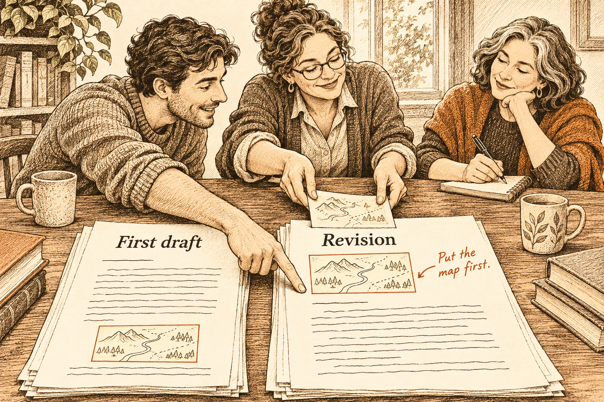

You can do something similar with Version History in Google Docs or a Word document saved to OneDrive. Open an earlier draft and see what changed. Software teams used versioning long before Git.

## Where did the name “pull request” come from?

On Halloween 2002, Linux developer Max Krasnyanskiy joked about running out of candy, then asked Linus Torvalds to pull some Bluetooth updates from a BitKeeper repository. [Original mailing list post](https://lkml.iu.edu/0211.0/0013.html).

Max was asking Linus to bring changes from Max’s copy into Linux. Bringing changes in from another copy is called a **pull**. GitHub later put that request on a web page.

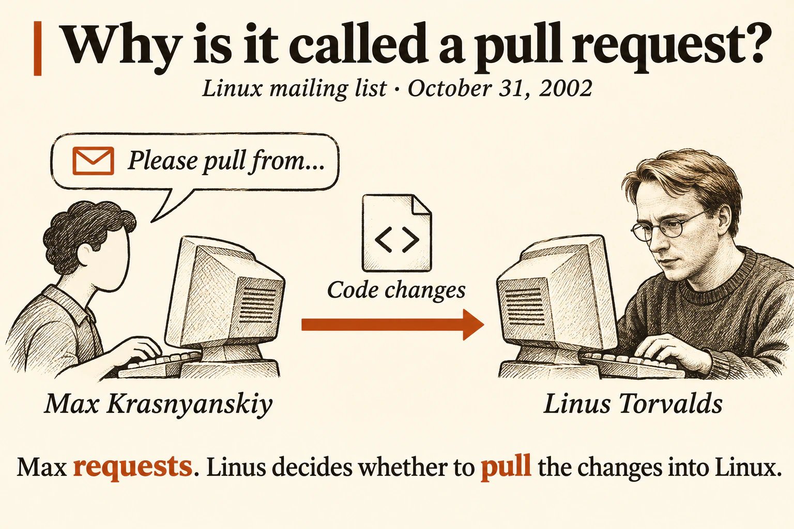

*Illustration based on the mailing list post.*

## Why Linus built Git

Linux maintainers used BitKeeper to work in separate copies of the code and send changes to one another. When the arrangement with BitKeeper broke down in 2005, Torvalds needed a tool that would preserve that way of working and stay fast on a project the size of Linux. He decided to write one. [Torvalds on why he built Git](https://www.linuxfoundation.org/blog/blog/10-years-of-git-an-interview-with-git-creator-linus-torvalds)

On April 7, 2005, he used Git to record its own first commit. The commit message called Git “the information manager from hell.” [Git’s first commit](https://github.com/git/git/commit/e83c5163316f89bfbde7d9ab23ca2e25604af290)

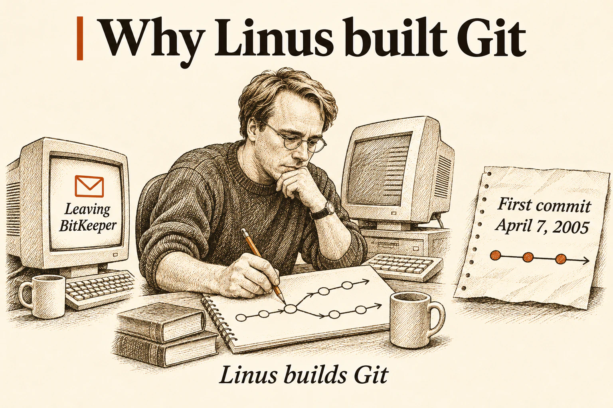

*Illustration based on Torvalds’s account.*

## What’s in a Git commit?

Git is a version control system. It keeps the history of a project’s files. A **commit** records a set of edits at one point in that history. Git saves the resulting version along with the author’s message.

Imagine a simple to-do list app. You type “Book flights” to add a task and check it off once you’ve booked. When the list gets long, you might want a switch to hide completed tasks. The code in that commit adds the switch. The message explains why it helps people see what’s left to do.

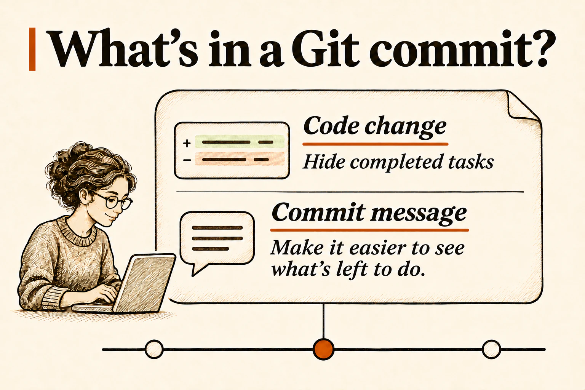

You can compare any two commits. Git calls the difference a **diff**. It’s like comparing Maya’s first draft with her fourth to see what changed across several rounds of edits.

## When GitHub gave code review a home

GitHub, a site where people share Git projects, introduced pull requests in 2008. The turning point came in 2010, when GitHub put the diff, commits, and conversation on one page. A reviewer could ask about a change and return to the same discussion after the developer revised it. In 2011 GitHub added a Merge button, so the team could accept the change right where they had reviewed it. [GitHub introduces pull requests in 2008](https://github.blog/news-insights/oh-yeah-there-s-pull-requests-now/) · [GitHub brings the diff and discussion together in 2010](https://github.blog/news-insights/pull-requests-2-0/) · [GitHub adds the Merge button in 2011](https://github.blog/news-insights/the-merge-button/)

Pre-AI, a human developer would open a pull request (often called a **PR**) to make a code change. Let's suppose the change is to add the “Hide completed” switch. The PR reviewer would read the diff and check whether the design fits the app, whether the code will be easy to maintain, and whether automated tests cover the new behavior and its edge cases.

Here the reviewer asks, “Is there a test for turning the filter off?” The developer then adds a test that checks that completed tasks reappear. The question, the response, and the new commit stay in the same PR. It's all one discussion on a set of code changes.

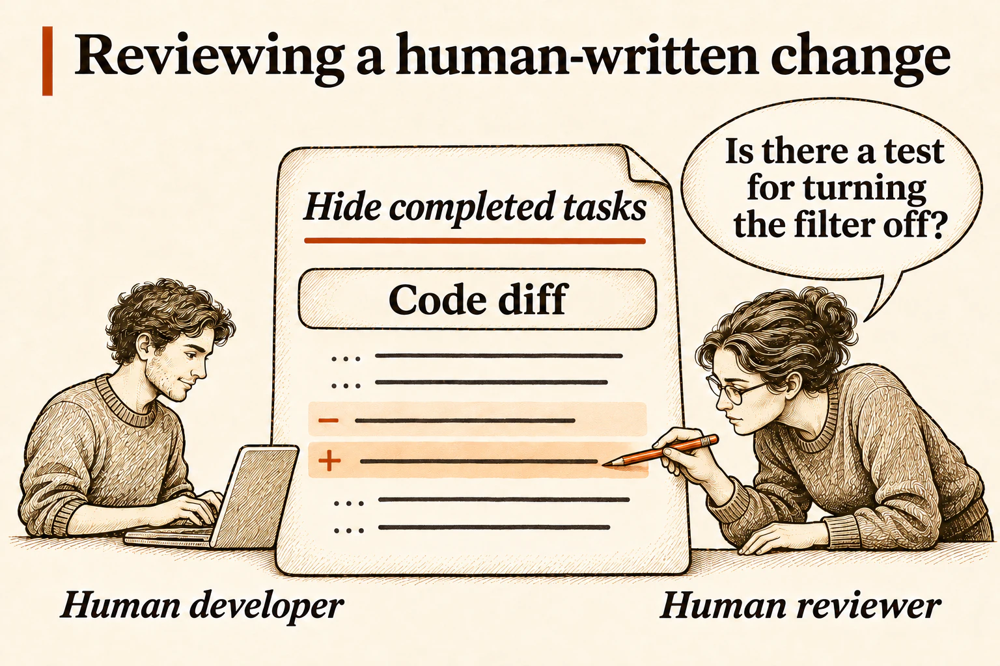

## Complicated apps are built one small PR at a time

In our to-do list example, we might have a PR for where you add a task. The next PR might let you mark it done. The third PR might let you hide completed tasks. Each PR should be tested before merging it. Each PR gives the team one behavior to understand and verify before other work builds on it.

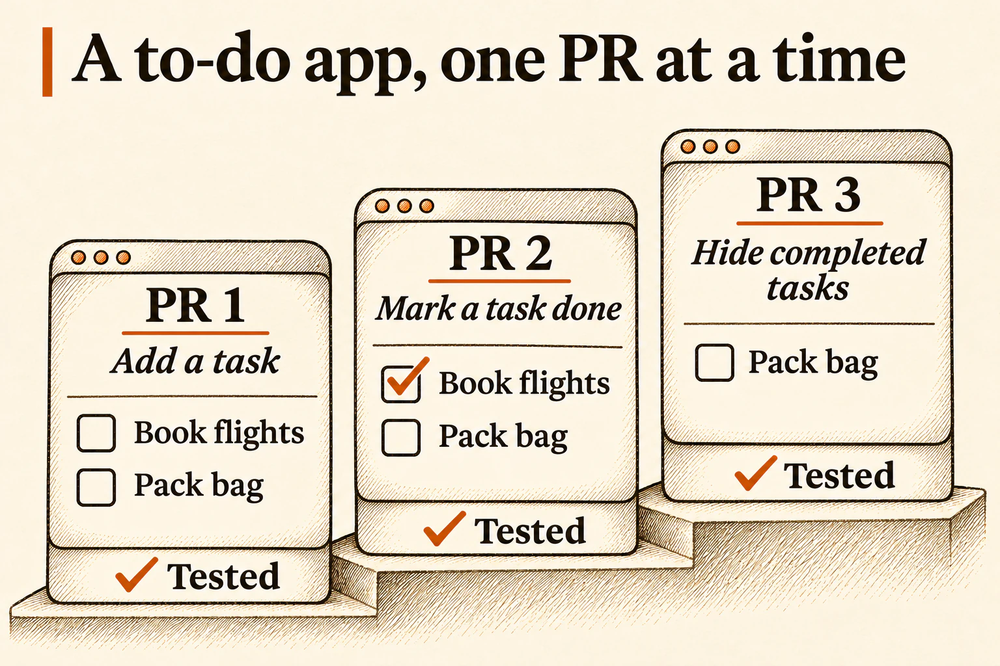

A PR can include several commits as the developer builds the feature and responds to reviews. A common way to merge is to combine them into one commit on the **main branch**, where the project’s accepted changes go.

### Why keep commits small?

- **Change direction quickly.** Seeing an agent’s first attempt can make you realize the idea needs rethinking. A focused commit gives you a clear piece of work to revise or set aside.
- **Make review and testing manageable.** A human reviewer can inspect one change at a time and check it before more work depends on it.
- **Find where something broke.** If you know something was recently working and then broke, you have a few places to look for the error. This makes it much easier to find the root cause of a new error.

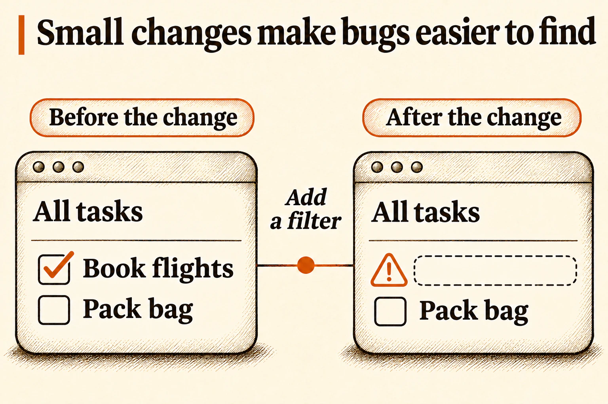

## Why use PRs when agents can make commits

If you’re vibe coding a personal prototype, direct commits may be enough. A PR gives people and agents a shared place to discuss the work, ask for changes, and see how the team decided it was ready.

Back to our to-do list example, say the coding agent adds an Export button that downloads the visible tasks as a file. It builds the feature and runs tests. A separate agent reviews the diff and flags gaps. The coding agent revises the change and runs the checks again. That loop can go through several rounds before a person weighs in.

When agents write more code than a person can read line by line, the human reviewer needs evidence for the version in front of them. The PR’s **evidence packet** explains what changed and why. It shows which tests ran, what they covered, whether they passed, and what the agent review found or left open. That evidence helps the reviewer decide where to read the code closely. [Reviewing the evidence in a Shaka PR](../pr-verification.md)

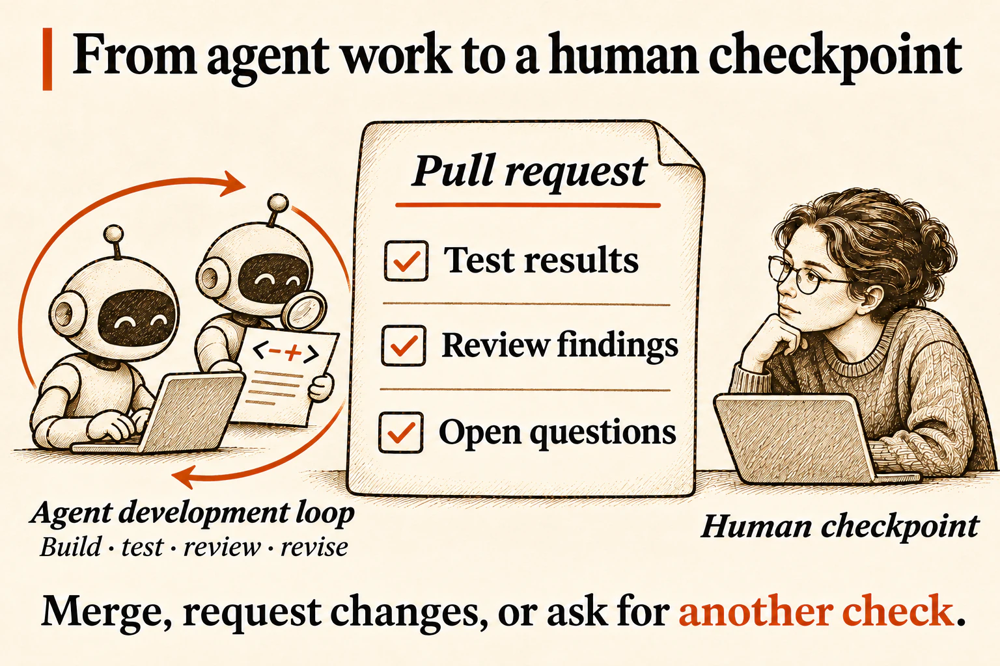

### What a Shaka PR looks like

Shaka is a skill for coding agents. When the work needs a maintainer’s decision, Shaka provides a PR description and a checkpoint.

The checkpoint asks whether the change solves the original problem, whether the evidence supports merging, and how risky the PR is. Here’s a shortened fictional example. Shaka puts an open decision ahead of the summary so the maintainer sees it first.

> **Add CSV export for visible tasks**
>
> 🤖 Codex · OpenAI · gpt-6.1-sol (configured) · medium - AI spend: $0.42
>
> **Decisions to make**
>
> - Test a large list first, or accept the gap for this release? I recommend testing before merging.
>
> Code Walkthrough · Code Review · Checkpoint
>
> **Summary**
>
> The Export button downloads the visible tasks as a CSV file you can open in a spreadsheet.
>
> **Intent**
>
> **Why:** Let people share a filtered task list.
>
> **Scope:** Export the current list using the existing filter.
>
> **Risk and review**
>
> 🟡 **Medium.** The reviewing agent flagged a possible timeout on large lists.
>
> **Verification**
>
> With completed tasks hidden, a short export contained only the visible tasks.
>
> **Not verified:** Export time on large lists.

See [a Shaka PR with an open decision](https://github.com/shakacode/shaka/pull/1135) and [a PR with a merge recommendation](https://github.com/shakacode/shaka/pull/1152).

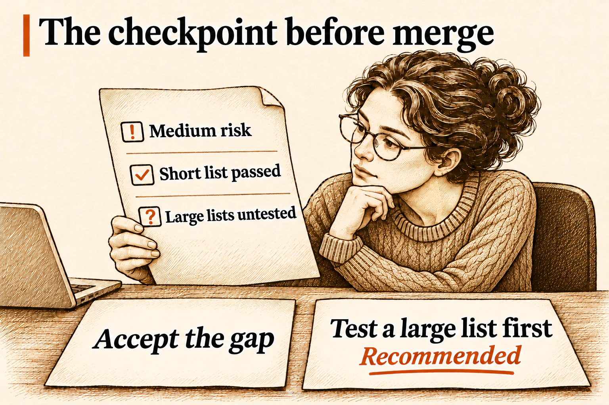

The maintainer can ask for that test, accept the gap, or request a change to the feature itself. The export PR waits for that decision.

### When should an agent merge?

In Shaka’s default **Ask** mode, a ready PR goes back to a person to merge or approve. **Auto** lets the agent merge a PR that meets the repository’s merge requirements. The diagram shows two reasons Auto can hand a PR back to a person. The change may be too large or too risky. A PR that changes who can see someone’s tasks can be risky even if it changes only a few lines. The PR keeps the evidence and the decision either way. [Shaka’s merge policy guide](../working-with-shaka.md#choose-a-merge-policy)

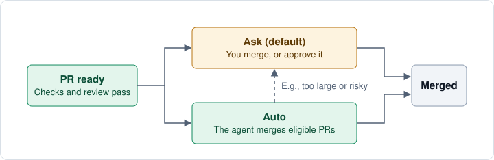

## Publish changes to your users

In this example of the to-do list, suppose the maintainer accepts the gap and merges the export PR. Merging adds the change to the main branch. A **release** publishes a version to users, for example by updating the live site or making an app update available.

Before publishing, the team might compare the new version with the one users have. When this app added the “Hide completed” switch, that comparison told the team what to check and what to announce.

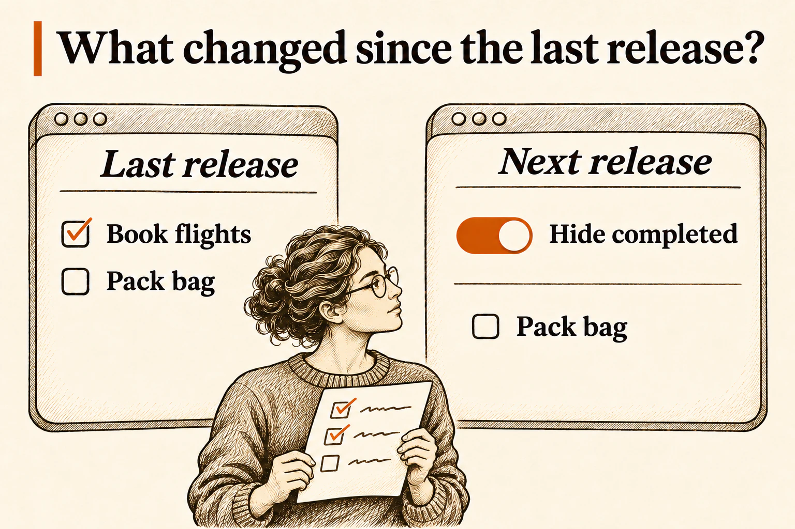

## What the next agent inherits

A user with a long task list reports that Export never finishes. The agent picking up the bug can open the original PR and see what the team knew when it merged. The filter worked on a short list, and the maintainer had accepted the gap in testing large lists. That gives the agent a place to start and a behavior to preserve.

The fix PR checks that a large list exports in time and still respects the filter. The team adds that check to its review guidance for future export changes.

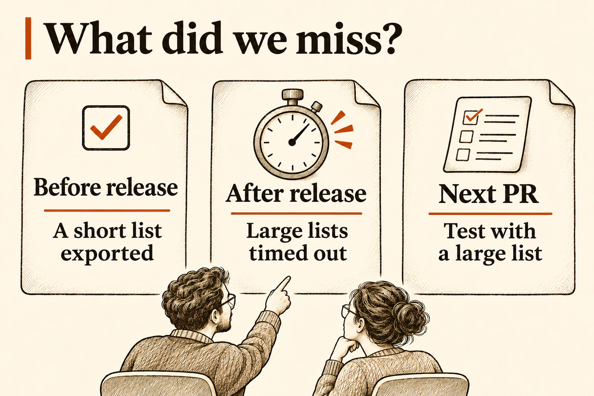

The next person or agent to change Export can read both PRs and see why that test is there. The team doesn’t have to remember the conversation to keep what it learned.
