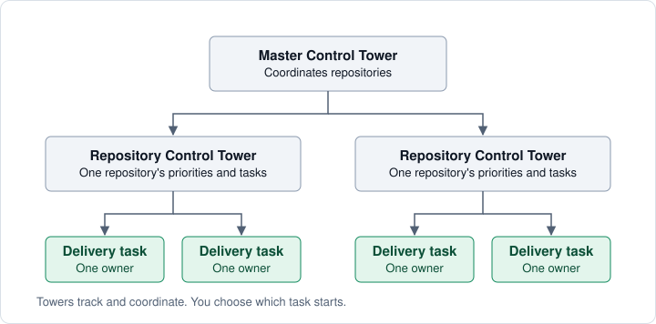

# Control towers

Use one coordination chat to choose work and follow several Shaka tasks.
Try [a few individual tasks](getting-started.md) first.

A **Repository Control Tower**, or RCT, coordinates one repository. A **Master
Control Tower**, or MCT, coordinates repositories and their dependencies.



## Set up your towers

In Codex desktop, ask:

```text
Install Shaka's control towers for Codex.
```

Use `$mct` in your master coordination chat, then `$rct` in each repository's
checkout. Setup needs exactly one matching saved Codex project on that computer.

In Claude Code desktop, use `/mct-claude` and `/rct-claude`. After registering a
repository, send `/mct-claude` in the master again so it notices the new tower.
Keep each tower set in one environment; Claude and Codex cannot read each other's
sessions. Ask the owning tower for a handoff before moving work between them.

Setup starts no backlog work or recurring scans. You choose what starts.

<a id="run-a-bounded-batch"></a>

## Choose what to work on

Ask the repository tower:

```text
What should we tackle next? Focus on checkout reliability.
```

Approve one task or ask for a batch:

```text
Suggest up to three tasks that can proceed together.
```

When the selection suits you:

```text
Start that batch with Shaka and Ask. Coordinate the chats.
```

Ask brings each PR back for your merge decision. If a chat stops, ask the tower
to resume it.

Claude normally offers sessions you start with a click. If you request unattended
work, it starts background agents that
stop when the tower chat ends. Those agents publish PRs and never merge, even
under Auto. Keep the tower open while they work.

## Follow the work

```text
What needs my attention? Link the PR and owning chat for each decision.
```

Use the owning chat for detailed questions. Codex chat locators open in the
owner's app; they do not share a public conversation.

## Unblock dependent work

After a prerequisite merges:

```text
PR #123 merged. Have the waiting chats update their PRs and recheck them.
```

Wait for updated evidence before treating those PRs as ready. An earlier pass
does not establish that the combined change works.

### If your project shares one test environment

Let its current test run finish, then ask the next chat to reserve the environment
through your project's process. Other chats can keep working elsewhere.
Shaka does not schedule shared test resources for you.

## Decide what to merge first

```text
Which PR should I merge next? Weigh impact and readiness, and link its chat.
```

Merge one at a time, then ask the next chat to check against the updated base.
Starting a batch does not authorize a deployment. See
[merge choices](working-with-shaka.md#choose-a-merge-policy).
