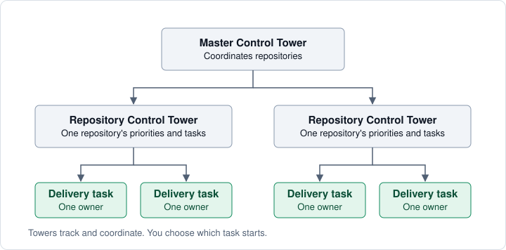

# Control towers


Use control-tower chats to choose work and follow progress across your coding tasks.
Try [a few Shaka tasks](getting-started.md) first.

A **Repository Control Tower (RCT)** gives you one chat for choosing work and
following PRs in a repository.
A **Master Control Tower (MCT)** coordinates RCTs and dependencies—for example, a
library fix needed before an application upgrade.



## Set up your towers

For Codex, ask your agent:

```text
Install Shaka's control towers for Codex.
```

1. If you already have a master chat, continue there. Otherwise, choose one
   chat to coordinate your projects and run `$mct` there.
2. Open a chat in each repository's Codex project and run `$rct` to connect it
   to the master.

In Claude Code, use `/mct-claude` and `/rct-claude` instead. Use the desktop apps
for tower setup; see [coding agents](coding-agents.md) for other environments.
A message from a new tower may not start the master's chat, so after `/rct-claude`
finishes, send `/mct-claude` in the master again so it checks the new tower. The
tower is usable before that.

In Codex, a chat opened directly in a checkout can use the one registered project
at that repository's exact path. For example, a chat in your application's
checkout can establish its tower without first moving the chat into the project.
An ambiguous project match still stops setup.

After the master acknowledges the repository tower, or a Claude Code tower reports
its setup, ask the tower what needs attention. You choose which task starts; setup
starts no backlog work or recurring scans.

Keep each tower set in one environment: Claude and Codex cannot read each other's
sessions. Ask the owning tower to explain its setup, ownership, or handoff before
moving work between environments.

<a id="run-a-bounded-batch"></a>

## Choose what to work on

In your repository's RCT chat, ask:

```text
What should we tackle next?
```

The RCT recommends one task and explains why it matters. When it looks right:

```text
Start that task with Shaka and Ask.
```

To work on several tasks at once, ask:

```text
Suggest a batch of up to three.
```

Expect a short proposal showing which tasks can proceed together and which need
to wait. You can narrow it with a request such as “Focus on checkout reliability.”

When the selection looks right:

```text
Start that batch with Shaka and Ask. Coordinate the chats.
```

**Ask** brings each PR back to you for a merge decision. The RCT reuses existing
chats and creates any missing ones. Each task stays with one chat through testing,
review, and its PR. If a chat stops, ask the RCT to resume it.

See [merge policies](working-with-shaka.md#choose-a-merge-policy) for Ask and Auto.
Setting up towers or starting a batch does not authorize a deployment.

## Follow the work

```text
How is the work going? Show what needs my attention, with PR and chat links.
```

A useful update combines the latest chat reports with the current PRs on
GitHub. It should tell you what changed and what happens next:

| Status | What to expect |
| --- | --- |
| In progress | What the chat is working on and what comes next, such as implementing the fix, then running tests |
| Ready for review | A PR with completed checks, review results, and evidence that the change works |
| Blocked | The specific problem, the chat handling it, and its next action; if it needs your input, the question and recommendation |
| Replaced by other work | A link to the replacement and a recommendation for the old issue or PR |
| Merged | The merged PR and any other work it unblocks |

A chat can handle some blockers, such as waiting for CI, without your input.
The update should distinguish those from decisions that need your attention.

Before merging, check [how the PR’s latest changes were verified and what remains
unverified](pr-verification.md#check-the-latest-changes).

## Unblock dependent work

When a prerequisite PR merges, tell the RCT:

```text
PR #123 merged. Have the waiting chats update their PRs and recheck them.
```

Those chats need to incorporate the merged fix, rerun their checks, and refresh
affected reviews and manual checks. Wait for their updated results before treating
the dependent PRs as ready.
Any outstanding security or business decision still needs to be settled.

### If your project shares one test environment

Some projects have a database or test server that only one chat can use at a
time. You can ask:

```text
Let the checkout fix use the shared test environment next.
```

Let the current test run finish. The next chat must reserve the environment
using the project’s existing process before testing. Other chats can continue
work that doesn’t need it. Shaka does not include an environment scheduler.

## Decide what to merge first

```text
Which PRs should I merge first? Include PR and chat links.
```

Expect ready PRs in recommended order, with a brief reason for each. List blocked
PRs separately, with the next action and the chat handling it.

The recommendation should weigh impact and readiness together. A tested fix for
lost orders may deserve attention before a development convenience. An urgent
PR that still needs a security review should name that blocker and the next step.

Here is an example response from an RCT in Codex:


*Example snapshot: merge priorities first, remaining blockers below.*

Open a PR to review it, or its chat to ask questions. Merge one PR at a time.
After each merge, have the next chat recheck its PR against the updated base.
Under Ask, you decide whether each PR should merge.

Codex chat links open in your app; they are not public conversation shares.
