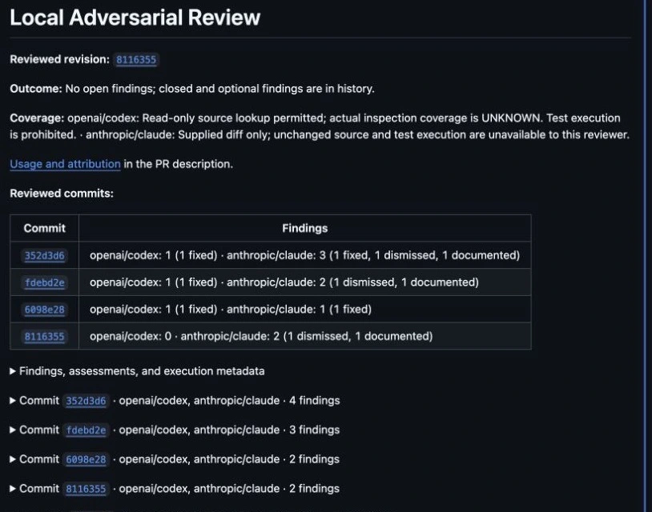
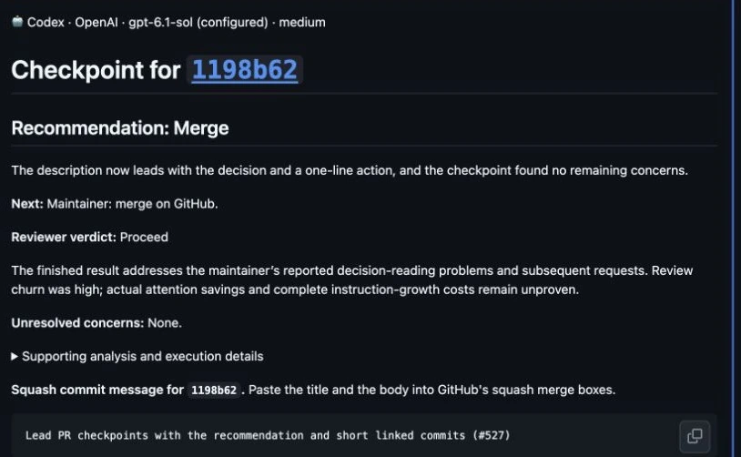
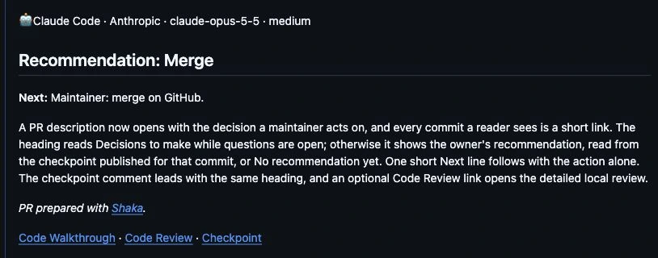

# Decide what happens next

<a id="pr-verification"></a>

Shaka produces a pull request with an **evidence packet**: an explanation of the
change, checks and review findings, visual comparisons when relevant, and what
remains unverified.

The packet should give you enough context to make a quick, accurate, and confident
decision: request changes, answer an open question, or authorize merging.

The same record supports regular retrospectives, including after automatic merges.
People and agents can examine results, token use, timing, and review findings to
improve the accuracy, efficiency, and effectiveness of the PR workflow.

## What the evidence packet gives you

The evidence packet explains what changed, why, how it was checked, and what
remains uncertain. It supports your next decision and later examination of how
the work was done.

The visible summary should make the outcome, unresolved concerns, and next action
easy to find. Linked and expandable details preserve the evidence needed for
closer human review and agent analysis.

Useful evidence connects each result to the revision it covers. It distinguishes
observed results from judgments and unverified claims. Missing measurements remain
explicit gaps.

During regular retrospectives, use that record to examine where time and tokens
went, which checks caught problems, what required repeated repair, and what
happened after merging.

<a id="read-a-pr-for-your-decision"></a>
<a id="answers-for-your-merge-decision"></a>
<a id="answers-for-your-next-decision"></a>

## Start with the change

Read the PR description for the outcome and why it matters. Compare the result
with your request. Try the changed feature when that helps you judge it.

Then check the evidence and its limits, read unresolved concerns, and decide what
happens next:

| What you need | Where to look |
| --- | --- |
| What changed and why | **Summary** and **Intent** in the PR description |
| What was checked and what remains uncertain | **Verification** in the PR description |
| What needs your input | **Decisions to make**, when present at the top of the description |
| Whether the result is worth merging | **Checkpoint**, linked near the top of the description |
| How review went | **Code Review**, linked near the top of the description when published |
| How the change works | **Code Walkthrough**, linked near the top of the description when published |

## See what needs your decision

When your input is needed, **Decisions to make** appears at the top of the PR
description. Each question should explain the concern, the relevant evidence,
your options, and the agent's recommendation.

For example:

> The export passed tests with 10,000 rows. Larger exports remain untested.
> We recommend checking the expected maximum before merging. What export size
> should we support?

Read the evidence behind the recommendation. Passing checks do not settle a
product choice or establish that an untested case is acceptable.

After you answer, the record should preserve your decision, its reason, and the
revision it applies to. Later retrospectives can compare what was known and
accepted with what happened afterward.

Steps you need to carry out should name their owner, timing, and how to confirm
completion. See [steps before or after merging](#check-for-steps-before-or-after-merging).

<a id="approval-and-attention-labels"></a>

## Request changes or authorize merging

**To request changes**, explain the result you want or the concern the PR hasn't
resolved. Comment on the PR and paste the link into the owning chat, or give
feedback directly in that chat.

For example:

```text
The export needs to handle 100,000 rows. Update the change and its evidence before asking me to merge.
```

After a revision, check the updated explanation and evidence. Earlier results
should remain identifiable by the revision they cover.

**To authorize an Ask merge**, tell the agent:

```text
Merge the commit in your handoff.
```

The handoff is the agent's message naming the PR and commit ready to merge.
You can also merge through GitHub. Check that its current commit matches the
handoff, and use the [prepared squash message or merge queue](#squash-merge-details)
as applicable. If the commits differ, return to the agent.

Your merge authorization does not replace required checks or GitHub approvals.
Agreeing with an approach or answering a question does not, by itself, authorize
merging.

**With Auto**, the agent already has authority to merge eligible work. The evidence
packet still explains the result and supports later retrospectives. Work outside
that authority returns to you for a decision. See
[Ask and Auto](working-with-shaka.md#choose-a-merge-policy) to choose who merges.

### See whether human review is needed

[PR #1081](https://github.com/shakacode/shaka/pull/1081) proposes the risk assessment
below. It is not released yet. Current installations show **Human review** under
**Intent** in the PR description. See [the current rating](#current-human-review-rating)
for how to use it.

When the proposed assessment is available, open the **Checkpoint** link near the
top of the PR description:

- **Low:** eligible for automatic merging when enabled, with later audit.
- **Medium:** read the description, risk reasons, and verification; inspect the
  code those reasons identify.
- **High or unknown:** review carefully, starting with whether the evidence
  demonstrates that the change works.

The assessment includes reasons to help you focus your attention. Low risk does
not mean automatic merging is enabled. In #1081, risk governs automatic merging
only when the repository opts into low-risk-only Auto merging. Otherwise, the
rating is advisory and existing merge rules apply.

<a id="current-human-review-rating"></a>

<details>
<summary>Current Human review rating</summary>

Current PR descriptions rate human review from 1 for a quick review to 5 for close
reading of the riskiest files. The rating names the files that set it. When
present, **Closer reading** links to particular code and explains why it needs
attention. No check establishes how closely anyone read.

Repositories set [minimum ratings by changed file](settings.md#pr_descriptionhuman_review_floors).
Current Auto settings can return work to you when a changed file's minimum rating
exceeds the [configured threshold](settings.md#mergeauto_max_review_floor).

</details>

<details>
<summary>GitHub approvals and Auto safeguards</summary>

An **Approve** review on GitHub also grants Ask authority when it comes from a
login you named to the agent as a merge approver for this task. For example:
"Treat `maria` as a merge approver for this task." That review can also satisfy
a required GitHub approval if the reviewer is eligible under the repository's rules.
Return to the owning chat unless the handoff names active automatic follow-up.
Approval in chat does not satisfy a required GitHub review. GitHub does not let
the PR author approve their own PR.

Under Auto, every check reported on the commit has to pass, not only the
required ones. Skipped and neutral results count as passing. A job that hasn't
started when the agent merges isn't seen, so make a check required if it must
always gate the merge. A failing or unfinished optional job holds the merge.
When one fails, the agent hands the PR back to you as it does under Ask.

If GitHub requires a branch update, the agent rebases, revalidates, and reviews
the new commit. Your merge decision carries forward when the change keeps the
approved behavior. A branch rule may still require fresh GitHub approval.
If behavior changes, the agent explains the difference and returns the new
commit for your decision.

After an Auto merge, the PR carries the `auto-merged` label. Two cases go
unlabeled, and the agent says so: a PR it added to a merge queue, and one where
GitHub refused the label after the merge.

</details>

## Supporting reference

### Understand the limits of verification

The PR description's **Verification** section summarizes the checks and reviews
for the change. Expand **Evidence and limitations** for the supporting results.

Pay particular attention to:

- **Not verified:** a claim or behavior that remains unproven.
- **Setup gaps:** a review could not complete as configured. Read what it actually covered.
- **Merge limitations:** something that should hold the merge until it is resolved.

A passing test supports only the behavior it exercised. A review with no findings
is useful evidence, but its coverage and limitations still matter.

For example, screenshots can show the resulting layout. They do not establish
that a payment completes successfully. A review based only on the diff cannot
establish that the reviewer ran the application.

These distinctions also matter during retrospectives. An untested behavior, a
missed defect, and a check that could not run point to different improvements.

When review is incomplete, the gap report names the missing reviewers and how many
completed. A Codex reviewer whose sandbox could not start is identified as reading
only the diff; the review record explains that limit.

See [review coverage settings](settings.md#reviewprovider_coverage) for incomplete
reviewer coverage. The agent reports unverified claims; Shaka does not prove that
those reports are complete. See [what is enforced](workflow.md#what-is-enforced).

### Check how review went

The PR's **Code Review** link opens a summary of the reviewed revision, coverage
limits, unresolved findings, and review history.

You can check how the process went without reading every finding. Notice how many
review rounds were needed. Repeated rounds can signal that the solution needs
reconsideration or that the process is going in circles.

Detailed findings and responses remain available for agent analysis during
retrospectives, or investigation when a problem surfaces later.

<a id="follow-the-review-history"></a>

<details>
<summary>Example review history</summary>



[The review record on PR #539](https://github.com/shakacode/shaka/pull/539#issuecomment-6186181367)
gathers several reviewed commits in one comment. The capture is from October 14,
2026, Hawaii time; the live PR may have changed.

</details>

### Check the cost of getting the result

The PR shows recorded token use, estimated cost, and timing where available.
It identifies missing measurements and any usage shared with other work.

Use these details to spot unexpectedly costly work, slow checks, or repeated repairs.

During regular retrospectives, agents can investigate where the time and tokens
went and what that effort achieved. Did more review catch consequential problems?
Did repeated repairs improve the solution? Could a simpler approach have produced
an equally reliable result?

Assess cost and speed alongside correctness and usefulness, including problems
discovered after merging. Under **Shaka metrics** in the PR description, expand
**Details** for the records. See [usage and cost](reference/usage-and-cost.md) and
[timings](reference/timings.md) for the accounting rules and measurement limits.

<a id="checkpoint"></a>
<a id="reconsider-the-finished-result"></a>
<a id="decision-checkpoint"></a>
<a id="evaluation-checkpoint"></a>

### Understand the recommendation

The **Checkpoint**, linked near the top of the PR description, assesses whether
the change solves the intended problem, whether the evidence supports its claims,
and whether the benefit justifies the maintenance cost.

Read the recommendation and any unresolved concerns first. Open the supporting
assessment when you want to examine the reasoning.

A recommendation to merge is a judgment based on the available evidence. It does
not grant merge authority or replace required checks and approvals.

During retrospectives, compare that assessment with later outcomes. Did the
change solve the problem? Were its costs and risks judged accurately? What should
future assessments consider?

<details>
<summary>Checkpoint verdicts and accepted concerns</summary>

The reviewer's conclusion is **Proceed**, **Simplify/reframe**, or **Do not merge**.
Substantive unresolved concerns hold readiness and Auto even when technical checks
pass. The checkpoint separates the reviewer's verdict from the task owner's
recommendation.

When the conclusion is **Proceed**, you can explicitly accept a listed concern.
The agent records that decision under **Concerns recorded as accepted by the
maintainer**. Read that list before merging. Shaka checks that decisions are
recorded, not who made them or whether the judgment is sound. Accepting a concern
does not override **Simplify/reframe** or **Do not merge**.

The checkpoint also judges whether verification supports the PR's claims:
**Adequate**, **Adequate, with gaps the reviewer judged acceptable**,
**Inadequate**, or **Cannot judge**. The reviewer's acceptance of a gap is not your
acceptance. With Ask, the verdict informs your merge decision. With Auto,
**Inadequate** or **Cannot judge** stops the merge until you approve that commit.

If a consequential question remains, the description shows **Decisions to make**.
A checkpoint containing only the reviewer's verdict is not an owner recommendation.
A new commit needs current evidence; an earlier recommendation does not cover it.
See [checkpoint settings](settings.md#checkpoint) for customization.

The report uses these labels to distinguish a proposal from a decision:

| Label | Meaning |
| --- | --- |
| **Recommendation** | What the task owner proposes doing next. |
| **Recorded decision** | Guidance accepted or acted on under existing authority. |
| **Reviewer recommendation** | The reviewer's view, before the task owner records a recommendation. |
| **No recommendation yet** | The owner has not recorded a recommendation for this commit. |
| **Not published yet** | The linked report is not available yet. |
| **Merge after maintainer decision** | A question or concern needs your decision before merging. |



[The checkpoint on PR #527](https://github.com/shakacode/shaka/pull/527#issuecomment-6184807134)
is a historical example captured October 14, 2026, Hawaii time.

</details>

<a id="show-what-a-person-will-see"></a>
<a id="show-what-changed-between-captures"></a>

### Inspect visible changes

Annotated before-and-after screenshots, on mobile and desktop, enable quick
assessment of UX changes. Recordings can show a flow and animations.

The explanations will say what was tested and what remains unverified.

Detailed captures remain available for closer inspection and later analysis when
a visual or interaction problem surfaces. Open the PR's linked verification
comment to find the captures.

<details>
<summary>Examples of useful evidence</summary>

| Change | Useful evidence |
| --- | --- |
| Layout, styling, or visible output | Annotated before-and-after desktop and mobile screenshots. |
| Interaction, animation, or timing | A short recording, with screenshots where they help comparison. |
| Backend or command-line behavior | Focused tests and concise before-and-after output. |

A diagram explains the approach. Running the changed software supplies evidence
that the approach works.

</details>

<a id="notes-on-the-diff"></a>
<a id="when-a-diagram-helps"></a>

### Understand how the change works

The **Code Walkthrough**, linked near the top of the PR description, explains the
approach, important implementation choices, and alternatives considered. Linked
code and diagrams help you inspect the parts that matter.

Consult it when you want to understand a consequential choice or examine how the
pieces fit together.

During retrospectives, agents can compare the recorded reasoning with later
results: which assumptions held, what changed, and whether a simpler approach
would have served better.

Walkthrough notes on GitHub's diff point out code worth reading. They are reading
guidance, not findings to fix. Diagrams explain the approach; they do not prove
that it works.

<details>
<summary>Example diagram and a change that needs none</summary>

A change that prevents duplicate refunds might show both callers reaching the
same check before a payment is issued:

```text
RefundsController#create ──┐
RefundRetryJob#perform ────┴── Refunds.issue
                               ├── RefundPolicy.check      refuses a second refund for the same order (new)
                               └── PaymentGateway.refund   reached only after the policy passes
```

A smaller change can use a sentence: "RefundPolicy.check now also rejects refunds
larger than the original charge." No call order changed, so no diagram is needed.

</details>

<a id="what-a-rollback-undoes"></a>

### Understand what undoing the change would require

For changes with significant consequences, the walkthrough explains who could be
affected and how recovery would work.

Reverting code may restore previous behavior without undoing actions already
taken. Sent emails remain sent; issued refunds remain issued. Changed or deleted
data may need a separate recovery procedure.

Look for those consequences before merging. If recovery depends on a backup,
migration, or manual action, the record should make that dependency clear.

<a id="see-what-people-said"></a>

### Find feedback from people

AI reports can fill a PR's discussion. When people leave feedback, Shaka highlights
it in a **Human comments** section near the top of the PR description so it stays
visible.

The section links to the original comments and responses and shows what remains open.

The list reflects the agent's last read of GitHub comments. Later feedback appears
when the agent next reads comments and updates the description. Guidance given
only in chat is not included in this list.

See [human-comment settings](settings.md#pr_descriptionshow_human_comments) to
change its visibility. Untrusted public comments appear as linked **Unverified**
entries without quoted or summarized content; see [review safety](workflow.md#trust-model).

### See which skills contributed

Skills give an AI agent instructions for particular kinds of work, such as
reviewing code or checking documentation.

In the PR description, expand **Skills used**, when present, to see which skills
the agent reports using and what they contributed.

These records help later analysis examine which techniques were useful and where
the process could improve. A listed skill does not establish that its instructions
were followed or that it improved the result.

**Agent-reported** means the agent says it applied the skill. **Corroborated**
means the agent identifies a record confirming invocation or loading. Shaka checks
the metadata, not that record. Completeness remains unverified. Shaka's own version
appears under **Execution details** rather than in **Skills used**.

<a id="return-points"></a>

### Revisit an earlier direction

During a task, you may change your mind about the approach. The PR description can
record earlier guidance as **return points**, labeled C1, C2, and so on. Each
connects your guidance to a code revision.

For example:

```text
Return to C2 and try the simpler approach.
```

Ask the agent what it can restore before proceeding. A return point records
guidance and the associated work; it does not guarantee recovery of unsaved
changes or undo deployments and other outside effects. See
[how to revise earlier guidance](working-with-shaka.md#revise-earlier-guidance-and-try-again).

### Find PRs waiting on you

Shaka adds labels to GitHub PRs to show what needs your attention:

- **awaiting-answer:** the agent needs your input. Open the PR description and
  look for **Decisions to make**.
- **awaiting-merge-approval:** the PR is ready for your merge decision.
- **awaiting-resume:** work has paused and needs you to restart the conversation.

For paused work, expand **WIP Details** in the PR description. Follow its chat
link and paste the recorded **Next action** into that chat.

A label identifies what is waiting; adding a label does not itself wake the agent.
See [PR searches and next actions](working-with-shaka.md#find-prs-waiting-on-you).

### Check for steps before or after merging

Some changes need an action outside the code, such as configuring a service
before merging or migrating data afterward.

When those actions are needed, the PR description includes a **Before and after
merge** section. It says what to do, who should do it, when it must happen, and
how to confirm completion.

Read these steps before authorizing a merge. A merged PR does not establish that
the service was configured, the migration ran, or the change reached users.

<a id="show-whether-it-is-faster-or-slower"></a>

### Check claims about speed

When a PR aims to improve performance, look for a comparison between the previous
version and the proposed change.

The evidence should name what was measured, the tested conditions, and the result:
faster, slower, no meaningful difference, or inconclusive.

For example, a faster page-load claim needs measurements of the affected page.
Passing functional tests does not establish that improvement.

If performance was not measured, the PR should say so. Keep inconclusive results
visible so later analysis can distinguish an expected improvement from one that
was demonstrated.

<a id="publish-work-while-a-base-repair-is-pending"></a>

### Understand a blocked draft

Sometimes a check fails because of a problem that already exists before the
proposed change.

The agent may publish a draft PR so the work remains available for review. The PR
should explain the failure, show evidence that it also occurs without the change,
and say what needs to happen next.

A draft published this way is not ready to merge. An existing failure is still
a failure. Accepting a known failure does not waive required checks, security,
trust, or repository protection. See [verification limits](#understand-the-limits-of-verification).

<a id="squash-merge-details"></a>

### Use the prepared merge message

When GitHub combines a PR's commits into one, it calls that a **squash merge**.

Shaka prepares a short commit title and description explaining what changed and
why. Open the **Checkpoint** link near the top of the PR description to find them,
then copy them into GitHub's squash-merge fields.

If the agent merges for you, it supplies the message.

<a id="merge-queues"></a>

If GitHub offers a **merge queue**, add the PR to the queue instead. The queue
manages the merge and provides no message fields.

If you explicitly skipped the checkpoint, the agent publishes the squash message
in a separate comment. Check that the prepared message covers the commit in the
handoff. After code changes, wait for an updated message.

<details>
<summary>Repository settings for merge messages</summary>

GitHub normally fills squash-merge fields from the branch commit titles. To start
from the PR title and an empty body, choose **Pull request title** under
**Settings → General → Pull Requests → Allow squash merging**.

A merge queue uses its repository settings. **Pull request title and description**
copies the whole PR description, including **WIP Details**, into Git history.
Shaka warns about that choice and refuses to submit a queued merge with it, or
when the queue settings cannot be read. For a squash queue, choose **Default
message** for branch commit messages or **Pull request title** for the PR title.

</details>

<a id="revisit-a-merged-change"></a>

### Improve the process over time

Regularly ask your agent to examine completed PRs, including what happened after merging.

Retrospective skills can help. Examples include
[AI Hero's `/retro`](https://github.com/mattpocock/skills/blob/main/skills/engineering/retro/SKILL.md),
for improving the agent's working environment, and
[Poteto's `/reflect`](https://github.com/cursor/plugins/blob/main/pstack/skills/reflect/SKILL.md),
for turning session lessons into skill improvements.

Give the agent the PR links and ask it to examine correctness, review rounds,
repeated repairs, token use, and timing. Ask for recommendations supported by the
evidence and an account of missing information.

Those skills focus on sessions. The PR evidence supplies additional material for
a broader retrospective. Skill command names depend on how they are installed.

<a id="check-the-latest-changes"></a>
<a id="corrections-after-review"></a>

### Check that the evidence is current

A PR can change after tests and reviews finish. Each saved version has a **commit
ID**, which identifies the code that was checked.

Look for evidence covering the PR's latest version. If results come from an
earlier version, the explanation should say which still apply and what was
checked again.

If that connection is unclear, ask the agent to update the evidence before you decide.

<a id="see-a-current-pr"></a>
<a id="start-with-the-recommendation"></a>

<details>
<summary>Example PR description</summary>



[PR #527](https://github.com/shakacode/shaka/pull/527), captured October 14, 2026,
Hawaii time, shows the recommendation and evidence links. Its layout is historical;
its recommendation is not approval to merge another commit.

</details>

<a id="keep-the-pr-easy-to-read"></a>
<a id="expect-a-readable-delivery-record"></a>
<a id="change-one-behavior-at-a-time"></a>
<a id="documentation-changes"></a>

For how agents produce and verify the record, see [the workflow guide](workflow.md).
