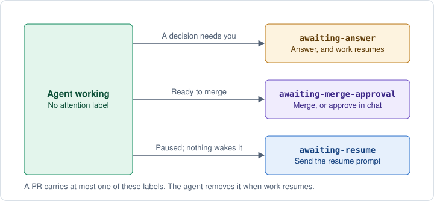
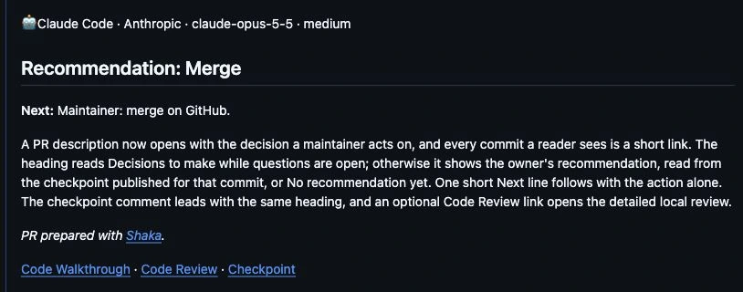
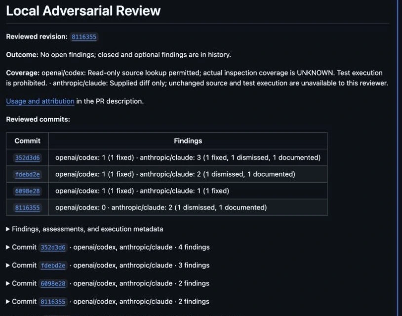
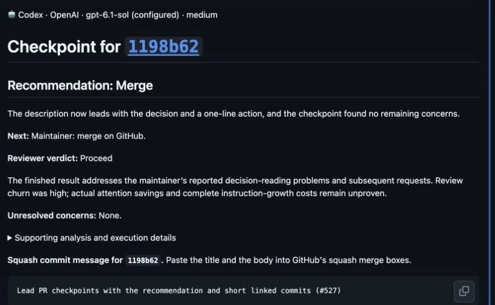

# PR verification


Use a Shaka PR to understand the change, assess its evidence, and decide what
needs closer review. The same record helps you revisit decisions after merging.

## Approval and attention labels

To find work waiting on you, use the [attention-label searches and next actions](working-with-shaka.md#find-prs-waiting-on-you).
The agent manages the labels as it works. Your part is to answer open decisions,
authorize an Ask merge, provide any required GitHub approval, or resume a paused
chat when nothing can wake it.



Under **Ask**, the agent brings you the verified commit and waits for your merge
decision. You can tell it in chat to merge that commit, or merge it yourself
through GitHub's offered control. For example: “Merge the commit in your handoff.”
Saying “Go” to start the task does not grant this later merge authority.

An **Approve** review on GitHub also grants Ask authority when it comes from a
login you named to the agent as a merge approver for this task. For example:
“Treat `maria` as a merge approver for this task.” That review can also satisfy
a required GitHub approval if the reviewer is eligible under the repository's rules.
Return to the owning chat unless the handoff names active automatic follow-up.
Approval in chat does not
satisfy a required GitHub review; a required review must come from an eligible
GitHub reviewer. GitHub does not let the PR author approve their own PR.

After authorization, the agent submits the merge when required checks, approvals,
and review findings are settled. Under **Auto**, it already has that authority
for eligible work. Both paths preserve repository protection and required approvals;
a checkpoint recommendation alone grants no merge authority.

If GitHub requires a branch update, the agent rebases, revalidates, and reviews
the new commit. Your merge decision carries forward when the change keeps the
approved behavior. A branch rule may still require fresh GitHub approval.
If behavior changes, the agent explains the difference and returns the new
commit for your decision.

When you choose to merge through GitHub, compare its current commit with the
agent's chat handoff before using the offered control. If they differ, or no allowed merge
method is offered, return to the agent. For a squash merge, use the
[prepared commit message](#squash-merge-details).

<a id="read-a-pr-for-your-decision"></a>

<a id="answers-for-your-merge-decision"></a>

## Answers for your next decision

Start with the description for the outcome, open decisions, steps besides
merging, and what the change is for and how it was proved. Follow the code
walkthrough for implementation choices and alternatives.
Then inspect the supporting evidence for the revision you are reviewing.
A handoff should make clear whether the change is ready to merge or needs your
input. You can approve the approach, request revisions, or settle an open question.

| Your question | Where to look |
| --- | --- |
| What changes for users? | The description, preview, and visual comparisons when applicable. |
| What is it for, and what does it leave out? | **Intent** in the description: the problem, the scope, what was deliberately left out, and why the change is safe. A bug fix also names its **Root cause**, or says it was not found and the PR treats only the symptom. |
| How carefully should I review it? | **Review effort** under Intent, from 1 (read the description) to 5 (review every line, reproduce it, and ask a second reviewer), based on what a mistake could reach. |
| Why this approach? | The walkthrough, linked code, alternatives, and maintenance-cost assessment. |
| How was it checked? | **Verification** in the description: up to three checks, each with what ran, its outcome, and a link to the evidence or the command itself. **Not verified** names what went unproven and why that is acceptable. Independent review covers the current revision. |
| Which skills contributed? | **Skills used** lists the reported skills, their contributions, and evidence labels. |
| What did people say? | **Human comments** in the description: each comment a person wrote, its reply, and whether it is still open. |
| What happened to concerns? | Review findings, replies, and recorded fixes or reasons for declining a suggestion. |
| What do I need to do? | Open decisions and steps besides merging, with their timing and owner. |

For example, a CSV export PR may use a simple download instead of a background
job. The walkthrough should explain that choice; tests should exercise the
export behavior. You can then judge whether the approach suits the expected
volume and whether important cases are missing.

## See a current PR

These captures show real public PRs on October 14, 2026 (Hawaii time).
Open each source to read the full record; its live state may have changed.

### Start with the recommendation



[PR #527](https://github.com/shakacode/shaka/pull/527) shows the recommendation
above the summary and links to its supporting evidence. Newer descriptions put
those links on the recommendation's line. Open **Checkpoint**
before acting on the recommendation; the screenshot is a historical example,
not approval to merge another commit.

### Follow the review history



[The review record on PR #539](https://github.com/shakacode/shaka/pull/539#issuecomment-6186181367)
gathers several reviewed commits in one comment. The table shows findings and
their dispositions; expandable sections keep the reports available. Read the
coverage limits even when the outcome says no open findings.

## Check the latest changes

Before merging, open the PR to see how the change was checked. Tests and reviews
should cover its latest code. For visible changes, look for results from using
the app, including desktop and mobile where relevant. A review app should let
you try the feature with the data and services it needs.

Good checks also show that they can catch the problem. For example, a smoke test
should pass on a healthy page and fail when required content is missing. This
is a **negative control**.

Use focused AI review for code and tests, and spend human review time on decisions
that need your knowledge. An agent can check a billing calculation; someone who
knows the contract must decide whether that is the right billing rule.

## See which skills contributed

Expand **Skills used** to see the skills reported during planning, implementation,
review, and integration, with their sources and revisions when available.
**Agent-reported** means the agent says it applied the skill. The agent selects
**Corroborated** when it identifies a record confirming invocation or loading.
Shaka checks metadata shape, not that record or instruction compliance.
Contributions remain the agent's account, and completeness is unverified.
Missing records show unknown coverage. Shaka's own entries, from source
`ShakaCode/shaka`, are not listed: every managed PR uses Shaka, and **Execution
provenance** names the workflow version that ran.
Agents are instructed to withhold private skill identifiers; Ruby does not screen
them.

## See what people said

Agent posts can outnumber a person's comments many times over: on one Shaka PR,
5 of 52 comments and reviews came from a person. The description lists those
under **Human comments**, after any open decisions and before the agent's own
sections:

| From | Said | Response | Status |
| --- | --- | --- | --- |
| **Reviewer** maria | Finds the tester terms unclear; suggests template notation | — | **Open** |
| sam | “you mean chat, not owner.” | “Changed the guide to use chat throughout…” | Resolved |

- **From** names the account. The PR author's comments show the account alone;
  **Reviewer** marks one from another trusted account. Agents post from a person's
  account, so the account name cannot tell a person from an agent.
  Every post a person did not write opens with the agent's 🤖 line, so a comment
  without it counts as a person's. A bot account's post, a post that opens with
  a hidden tool marker such as `<!-- shaka:reply:… -->`, and a superseded
  walkthrough under Shaka's pointer also count as an agent's.
- **Said** links to the comment. A comment of at most 12 words and 90 characters
  appears in quotation marks, in the person's own words, without its code. A
  longer one is already on the PR, so the agent summarizes it in one line, shown
  without quotation marks; so is a short comment with a list beside code. Shaka
  refuses to publish while a comment it summarizes has no summary.
- **Response** links the agent post, or the trusted bot's post, that answered it.
- **Status** is GitHub's resolved state for an inline thread, and the verdict for
  an approval, a request for changes, or a dismissed review. Any other comment
  stays open until an agent reply links to it.

Open comments come first, and a reviewer's come before the author's.

On a public repository anyone can comment or submit a review. A comment from an
account the repository does not trust is listed as **Unverified** and linked
without a quotation or summary, because the agent does not read it. That account's
approval or request for changes is not shown, and its comments do not count as open.

The list names the commit at which the agent read the comments. A comment added
later appears the next time the agent reads comments and updates the description.
If the PR has moved to a newer commit since that read, a note under the list says
so. On a PR from a fork the list appears only when the agent passes a fresh read.
Instructions you give in chat are not on GitHub, so they are not in this list.

To leave the list out or change how many rows it shows, see
[`pr_description.show_human_comments`](settings.md#pr_descriptionshow_human_comments).

## Revisit a merged change

Assess the decision and the process separately:

- **Was the approach reasonable?** Compare the recorded goal, alternatives, and
  risks with what was known then and what you learned after deployment. A working
  feature can still introduce more maintenance than its benefit justifies.
- **What evidence supports the process?** Check which revision was tested and
  reviewed, how findings were handled, and which gaps or exceptions were reported.
  Missing evidence leaves a question open; it does not establish that a step
  passed or failed.

For the CSV export, later growth may justify a background job. The original
walkthrough helps distinguish changed needs from an assumption that lacked support.
The test and review records help you examine how that assumption was checked.

Shaka makes the recorded work inspectable. It does not prove that every workflow
instruction was followed or that the tests and review were sufficient. See
[what is enforced](workflow.md#what-is-enforced).

<a id="keep-the-pr-easy-to-read"></a>

## Expect a readable delivery record

The agent writes the description, publishes validation and review evidence, and
prepares the code walkthrough and checkpoint. It leads with the outcome and a
short validation result, puts useful comparisons beside the explanation, and
keeps longer output in expandable sections. Its chat handoff links to that record.

For example: “The menu stays reachable on narrow screens. The regression test
failed before the fix and passes now; desktop and mobile screenshots show the
result.” Details can hold commands, tested commits, and a recording of the menu.

Shaka uses your existing tests and validation commands, plus browser tools when
needed. Required GitHub checks and approvals still apply.

## Notes on the diff

The walkthrough can also leave a few notes on the diff itself, written for you
as the reviewer. Each note sits on the lines it is about and says how to read
them: where to start, which lines change behavior, what to check closely, what
to skim, or why the code took this approach. They are not findings to fix, and
they do not replace explanations the code itself needs.

For example, in a PR that stops duplicate refunds:

> **Start here:** this check is the whole behavior change; the controller and
> retry job only call it.

> **Skim:** the rest of this file moves the old helper unchanged.

Notes help most on a change of several files. Reviewers tend to read files in
the order GitHub lists them and comment less on the later ones
([Fregnan et al., 2022](https://arxiv.org/abs/2208.04259)), so a note can send
you to the important part first. Understanding a change is usually harder than
finding its defects
([Bacchelli and Bird, 2013](https://www.microsoft.com/en-us/research/publication/expectations-outcomes-and-challenges-of-modern-code-review/)).

When the agent publishes a walkthrough for a newer commit, it resolves the
older walkthrough's notes. A note you replied to stays open, and the agent
answers it like any review comment.

## When a diagram helps

A walkthrough may include one small diagram when a change crosses several
components or adds a branch. It sits beside the step it explains and names code
you can find in the reviewed commit. For example, a PR that stops duplicate
refunds might show which callers reach the new check and where it refuses:

```text
RefundsController#create ──┐
RefundRetryJob#perform ────┴── Refunds.issue
                               ├── RefundPolicy.check      refuses a second refund for the same order (new)
                               └── PaymentGateway.refund   reached only after the policy passes
```

The tree shows that the web request and the retry job both pass the new check
before the gateway call, which is the point a reviewer most needs to confirm. A
flowchart suits a change with several outcomes or states.

A smaller change reads better as a sentence: “`RefundPolicy.check` now also
rejects refunds larger than the original charge.” No diagram is added, because
nothing about the order of calls changed.

A diagram explains the change; it is not evidence that the change works. The
before and after results still come from running the tested commit. Diagrams are
optional, and Shaka does not check that one matches the code.

## What a rollback undoes

A walkthrough names who a failure would reach and what they would see, such as
“customers with a pending refund see the old amount until the job reruns.” It
also separates reverting the code from undoing what the code already did:

- **Reversible:** “Reverting this commit restores the previous refund limit.
  No stored data changes, so nothing else needs repair.”
- **Not undone by a revert:** “This change emails each customer when a refund is
  issued. Reverting stops new emails; messages already sent cannot be recalled,
  and refunds already issued stay issued.”

When a change rewrites or deletes stored data, expect the walkthrough to say how
that data is restored, or that it cannot be. Use this to decide how much review
and staging the change needs before it merges.

The agent writes this from its reading of the change, and Shaka does not check
it. A walkthrough that says nothing about data or outside effects is not
evidence that a revert is enough.

## Publish work while a base repair is pending

A failure already present on the trusted base can leave unrelated work blocked.
For example, a dependency advisory may fail the same security check on both the
base and a task branch that never changed that dependency.

Shaka can publish that work as a **blocked draft** after reproducing the same
failure on an immutable base and confirming the task leaves affected inputs
unchanged. The PR names the failed check, comparison evidence, separate repair
issue, and next action. Independent review still happens before push. The agent
performs this comparison; Ruby does not prove it.

The draft stays blocked until the repair lands or a maintainer explicitly accepts
the documented local failure for that task. Acceptance does not waive security or
trust failures, required GitHub or seam merge checks, or protection. In the advisory
example, the security gate still needs a repair. Failed validation stays failed;
it is never reported as passing. Missing readiness evidence remains UNKNOWN.

Ask the agent to show the failure on the unchanged base and explain which checks
still block merging before accepting a base failure.

<a id="reconsider-the-finished-result"></a>
<a id="decision-checkpoint"></a>
<a id="evaluation-checkpoint"></a>

## Checkpoint

At a **checkpoint**, Shaka presents a result, question, or blocker and recommends what to do
next. The task owner may be a human or a coordinating agent acting within existing
authority. This is the return from the agent's work loop; it does not mean the
overall task is finished.

The current pre-merge checkpoint evaluates whether the result solves the original
problem for its users and earns its maintenance cost. It considers actual scope,
complexity, simpler alternatives, and whether the testing matches what a failure
would reach. Unexpected growth or repeated repairs can
prompt this review earlier. The code walkthrough explains what changed and how it works.

The checkpoint recommends the next action for the PR and includes copyable
squash commit title and body blocks when it recommends merging. Required checks,
reviews, and your Ask or Auto choice still apply.

A checkpoint that recommends merging comes after the code walkthrough and any
screenshots for the same commit, so you read the evidence before the recommendation
and merge text. Shaka refuses to publish it until the walkthrough for that
commit exists; your agent publishes the screenshots first.



[The checkpoint on PR #527](https://github.com/shakacode/shaka/pull/527#issuecomment-6184807134),
captured October 14, 2026 (Hawaii time), separates the owner's recommendation
from the reviewer's verdict. Current checkpoints show the owner's reason, the
reviewer's conclusion, and any unresolved concerns. For **Merge**, a **Next** line appears
only when merging waits on something the recommendation does not say. The reviewer's summary,
token counts, and squash message sit in closed sections below.

The checkpoint explains one conclusion:
**Proceed**, **Simplify/reframe**, or **Do not merge**. Substantive unresolved concerns
hold readiness and Auto even when technical checks pass. When the checkpoint says
**Proceed** and you decide a listed concern is acceptable, tell your agent, for example
"I accept the unknown-frequency concern; merge as is." The agent republishes the
checkpoint with your decision under **Concerns recorded as accepted by the maintainer**, and merge
preparation continues. Shaka checks that a decision is recorded for each concern, not
who made it, so read that list before you merge. Accepting a concern does not override
**Simplify/reframe** or **Do not merge**. Shaka blocks final merge
preparation without this account's published ready review or explicit opt-out for the
current commit. A new commit needs fresh evidence. The reviewer judges value; Ruby
checks the published result and commit, not the judgment’s quality.

The checkpoint also says whether the description's **Verification** proves what its
**Intent** claims: **Adequate**, **Adequate with accepted gaps**, **Inadequate**, or
**Cannot judge**. It names the weakest claim and the one check that would most raise
confidence, and the description shows the verdict under its recommendation. With Ask,
an **Inadequate** or **Cannot judge** verdict is information for your merge decision; with
Auto, your agent stops and hands the PR back to you, and merges only after you approve that
commit. No setting turns this stop off: Auto merging past verification that failed or could
not be judged has no known use; open an issue if your repository needs one. For
example, a fix whose safety rests on a shared caller, checked only by a unit test that
stubs that caller, would be **Inadequate**, with the next check naming a run through it.

Use **Recommendation** for the proposal and **Recorded decision** for
accepted guidance. Once a direction is chosen, the agent records that guidance
and recoverable work state for a later return. This uses the existing
[recovery procedure](working-with-shaka.md#revise-earlier-guidance-and-try-again),
not an automatic Ruby snapshot or an extra human approval at every return point.
The PR description opens with **Decisions to make** while you have questions to answer.
Until you answer them, the links below the questions show **Decisions to make** as the
checkpoint, and the code walkthrough waits, because your answers may change the code it
would explain. Ask your agent for a walkthrough sooner if you want to read one first.
Otherwise, below the line naming the AI that wrote it, it opens with the task owner's
recommendation from the checkpoint published for that commit, such as
**Recommendation: Merge**, or **No recommendation yet** before the owner has recorded one.
Shaka reads the recommendation from the latest checkpoint for that commit each time the
description is published; your agent republishes the description when the checkpoint
changes. A checkpoint that holds only the reviewer's verdict shows it as **Reviewer
recommendation** and leaves the description at **No recommendation yet**. Shaka refuses
to show a recommendation made for an earlier commit, so the recommendation does not name
one. Beside it, links open the walkthrough, the detailed code review when one was
published, and the full checkpoint. Your agent adds a **Next** line when merging waits on
something the recommendation does not say, such as another PR. The **Summary** follows.
Your agent summarizes
consequential decisions, questions or friction, and critical changes in a few lines.
Supporting evidence appears below.
The report keeps the **Reviewer verdict** within the checkpoint. A recommendation becomes a
**Recorded decision** after the owner accepts it or acts under existing authority.
Auto applies previously granted authority; a consequential unresolved choice still needs direction.
Parsed identifiers and readiness rules remain unchanged.

For example, a settings page may satisfy the task but introduce an interface most
users never need. The agent can recommend extending an existing setting instead
before more work builds around that page. Maintainers can customize the
[checkpoint settings](settings.md#reviewpost_implementation)
with their audience and architectural priorities.

## Change one behavior at a time

The agent writes a focused test, confirms it fails because the behavior is broken
or missing, then fixes the code and simplifies it while tests stay green. Tests
exercise behavior through public interfaces; matching implementation details or
instruction wording does not prove the result.

When automation is impractical, the agent records the limitation and useful
before/after evidence. Wording edits need documentation checks, not invented
failing tests. Validation can select checks for affected files; required security
checks still apply.

## Corrections after review

A correction repairs a review finding on a PR that was already validated, reviewed,
and explained. It should cost in proportion to the repair, without lowering what the
PR has to prove. Your agent checks the repair and the behavior it affects, then
updates the existing PR once.

| What you see on the PR | After a correction |
| --- | --- |
| The finding's thread | A reply with how the defect was reproduced, and the fix commit |
| Repository validation and required checks | Run again for the new commit |
| Local review | The configured reviewers review the new commit |
| Hosted review | Awaited again when your repository's review settings require it for the change |
| [Checkpoint](#checkpoint) | Run again; merging needs a checkpoint, or your explicit skip, for the exact commit |
| Code walkthrough | The same walkthrough for the new commit, with only the affected steps rewritten |

Evidence for an earlier commit is shown with that commit. It counts for the new one
only where Shaka can prove nothing relevant changed, such as a clean merge of the
base or a prose-only edit.

Your agent reproduces a finding on the versions your repository's required checks use. In
[PR #463](https://github.com/shakacode/shaka/pull/463), a credential-redaction finding
was dismissed after a test on URI 1.1.1, which drops the password itself. CI used
URI 1.0.3, which keeps it. The [replay](https://github.com/shakacode/shaka/blob/main/eval/reports/correction-replay-463.md)
shows both results and the work each path performs.

The walkthrough is reused only while the repair leaves the goal, scope, dependencies,
and settings of the task unchanged. A small diff alone does not make a change low risk.

To skip the checkpoint for one correction, tell your agent:

```text
Skip the checkpoint for this correction; the outcome is unchanged.
```

The PR can still merge, and it shows that no product review ran for that commit.

## Documentation changes

The agent checks links and rendered pages. For a substantial rewrite, it also
checks whether a fresh reader can complete the intended task from the normal
entry point, without hints from the author. Expect that result alongside the
validation evidence; passing link checks alone does not establish that a guide is useful.

## Show what a person will see

| Change | Useful evidence |
| --- | --- |
| Layout, styling, or visible output | Test on desktop and mobile; capture before/after screenshots of both, with [annotations explaining meaningful changes](#show-what-changed-between-captures). |
| Interaction, animation, or timing | A short recording, with screenshots where they help comparison. |
| Backend or command-line behavior | Focused tests and concise before/after output. |

The agent inspects screenshots for the intended state and reviews relevant video
frames to confirm the interaction is visible. Expect useful evidence of the
change, rather than an error page, blank screen, or loading placeholder.
Screenshots and video complement tests.

The agent uses safe test data and checks captures for credentials, private task
details, customer data, and unrelated screen content before publishing.
Expandable sections on public PRs are public too.

For any on-screen change other than command-line output, the agent also uses the
change by hand on the head it pushes, and repeats that pass after any later commit
that changes runtime behavior.
When the PR has a preview deployment, it checks the preview too, or says why not.

The agent uploads captures to the PR and verifies that you can open them; a local
path is not shared evidence. Below the agent's 🤖 line, the comment opens with a
**Verification for** heading that links the tested commit, so you can find it among
review comments and see whether it matches the current head. The agent names the
tested behavior, then refreshes affected evidence after code changes or explains
which part still applies.
After a later commit, the new comment covers every view the PR changes and repeats
the earlier captures of views that stayed the same, so only the latest check stays open.
Shaka posts the check, folds the earlier ones, and refuses a check that drops an earlier
capture unless the agent marks it replaced.
When a new comment replaces an earlier one, the agent folds the earlier one
beneath a link to its replacement. Current evidence appears first; older captures
stay one click away. When a capture cannot be published, the PR records the
missing upload route, refusal, or upload error.

## Show what changed between captures

See the resulting UI with a few numbered boxes, highlights, or arrows explaining
what changed. The original before and after captures stay available, so a reviewer
can inspect the change beyond those callouts.

For example, when three sidebar links are added, three boxes on the new screenshot
identify them. A pixel difference can instead highlight every following row because
it moved. For a removed element, a labeled before crop supplies the missing context.

The agent compares the whole affected view before choosing annotations and labels
both intended and unexpected changes. Callouts explain the comparison; they do not
prove that the UI works. Ask the agent to publish captures with the tested revision
and explain what it verified through interaction.

Comparable captures use the same route, viewport, theme, scroll position, test data,
and interaction step. When layout changes, animation, or live data prevent alignment,
the comparison explains that limit. A short recording remains useful for timing and interaction.

Pixel differences are optional diagnostic evidence, kept in expandable details when
useful for investigating subtle color, opacity, or unintended changes. Rendering
noise and moved content can dominate them; a highlighted pixel is not itself a defect.

## Show whether it is faster or slower

Some changes aim to speed up page load, rendering, or bundle size, or could slow them.
Others change what a page loads or how it is cached or streamed. For these, the agent
compares the base with the change on pages and metrics that reach the change. It uses
the repository's own benchmark when there is one, and
[ShakaPerf](https://github.com/shakacode/shakaperf#usage) otherwise.

The PR reports the verdict: improvement, wash, regression, or ambiguous. It names the
pages, metrics, sample count, and the base and change commits. Any regression or
ambiguous result, and a wash for an intended speed-up, go back for a fix or for the
maintainer to accept. When no comparison can run, the PR says the speed was not measured.

## Squash merge details

For a manual squash merge through GitHub, open the **Checkpoint** linked from the
PR description. A ready checkpoint includes copyable title and body blocks for
its commit: a title such as `Add CSV export (#42)` and a short body explaining
what changed and why, with any branch `Co-authored-by` lines. If the checkpoint
was explicitly skipped, the agent publishes a separate squash-message comment.

Check that the message covers the commit in the handoff, then paste its title and
body into GitHub's squash merge boxes. The agent refreshes the message when the
commit changes. When the agent submits an authorized merge, it supplies that
message itself. A merge queue uses the repository default instead; the prepared
message does not change that default.

GitHub fills those boxes from a repository setting, by default with every branch
commit's title. To start from the PR title and an empty body instead, set **Settings →
General → Pull Requests → Allow squash merging** to **Default to pull request title**.
