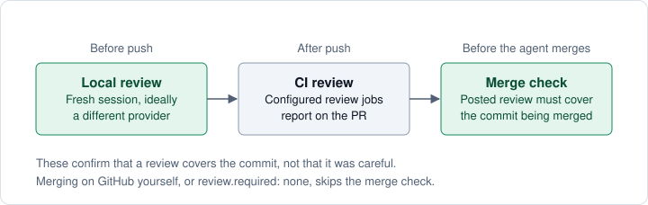

# Settings reference

<a id="settings"></a>

Start with [Choose your settings](settings-guide.md) for common choices and
prompts you can give your agent. This reference covers each option and its limits.

Settings live in `.agents/shaka/config.yml`. Ask your agent to
[configure the repository](configure-repository.md), or edit the file in a PR.

Browse [this repository’s configuration](https://github.com/shakacode/shaka/blob/main/.agents/shaka/config.yml) for a
commented example with explicit defaults and repository-specific review choices.
Optional choices without fixed defaults, such as the base branch and local reviewer models, stay commented.
Its [README](https://github.com/shakacode/shaka/tree/main/.agents/shaka#readme) notes
why its prompts and reviewer count differ from the defaults.

## Which settings apply?

Shaka uses one complete configuration for the task:

| Situation | Source |
| --- | --- |
| You explicitly select a settings PR | Its pinned commit |
| Your team has settings | The default branch, even when the task changes settings |
| No team settings exist | Your individual settings, kept out of Git |

An omitted value uses [Shaka's default](https://github.com/shakacode/shaka/blob/main/skills/shaka/config/defaults.yml),
not a value from another source. Local settings never override team settings.
An explicit task choice wins where the setting supports it, such as Ask for one task.
Required GitHub checks and approvals still apply.

Individual setup supports the same reviewer, prompt, checkpoint, writing, and WIP
preferences as team setup. A settings PR becomes the team's default after merge;
[previewing it](#preview-settings-before-adopting-them) changes only the selected task.

Two machine-wide files affect all projects: the public-comment allowlist and your
[reviewer list](#choose-reviewers-for-your-machine). Your
[personal starting point](#start-individual-setups-from-your-preferences) is copied
during setup, not combined at runtime. The exception is
[`pr_description.time_zone`](#pr_descriptiontime_zone), read from that file when the
repository leaves it unset.

## Start individual setups from your preferences

Put the preferences you use everywhere in `~/.agents/shaka/config.yml`. When you start
individual setup in a repository without Shaka settings, the agent shows a proposal that
combines them with the commands and checks it found in that repository. After you
approve it, Shaka writes the result to that copy's `.agents/shaka/config.yml`.

```yaml
version: 1
review:
  local_review_agents:
    - provider: openai
      model_family: codex
    - provider: anthropic
      model_family: claude
prose_limits:
  max_description_words: 250
pr_description:
  opening_check:
    enabled: false
```

The file uses the same keys as a repository's settings, limited to your own
preferences: local reviewers and how often they run, checkpoint and opening-check
reviewers, how PR descriptions read, writing limits, branch names, and WIP reporting.
Setup stops and names the file and key when the file holds anything that describes a
repository instead, such as commands, CI review jobs, merge policy, project guidance,
human review floors, or a prompt file, or when a value is invalid.

- **Read once.** Shaka reads the file only while a new individual setup runs. Editing it
  later changes no repository you already set up; change that copy's
  `.agents/shaka/config.yml` instead. Team settings, task settings, and `shaka seam
  init` never read it. [`pr_description.time_zone`](#pr_descriptiontime_zone) is the
  exception: setup leaves it in your file, and every PR description update reads it there.
- **Your choices for one repository win.** A reviewer list you give during setup replaces
  the file's list. To set up one repository without the file, ask the agent to skip your
  personal starting point.
- **Reviewer models.** The machine reviewer list still fills a reviewer's model and
  effort at review time. A `model` or `effort` written in this file becomes that
  repository's own value, which the machine list cannot change.

## Preview settings before adopting them

Keep proposed settings in an open PR and try them before making them your team's
defaults. Teammates can select the same PR for their tasks:

```text
$shaka <task or issue link>
Use settings from PR #123.
```

To switch an existing task:

```text
$shaka Switch this task to settings from PR #123.
```

The selected PR supplies the complete configuration, including reviewer choices
and merge preferences. Individual settings do not overlay it. An explicit task
choice, such as Ask, still takes precedence where supported. GitHub's required
checks and approvals still apply.

The agent records the selected PR and pinned commit on the task's PR. The selection
survives a fresh chat and stays with that task's branch and worktree. Updates require
explicit selection of a newer commit, followed by fresh affected checks and reviews.
Ask the agent to stop the preview to return to ordinary settings.

A local branch can prepare an experiment; the PR makes its choices visible before
team adoption. Ask to keep that settings PR open if you want to continue experimenting.

## `merge.preference`

**Required.** Values: `ask` or `auto`. Setup defaults to `ask`.

```yaml
merge:
  preference: ask
```

With `ask`, merge the ready PR on GitHub or tell the agent to merge the reviewed
commit. With `auto`, the agent merges after required checks, reviews, and approvals,
subject to the repository's restrictions. Some changes still need your decision.
Shaka uses your account's existing GitHub
permissions; an account that can bypass protection needs no extra Shaka setting.

Set a task's preference with `Use merge policy auto`. This is a task instruction;
editing the PR's settings does not change its own merge authority. Required human
approvals still apply. `Go` starts work; it is not merge consent. Ruby checks
readiness; the agent establishes your task-scoped authority. See
[merge policy](working-with-shaka.md#choose-a-merge-policy).

## `merge.required_checks`

**Optional.** CI checks that must pass before Shaka treats a PR as ready. Use it
when GitHub cannot require checks, such as on a private repository on the GitHub
Free plan.

```yaml
merge:
  preference: ask
  required_checks:
    - test
```

GitHub's required checks come first. If the base branch requires any, Shaka uses
those and ignores this list.

Otherwise, each listed check must appear on the PR and pass. Neutral and skipped
results count as passing, as they do on GitHub. If a listed check never appears,
the PR is blocked, so a renamed job cannot quietly drop out of the gate. Use the
names `gh pr checks` shows: CircleCI, for example, reports one check per workflow,
not per job.

The list governs only what Shaka does. In Ask mode, the agent waits for these checks
before it reports a PR ready and labels it `awaiting-merge-approval`. In Auto mode,
`shaka merge` refuses to merge until they pass. GitHub does not know about the list, so it
does not stop anyone from clicking merge. Nothing ties a name to a specific
workflow either, so a PR could add a job with a listed name. For protection that
GitHub enforces, use a ruleset or branch protection.

## `merge.limits`

**Optional.** Size limits for a merge the agent submits. A PR at a limit still
merges; one past it goes back to you.

```yaml
merge:
  preference: auto
  limits:
    max_changed_files: 29
    max_changed_lines: 999
    max_commits: 9
```

The values above are the defaults. Set any key to a positive integer to change
it; omitted keys keep their default. Changed lines are additions plus deletions.

When a PR is past a limit, or GitHub does not report its size, `merge` refuses
it. The agent then reports the counts and hands the PR back as Ask. To let the
agent merge it, confirm that commit in chat or
[approve it](working-with-shaka.md#find-prs-waiting-on-you). The confirmation
still counts after a clean rebase, or after conflict fixes that change no
behavior; any other new commit needs another confirmation. Required checks,
reviews, and approvals still apply.

`merge` checks the counts and that a confirmation names the commit being
merged. Whether you actually confirmed it is the agent's responsibility; the
[enforcement reference](workflow.md#what-is-enforced) explains the boundary.
Put other project restrictions in `AGENTS.md`.

## `merge.auto_max_review_floor`

**Optional. Default: 5, which holds nothing back.** Lets the agent merge only the PRs whose
[human review floor](#pr_descriptionhuman_review_floors) is at or below this number. Use it
with `preference: auto` when you want small code fixes merged for you but docs and agent
instructions brought back to you.

```yaml
merge:
  preference: auto
  auto_max_review_floor: 2
```

With the default floors, this merges a PR that changes only code, tests, and Markdown docs. A
PR that also edits `SKILL.md` sets floor 3, so the agent hands it back as Ask and names the
file: `skills/shaka/SKILL.md sets review floor 3 (changes agent instructions)`. To let the agent
merge it anyway, confirm that commit the same way as a PR past [`merge.limits`](#mergelimits).
Docs sit at floor 1 by default, so raise their floor first if a person should read them.

A PR that changes Shaka's settings in `.agents/shaka/` always comes back to you once this is
below 5, whatever floors you set. If Shaka cannot read the PR's complete list of changed files
from GitHub, the PR comes back too.

Try a number before you switch to `auto`. While `preference` is still `ask`, each ready
checkpoint comment on a PR says whether it passes the floor and `merge.limits`, or names what
would send it back, such as
`Auto merge preview: with merge.preference: auto, the agent would hand this PR back: skills/shaka/SKILL.md sets review floor 3`.
A PR that passes still gets the agent's own judgment of risk and compatibility under Auto.

The agent's rating does not hold a PR back. Rating it above its floor, or listing a file under
**Closer reading**, tells a reader where to look but does not stop Auto from merging it.

Floors only see file paths. They cannot tell that a PR removes a command or needs you to do
something after merge, so the agent hands those PRs back on its own judgment.

## `merge.hold_labels`

**Optional. Default: `[hold]`.** Put one of these labels on a PR to stop Shaka from merging it,
whether the repository uses `auto` or you tell the agent to merge.

```yaml
merge:
  preference: auto
  hold_labels: [hold, do-not-merge]
```

A label added while the agent is checking the PR still stops it. The agent then names the label and
hands the PR back to you. No confirmation in chat gets past a hold; remove the label when the PR
may merge. Label names match without regard to case.

The hold governs only Shaka. GitHub does not know about it, so it does not stop anyone from
clicking merge, and it does not take a PR out of a merge queue it has already joined. While
`preference` is `ask`, the ready checkpoint's Auto merge preview names a hold label the PR carries.

## `review.startup_check`

**Optional. Default: true.** Before implementation, Shaka resolves consent and sends
a tiny prompt to each selected local reviewer to check access. Covering standing
consent needs no new question. The probe sends no source code and may consume quota.
Set this to `false` to skip the probe; consent is still resolved early. A passing
probe cannot preapprove a future code transfer.

## `review.required`

**Required.** Choose when configured CI review reports are needed:

| Value | Effect |
| --- | --- |
| `meaningful_changes` | Trivial prose and no-op changes may skip review with a recorded reason. The agent judges whether the exception applies. |
| `always` | Review every change, including trivial prose. |
| `none` | No configured CI review requirement or local-review merge backstop. Omit `ci_review_jobs`. The PR says when no review ran. |

All three keep the workflow's local review before pushing meaningful work.
A fresh session reviews the change, preferably through another provider; the
agent addresses findings before publication. Use
[`local_review_count`](#reviewlocal_review_count) or
[`provider_coverage`](#reviewprovider_coverage) for several reviewers.



Except with `none`, the merge check requires a published review covering the
commit or a waiver reason. The result records which one it used. Only review comments
posted by the GitHub account doing the merge count. A recorded report does not
prove that a reviewer ran or its findings were fixed.

Earlier reviews can remain applicable after a conflict-free base update whose
result matches exactly, or after ordinary Markdown edits. Agent instructions
and Markdown under `.agents/`, `.claude/`, `.cursor/`, `.github/`, or `skills/`
need a new review. Git older than 2.41 or missing local commits prevents the
base-update comparison; get a new review or waiver instead.

Under Auto, unresolved local-review findings still stop merging, even with
`none` or a waiver. Unreadable review comments stop Auto too. Fix the findings,
disprove them, or explicitly accept the consequences.

## `review.ci_review_jobs`

**Required unless `review.required` is `none`.** List the GitHub job names that
produce review reports, such as:

```yaml
review:
  required: meaningful_changes
  ci_review_jobs:
    - claude-review
  ci_review_wait: one
```

The [hosted Claude review](configure-repository.md#add-hosted-claude-review) workflow
Shaka ships produces `claude-review`. The agent reads reports according to
`ci_review_wait`; a green job alone does not prove review completed. GitHub's required merge checks are configured separately.

## `review.ci_review_wait`

**Optional. Default: `one`.** Values: `none`, `one`, or `all`.

| Value | Wait before merging |
| --- | --- |
| `none` | No CI review report; local review still applies |
| `one` | At least one configured reviewer reports on the current commit |
| `all` | Every configured reviewer reports on the current commit |

Local review does not waive `one` or `all`. With `review.required: none`, no
configured review jobs apply. GitHub's required checks and approvals apply in
every mode. A task can increase the wait, but cannot lower the repository minimum.

Under Ask with `none` or `one`, optional checks may still be running or failing
when the agent merges. With `all`, every reported check must pass first.
Auto requires every reported check to pass regardless of this setting; skipped
and neutral results count as passing. A failed or unfinished optional check stops
Auto and returns the PR to you for an Ask decision.
An optional job that has not started is not seen, so make a check required if it
must always gate merging.

## `review.local_max_rounds`

**Optional. Default: `5`.** Positive number of commits reviewed in one local loop.
For example, `3` allows an initial review and two follow-ups. Several reviewers
of the same commit share one round.

At the cap, the agent stops before pushing unresolved defects or an unreviewed
fix. Reassess or split the task. You can authorize publication with unresolved
findings disclosed, but an unreviewed final fix still cannot be published.

To continue within a larger task-specific budget:

```text
Continue this task with at most fifteen review executions in total,
including its five existing reviews. Keep merge policy ask. Go.
```

That total counts reviewer runs, so two reviewers use two executions per commit.
The PR retains the history and shows the budget used. Repeating the same budget
adds no executions; a later increase needs a larger total.

## `review.local_review_agents`

**Optional.** Choose which reviewers Shaka tries first. Put a reviewer from a
different provider first to get another perspective on the change. Each reviewer
needs its CLI installed and signed in, or its API credentials on the machine doing the review.

Ask your agent:

> $shaka Prefer Claude for code review.

```yaml
review:
  local_review_agents:
    - provider: anthropic
      model_family: claude
      model: claude-opus-5-5
      effort: medium
    - provider: openai
      model_family: codex
      model: gpt-6-sol
      effort: medium
    - provider: xai
      model_family: grok
      model: grok-4.7
      effort: medium
```

Shaka prefers a different provider from the one that implemented the change,
then follows your list order among available reviewers. These settings choose
the available choices; [`local_review_count`](#reviewlocal_review_count) chooses how
many run, or [`provider_coverage`](#reviewprovider_coverage) names which providers do. Listing three does not require all three to review every change.
Each developer reviews with the listed reviewers their machine has: Shaka skips one
whose CLI is not installed, or DeepSeek when `OPENROUTER_API_KEY` is not set, and
names the skipped reviewer with setup steps. When none is set up, a fresh session
of the model that wrote the change reviews it.

### Model and effort values

Use these provider and family pairs for Shaka's supported local reviewers:

| Reviewer | `provider` | `model_family` | Effort values Shaka recognizes |
| --- | --- | --- | --- |
| Claude Code | `anthropic` | `claude` | `low`, `medium`, `high`, `xhigh`, `max` |
| Codex | `openai` | `codex` | `low`, `medium`, `high`, `xhigh` |
| Grok | `xai` | `grok` | `low`, `medium`, `high` |
| DeepSeek via OpenRouter API | `deepseek` | `openrouter` | `low`, `high`, `max` |

DeepSeek is an optional reviewer alongside your existing reviewers. Add this entry to your trusted
reviewer list when you want Shaka to send the prompt and diff to OpenRouter and
its selected upstream provider. Start with low effort: at high effort on a large
diff, it can use up its output budget before returning a report.

```yaml
- provider: deepseek
  model_family: openrouter
  model: deepseek/deepseek-v4.1-flash
  effort: low
```

Set `OPENROUTER_API_KEY` in the review process environment; keep it out of repository
files. If you load keys on demand, for example from your keychain, say so in your personal
agent instructions: agents often start a fresh shell for each command, so the loader must run
in the same command as the review. No separate reviewer CLI is needed. Shaka supports only this
[OpenRouter model](https://openrouter.ai/deepseek/deepseek-v4.1-flash) and the effort
values in the table. Omitted effort uses the provider default and shows as UNKNOWN on
the review.

Account settings govern provider routing and data policies. Shaka does not enforce
a provider allowlist or zero data retention. Before using private code, confirm
that your account's provider and privacy policies permit every possible recipient.
Keep your existing review checks while evaluating this optional reviewer; quality,
completion and savings remain unproved across workloads.

This reviewer receives the supplied diff and trusted criteria, with no tools or
filesystem access. It cannot inspect unchanged callers or execute tests, and its
reports say so. Shaka does not retry it or substitute another model. Existing
reviewers and merge preferences remain unchanged.

OpenRouter's response records token counts and account cost; missing usage stays
UNKNOWN. See [usage and cost](reference/usage-and-cost.md) for how to interpret
the PR's reported cost and coverage.

Choose a `model` available to that reviewer. The CLI example names above are
examples, not a closed list: newer names can run with a warning. Model names
cannot contain spaces. Effort names use lowercase.

Claude accepts only its listed effort values in Shaka. Codex and Grok values
outside the table produce a warning and still reach the CLI, which decides
whether they are supported.

Set `model` and `effort` to control review cost. Omit either to use the reviewer's
default for that setting; Grok requires a model from the configuration or the
task. A task can request a different model or effort for one review. Without a
reviewer list, Shaka uses a fresh review context with the model that implemented
the change.

### Use these settings from Cursor

The same repository settings apply when you work in
[Cursor](coding-agents.md). In a Cursor Agent chat, ask:

> /shaka Configure local reviews to prefer Grok 4.7 at medium effort, with
> Claude at medium effort as the next choice.

Cursor is the coding host. Reviewer entries identify the model provider and
reviewer CLI, so use `xai` / `grok` for Grok, including when your implementation
was written in Cursor. Local reviews support the reviewers in the table above;
Cursor is not one of them.

### Understand a reviewer warning

For these reviewers, Shaka flags unfamiliar model and effort names and likely
typos. You'll see the warning in the repository health check and
a **Reviewer settings** notice on the published local review. Check the spelling
and confirm that the model and effort are available to your reviewer. Shaka
keeps your chosen model; it does not substitute another one.

Most warnings allow the review to run. An unsupported Claude effort stops it;
choose one of Claude’s listed effort values to continue.

Put project-specific review criteria in `AGENTS.md`. To check that your AI accounts
can run the chosen reviewers, ask `$shaka Probe this project's configured reviewers.`
To choose how many hosted review reports to wait for, use
[`review.ci_review_wait`](#reviewci_review_wait).

### Add a second reviewer

A reviewer from another provider can offer a different perspective. When the
published review shows a **Reviewer fallback** notice, no listed reviewer from another
provider could run on that machine. Install one of the listed CLIs and sign in once
with the account that should pay for reviews:

- Codex: follow the [official CLI installation](https://github.com/openai/codex),
  then run `codex login`.
- Claude Code: follow the [official setup](https://code.claude.com/docs/en/setup),
  then run `claude` and sign in. Keep the
  normal sign-in; Shaka does not use `--bare`, which ignores it.
- Grok: follow the [Grok Build setup](https://docs.x.ai/build/overview), then run
  `grok` and sign in. Shaka looks for `grok`; another program named `agent` is
  not evidence of an installed Grok reviewer.

Then list that provider in `local_review_agents`. The next review picks it, and the
published review names it in its summary table instead of the fallback notice.
When you set up Shaka with the CLI already installed, the agent offers it and
records your choice, so no edit is needed.

### Choose reviewers for your machine

A repository may list reviewers you never use. Without a machine list, Shaka warns about
every listed reviewer that your machine is missing, except reviewers that
[`provider_coverage`](#reviewprovider_coverage) never selects on its own. List the
reviewers you run in `~/.agents/shaka/local-reviewers.yml`, and Shaka warns only about
those and the providers `provider_coverage` names, in every repository:

```yaml
version: 1
reviewers:
  - provider: anthropic
    model_family: claude
    model: claude-opus-5-5
    effort: high
  - provider: openai
    model_family: codex
```

A `model` or `effort` here applies only where the repository leaves that reviewer's
value unset, and a model or effort you name for one task wins over both. The list cannot
add a reviewer the repository does not list. `shaka doctor` shows the list and names
entries the current repository does not use. If the file is malformed, `shaka doctor`
names it and local reviews refuse to start until you fix it.

### Run Codex reviews in a container

On Linux, Codex's read-only sandbox needs unprivileged user namespaces. A container
without them, such as a default Docker container, fails every command the Codex
reviewer tries with `bwrap: No permissions to create a new namespace`. The reviewer
still answers from the diff in its prompt, so it reads no callers, tests, or
configuration. The PR description's [Verification](pr-verification.md#answers-for-your-next-decision)
then names it on the Setup gaps line.

Run Codex reviews where its sandbox can start, such as on the host instead of in the
container.

## `review.local_review_count`

**Optional. Default: `1`.** Number of reviewers reading each commit. Use a positive
integer, or choose [`provider_coverage`](#reviewprovider_coverage) instead; they
cannot both be set.

```yaml
review:
  local_review_count: 2
  local_review_agents:
    - provider: anthropic
      model_family: claude
    - provider: openai
      model_family: codex
```

When Claude implements, Codex and a fresh Claude session review concurrently.
The agent combines findings before repairing them. A task can choose another
count. If fewer reviewers can run, the PR names the gap; one applicable published
review satisfies the merge backstop. Additional reviewers cost more.

## `review.provider_coverage`

**Optional. Default: none.** Require the agent to select one local reviewer per
listed provider, replacing [`local_review_count`](#reviewlocal_review_count).

```text
$shaka Have Claude and Codex review every commit.
```

```yaml
review:
  local_review_agents:
    - provider: anthropic
      model_family: claude
    - provider: openai
      model_family: codex
  provider_coverage: [anthropic, openai]
```

Shaka chooses the first usable entry for each provider, preferring a provider
that did not implement the change. Other listed providers remain optional unless
the task names one. Implementation never counts as review.

A missing or unavailable provider is reported in the review and PR description;
no other provider substitutes for it. The gap does not itself block merging.
For one local review, omit this setting and use `local_review_count: 1`.

## `review.custom_instructions_file`

**Optional. Default: `.agents/shaka/instructions/review.md`.** Add your own rules to the
local code review without copying Shaka's prompt. Write them in that file. Shaka's
[review instructions](../skills/shaka/config/review-prompt.md) still apply in full; the
reviewer reads them, then your `AGENTS.md` files, then your file. For example:

```markdown
Check that every new setting has a test.
```

When your file conflicts with Shaka's instructions or your `AGENTS.md` criteria, the
reviewer follows your file. Shaka tells the reviewer that your file cannot relax its
safety rules, the finding classes, or the attestation line. Shaka checks the attestation;
the reviewer is trusted with the rest. See Shaka's own
[review instructions](https://github.com/shakacode/shaka/blob/main/.agents/shaka/instructions/review.md).

To keep the file elsewhere, name it with a path relative to the repository root. A named
file must exist; at the default path, a missing or empty file adds nothing. When the
settings name another path but a file still sits at the default, `seam check` and `doctor`
say it is ignored. The [checkpoint](#checkpoint) works the same way.

## `review.replacement_prompt_file`

**Optional. Default: Shaka's [review instructions](../skills/shaka/config/review-prompt.md).**
A Markdown file in your repository that replaces what the local reviewer looks for
and how it reports. Prefer [custom instructions](#reviewcustom_instructions_file); replace
only to remove one of Shaka's rules, and copy the default to start.

```yaml
review:
  required: meaningful_changes
  ci_review_jobs: [claude-review]
  replacement_prompt_file: .agents/review-prompt.md
  local_review_agents:
    - provider: openai
      model_family: codex
      replacement_prompt_file: .agents/review-prompt-codex.md
    - provider: anthropic
      model_family: claude
```

To give one review agent different instructions, set `replacement_prompt_file` on that
agent's entry in `local_review_agents`. It replaces `review.replacement_prompt_file` when that
agent reviews. Here Codex reviews with `.agents/review-prompt-codex.md`, and Claude,
which has no `replacement_prompt_file` on its entry, uses `.agents/review-prompt.md`.

### Where Shaka reads a prompt file

The [configuration source](#which-settings-apply) determines which `replacement_prompt_file`
and `custom_instructions_file` settings apply. This rule covers code-review, checkpoint, and
opening prompts, custom instructions files, and [project guidance](#project_guidance) files.
A settings preview reads each prompt at its selected commit. Without a preview:

- **Shared team settings:** commit the prompt with the settings PR. Shaka uses
  the version on the default branch, so a PR cannot rewrite its own review rules.
- **Individual setup:** put the prompt in `.agents/shaka/`, alongside your local
  settings. For example, `.agents/shaka/review.md` stays out of commits and applies to
  your task. A symlink cannot point outside that directory.
- **A prompt elsewhere in the repository:** Shaka reads the default-branch
  version, even during individual setup. A file that exists only on your feature
  branch cannot supply instructions.

Without a configured prompt, the reviewer uses Shaka's default instructions.

Settings validation fails when a configured file is missing, empty, larger than
100 KB, or not UTF-8. Replacement prompts keep the rules that identify the reviewed
commit and prevent edits. See [what Shaka enforces](workflow.md#what-is-enforced).

The file configures local reviews. A CI review job gets its prompt from its own
workflow; to give it the same instructions, have the workflow read this file.

## `checkpoint`

**Optional.** Choose who evaluates the result at the **checkpoint**:
whether it solves the intended problem, earns its maintenance cost, and what to do
next. This differs from the code walkthrough explaining the implementation.
With no settings, Shaka invokes Codex (`gpt-6.1-sol`) at medium effort using its
built-in prompt.

For example, to ask Claude Sonnet to reconsider each finished change with your
project's audience in mind:

```yaml
checkpoint:
  reviewer: anthropic/claude
  model: sonnet
  effort: high
```

Repository choices come from the [configuration source](#which-settings-apply),
and prompt files from [where Shaka reads prompt files](#where-shaka-reads-a-prompt-file).
A task's explicit choices take precedence. See
[the checkpoint](pr-verification.md#checkpoint)
for what the checkpoint means for your merge decision.

The PR records the conclusion, reasons, execution settings, and available native
usage. A failed invocation stays incomplete. “Simplify/reframe”, “Do not merge”, or
unresolved substantive concerns block readiness and Auto; green technical checks
and changed settings do not clear them. Earlier executions stay visible on the PR.
Setting `enabled: false` in the selected configuration opts out, and the PR then
shows a note saying so. Individual setup applies these choices too.

Ruby checks the settings, that the checkpoint ran, its report's shape, and that it
covers the current commit. The AI reviewer judges whether the change solves the
problem and is worth maintaining. A PR is merge-ready only with a report for the
current commit and no unresolved concerns, counting a concern you
[accepted](pr-verification.md#checkpoint) as resolved, or with the opt-out note.

### Add your own checkpoint questions

Write extra questions in `.agents/shaka/instructions/checkpoint.md`:

```markdown
Ask whether the change adds a step maintainers must remember.
```

The reviewer reads the built-in prompt, `AGENTS.md`, then your file. Your questions
win on conflicts, but cannot relax safety rules or the report format.
To use another path, set `checkpoint.custom_instructions_file` relative to the
repository root. A configured file must exist and contain text; an absent or
empty default file adds nothing. If a custom path leaves a file at the default,
doctor warns that the default is ignored.

To remove a built-in question, copy the
[default prompt](../skills/shaka/config/post-implementation-prompt.md) and set
`checkpoint.replacement_prompt_file`. You maintain that replacement as Shaka changes.
See [prompt locations and checks](#where-shaka-reads-a-prompt-file).

## `project_guidance`

**Optional. Default: none.** Files with project-specific requirements the agent
reads when needed:

```yaml
project_guidance:
  pr_evidence: .agents/shaka/pr-evidence.md
  merge_readiness: .agents/shaka/merge-readiness.md
  walkthrough: .agents/shaka/walkthrough.md
```

| File | When it applies | Example |
| --- | --- | --- |
| `pr_evidence` | Before writing the description | Attach rendered email templates. |
| `merge_readiness` | Before the checkpoint | Confirm a backfill plan. |
| `walkthrough` | Before writing the walkthrough | Explain whether a migration locks a large table. |

Set whichever files you need. They use the [prompt-file locations and checks](#where-shaka-reads-a-prompt-file).
A PR cannot rewrite the requirements used to judge itself. Changing these files
makes earlier validation and review results stale.

With `pr_evidence`, the agent also reads your PR template and fills sections the
Shaka description does not cover. Template lookup checks `.github/`, the root,
then `docs/`; select a particular template through `pr_evidence` if several exist.

Guides add agent instructions, not automated checks. Put deterministic checks in
validation or CI. Guides cannot relax review, required checks, or merge authority.
Task-specific acceptance criteria stay in the issue or spec.

### Example: Shaka's own PR evidence guide

[This repository's guide](https://github.com/shakacode/shaka/blob/main/.agents/shaka/pr-evidence.md)
asks agents to republish changed PR rendering on the PR itself. Other projects
need no such rule. For your project, start with a demonstrated gap:

```text
$shaka Add PR evidence guidance: when a change alters email templates,
attach rendered before and after screenshots.
```

<a id="opening_check"></a>

## `pr_description.opening_check`

**Optional.** Checks whether the opening of a description or walkthrough states
a useful outcome. It also suggests simpler terms in a description's visible
Intent and Verification. The check advises on wording, not factual accuracy;
a failure does not block publication or merging.

```text
$shaka Use Codex for opening checks.
```

```yaml
pr_description:
  opening_check:
    enabled: true
    reviewer: openai/codex
    model: gpt-6.1-sol
    effort: medium
```

| Setting | Default and effect |
| --- | --- |
| `enabled` | `true`; `false` skips the opening check. |
| `reviewer` | Selected from local code reviewers. An explicit `provider/family` chooses independently. |
| `model` | Codex or Claude CLI default. Grok needs an explicit model; OpenRouter needs `deepseek/deepseek-v4.1-flash`. Set `reviewer` when naming a model. |
| `effort` | `low`; use an effort the provider supports. |
| `replacement_prompt_file` | Shaka's default opening instructions. |

The check uses a separate session, even when you choose the implementation
provider. It has its own model and effort, not those of code review. Codex runs
without personal configuration. Pin a model for predictable results and cost,
or omit it to follow CLI defaults. OpenRouter supports `low`, `high`, and `max`.
A changed description or walkthrough opening can add a paid call.

### Customize the opening check

Copy [Shaka's default opening prompt](https://github.com/shakacode/shaka/blob/main/skills/shaka/config/opening-prompt.md)
and set `replacement_prompt_file` to your copy. The path is relative to the repository root,
not the configuration file's directory. For example,
`replacement_prompt_file: .agents/shaka/opening.md` selects that file beneath the repository
root. Both the separate AI session and the coding agent use those instructions.
Leave the setting out to use Shaka's default.

Shaka reads the file from [the same place as other prompt files](#where-shaka-reads-a-prompt-file).

Prompt files must pass the [review prompt file checks](#reviewreplacement_prompt_file).
Keep the default prompt's response format in your copy. Shaka treats the PR opening
as text to assess, not as instructions to follow.

If the selected reviewer cannot run, the coding agent checks the opening itself
with the same instructions. Shaka does not switch to another model.

## `prose_limits`

**Optional.** Limit the length of PR descriptions and code walkthroughs. These
limits are checked in code before publication. Recommendations and review
replies follow the agent's writing instructions but are not checked against
these limits.

```yaml
prose_limits:
  max_sentence_words: 35
  max_paragraph_words: 100
  max_description_words: 300
  words_per_changed_line: 4
```

The values above are the defaults. Set any key to a positive integer to change
it; omitted keys keep their default. Each limit counts selected prose.
Code blocks, tables, headings, quotes, link addresses, and the body of a
collapsed details block do not count. A collapsed block's summary label counts,
and an inline code span counts as one word.
In a description, only the part Shaka manages counts; text that people or other tools
add outside it is left alone.

- No sentence may run past `max_sentence_words`.
- No paragraph or list item may run past `max_paragraph_words`.
- The whole text may use 150 words plus `words_per_changed_line` for each
  changed line. A 6-line fix allows 174 words; a 100-line change allows 550.
- The description also stops at `max_description_words`, however large the change.

When text breaks a limit, nothing reaches GitHub. The command exits with an
error identifying the long passage or total word count. The agent shortens the
explanation before publishing.

For example, a 19-line change with a 950-word walkthrough is refused. The agent
splits long paragraphs, moves supporting detail into collapsed details, and
links to the code, then publishes again.

### Which limits apply?

The [configuration source](#which-settings-apply) determines the limits. For
example, with individual setup, a local 20-word sentence limit applies to
both your PR description and walkthrough. A shared team's changed limit takes
effect after its settings PR merges.

When Shaka cannot read the settings, a description uses the default limits and
says why. A walkthrough waits until the settings can be read.

## Standard command scripts

Connect your existing tools at these fixed paths:

| Script | Required? | Purpose |
| --- | --- | --- |
| `.agents/shaka/bin/setup` | Yes | Install dependencies |
| `.agents/shaka/bin/test` | Yes | Run tests; accept focused arguments |
| `.agents/shaka/bin/validate` | Yes | Complete checks before publishing |
| `.agents/shaka/bin/validate-local` | No | Faster checks before local review |
| `.agents/shaka/bin/trigger-hosted-ci` | No | Start deferred CI after local fixes; requires `validate-local` |

A wrapper can call an existing command. `seam init` generates each required wrapper;
it finds the repository root with Git, so it works from any directory and in linked
worktrees. To run a different command, change only its last line, for example:

```sh
exec bundle exec rake test "$@"
```

`exec` preserves the command's exit status and signals. A symlink to a tracked
executable also works if its directory, environment, and arguments already match.

Scripts must be executable and resolve within the repository. `.agents` and the
directories holding the configuration and scripts must be real directories.
Removing an optional check already on the default branch requires an explicit,
maintainer-approved policy change.

## `base_branch`

**Optional. Default: the repository's default branch.**

Use `base_branch: develop` to start from and target `develop`. An explicit task
choice or existing PR target takes precedence. A base outside the configured or
default branch needs confirmation and uses Ask. Policy always comes from the
default branch.

## `branches.name`

**Optional. Default: `'{login}-{host}/{issue}-{description}'`.**

```yaml
branches:
  name: '{login}-{host}/{issue}-{description}'
```

| Placeholder | Meaning |
| --- | --- |
| `{login}` | Authenticated GitHub login |
| `{host}` | Coding-agent slug, such as `codex` or `claude` |
| `{issue}` | Issue, PR, or work-item number, or `ad-hoc` for a task with none; required in the template |
| `{description}` | Short task description |

The settings check fills each placeholder with a sample value and refuses a template
whose result is not a plain branch name: one Git rejects, such as a name with a space
or `..`, or a full ref such as `refs/heads/{issue}`.

For example: `alex-codex/42-fix-search`, or `alex-codex/ad-hoc-fix-search` when the
task was given as a sentence. Before starting either one, the agent checks open PRs and
branches for the same name and stops for a decision when another one already uses it.

When a task comes from a tracker that offers a branch name, such as Linear's
**Copy git branch name**, the agent uses that name instead of the template.
Trackers link a pull request to its
work item through that branch name. Git must accept the name as a branch name.

## `pr_description.show_shaka_credit`

**Optional. Default: `true`.** Adds *PR prepared with [Shaka](https://shaka.shakacode.com/).*
to descriptions so readers can find the workflow. Set it to `false` to omit that
credit. Walkthroughs and replies carry no credit. Hiding it keeps verification,
execution details, and usage visible. Unreadable repository settings omit it too.

## `pr_description.show_human_comments`

**Optional. Default: `true`.**

Collect people's feedback in the description so it is easier to find among
agent posts. Later comments appear after the next refresh. Untrusted public
comments are linked without their bodies being read.

To leave the list out of this repository's PR descriptions, set:

```yaml
pr_description:
  show_human_comments: false
```

A description published after that change drops a list an earlier one showed.
Shaka keeps the list when repository settings cannot be read, because leaving it
out would hide what people wrote.

## `pr_description.max_human_comments`

**Optional. Default: `20`.**

The list shows at most this many rows, open comments first, and says how many more
it left out. Use a positive whole number:

```yaml
pr_description:
  max_human_comments: 40
```

Long comments are summarized and linked rather than copied in full. This
setting controls row count, not quotation or summary length.

## `pr_description.time_zone`

**Optional. Default: `UTC`.**

Shows the times in a PR description's Timings section in this zone. Use a name from the
[time zone database](https://en.wikipedia.org/wiki/List_of_tz_database_time_zones), so
daylight saving follows the date. With `America/Los_Angeles`, the task start reads
`11:00 PDT` in summer and `10:00 PST` in winter, and the tables name the zone below them:

```yaml
pr_description:
  time_zone: America/Los_Angeles
```

Shaka looks for a zone in this order:

1. The repository's settings, so everyone reading its PRs sees the same zone. Set `UTC`
   here to keep UTC whatever a contributor prefers.
2. `pr_description.time_zone` in your `~/.agents/shaka/config.yml`, read each time you
   update a PR description. The zone's name then appears on that PR, including a public
   one.
3. `UTC`.

A misspelled value, one the machine has no data for, or an unreadable personal file shows
UTC and labels it UTC, as does any update that cannot read the repository's settings. A time
zone never stops a PR update. `shaka configure settings`
reports the zone that applies, so you can check a new value. Only the display changes:
Shaka still stores UTC, and other commands' timestamps stay in UTC.

## `pr_description.human_review_floors`

**Optional. Default: the floors below.**

Every PR description says where a person's attention matters, from 1 (the description should be
enough) to 5 (read the riskiest files closely). Shaka sets a minimum from the files the PR
changes, so an agent can't rate a risky change as light reading.

The rating points at files. It does not ask for the whole PR to be studied. In a repository that
sets its docs at 5, as this one does, a code PR with one guide in it reads:

> **Human review:** 5 of 5. Read `docs/settings.md` (changes docs for Shaka's users). The rest
> set a lower floor.

Nothing checks how closely anyone read.

What deserves close review depends on your project, so set these floors for each repository.
The easiest way is to ask your agent:

> Help me choose Shaka's human review floors for this repository. Look at our folders and
> recent PRs, ask me which changes I review most carefully, and open a settings PR.

Your agent knows the matching rules and checks its proposal against your recent PRs. You
decide what matters; for example, a project whose guides are read by its customers may want
`docs/` changes at 5.

In [a study of 309 PRs in this repository](articles/one-shot-pr-study.md), people asked for
changes on many docs and agent-instruction PRs and on no PR that changed only code and tests.
So by default agent instructions sit above code. Docs stay at 1 because who reads them differs
by project; set them higher when they reach your users, as this repository does.

| Floor | Changed file |
| --- | --- |
| 5 | Shaka's settings in `.agents/shaka/` |
| 4 | GitHub Actions workflows, `CODEOWNERS`, and code named for auth, merge, release, trust, permissions, secrets, or credentials |
| 3 | Agent instructions, such as `AGENTS.md`, `SKILL.md`, and `skills/` |
| 2 | Any other code or configuration |
| 1 | Markdown docs and images |

The PR's floor is the highest one any of its files reaches. A PR changing a guide and a GitHub
Actions workflow needs at least 4.

Each floor lists the files it covers, and can list exceptions that leave a file out of that floor
only. For example, the default floor 4 covers `docs/merge-guide.md` by its name but excepts
Markdown, so the guide falls to the next floor that covers it, or to 1. The same guide under
`skills/` still gets 3 from the agent-instructions floor.

Your list replaces the default one. This repository adds three floors ahead of the defaults,
so a guide gets the closest review and a page under `docs/reference/` gets a skim:

```yaml
pr_description:
  human_review_floors:
    - level: 5
      reason: changes docs for Shaka's users
      paths: [docs/**/*]
      except: [docs/reference/**/*]
    - level: 2
      reason: changes a reference page
      paths: [docs/reference/**/*]
    - level: 4
      reason: changes evidence or settings checks
      paths: [skills/shaka/lib/shaka/evidence/**/*, skills/shaka/lib/shaka/seam/**/*]
    # ...followed by the default floors
```

Shaka reads the floors from the same settings as everything else on this page, never from the
PR's own branch, so a PR can't lower its own floor. An empty list, `[]`, turns floors off.

## `wip.include_checkout_path`

**Optional. Default: `true`.** Includes the checkout path under **Workspace** in
WIP Details. To show `REDACTED` instead:

```yaml
wip:
  include_checkout_path: false
```

The owner, revision, state, next action, and chat locator remain. If settings
cannot be read, the path is withheld and the PR explains how to reload them.

A local locator such as `codex://threads/...` identifies a chat in the owner's
app; it does not publish the conversation. A share or export link can publish
content, and Shaka does not create one. Other hosts' links can have different
access rules. Ask the agent to withhold the locator before publication if needed;
it then reads `UNKNOWN`.

This setting hides only the checkout path. Expandable details on a public PR
remain public, so inspect the rest of the publication for private information.

## `repo_prefix`

**Optional. Default: a label derived from the repository name.**

Use 1–6 uppercase ASCII letters or digits, such as `repo_prefix: SHOP`, to label
chat titles: `SHOP PR #42 · Fix checkout`. The
[repository catalog](repository-catalog.md) reports duplicate prefixes.

Shared settings on the default branch supply the prefix. Without them, complete
individual settings supply it. Incomplete or invalid individual settings use the default label.

## `version`

**Required. Currently `1`.** This identifies the configuration format, not the
installed Shaka release.

Unknown keys and invalid values produce an error. Link requirements and design
plans from `AGENTS.md`.
