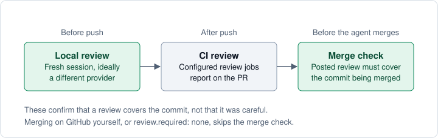

# Settings reference

<a id="settings"></a>

Start with [Choose your settings](settings-guide.md) for common choices and
prompts you can give your agent. This reference covers each option and its limits.

Settings live in `.agents/shaka/config.yml`. Ask your agent to
[configure the repository](configure-repository.md), or edit the file in a PR.

Browse [this repository’s configuration](https://github.com/shakacode/shaka/blob/main/.agents/shaka/config.yml) for a
commented example with explicit defaults and repository-specific review choices.
Optional choices without fixed defaults, such as the base branch and local reviewer models, stay commented.
Its [README](https://github.com/shakacode/shaka/tree/main/.agents/shaka#readme) notes
why its prompts and reviewer count differ from the defaults.

## Which settings apply?

Shaka uses one configuration source for the task. It does not combine individual
settings with shared team settings.

| Repository setup | Settings used |
| --- | --- |
| A settings PR is explicitly selected for this task | The complete configuration at its selected commit. |
| Shared Shaka settings exist on the default branch | The default-branch configuration, including when reviewing a PR that changes it. |
| No shared settings; individual setup is configured | Your local `.agents/shaka/config.yml`, kept out of Git. |

Sources never fill each other's gaps. When the chosen source leaves out a value,
Shaka uses its own default for it, never your individual setting. For example, if
team settings leave out `prose_limits`, PR descriptions use the default limit of
300 words, whatever your individual setup says. The one exception is
[`pr_description.time_zone`](#pr_descriptiontime_zone), a display choice that falls
back to your personal file when the repository sets none.

Shaka keeps no settings in your home directory, with two exceptions about your machine:
the comment allowlist, which adds people and bots whose public comments the agent may read,
and the [machine reviewer list](#choose-reviewers-for-your-machine). Your
[starting point for individual setup](#start-individual-setups-from-your-preferences) also
lives there, but it is not a settings source: setup copies it into a new copy of a
repository once, and tasks read only its time zone.

Omitted optional values use Shaka's defaults, all listed in
[Shaka's defaults file](https://github.com/shakacode/shaka/blob/main/skills/shaka/config/defaults.yml).
An explicit task choice takes
precedence where an option supports it, such as choosing Ask for one task.
Each option below describes any such override. Individual settings govern
delivery preferences, such as AI reviewers and writing limits; they cannot
disable required merge gates or authorize merging.

A settings PR becomes the team's default after it merges into the default branch.
You can also select it for one task before adoption. Local settings do not override
shared settings.

Individual setup honors the same settings as shared setup: reviewers, custom
code-review instructions, checkpoint choices, writing limits, opening checks, and
WIP reporting. [Prompt files](#where-shaka-reads-a-prompt-file) are the one
setting whose location matters.

## Start individual setups from your preferences

Put the preferences you use everywhere in `~/.agents/shaka/config.yml`. When you start
individual setup in a repository without Shaka settings, the agent shows a proposal that
combines them with the commands and checks it found in that repository. After you
approve it, Shaka writes the result to that copy's `.agents/shaka/config.yml`.

```yaml
version: 1
review:
  local_review_agents:
    - provider: openai
      model_family: codex
    - provider: anthropic
      model_family: claude
prose_limits:
  max_description_words: 250
pr_description:
  opening_check:
    enabled: false
```

The file uses the same keys as a repository's settings, limited to your own
preferences: local reviewers and how often they run, checkpoint and opening-check
reviewers, how PR descriptions read, writing limits, branch names, and WIP reporting.
Setup stops and names the file and key when the file holds anything that describes a
repository instead, such as commands, CI review jobs, merge policy, project guidance,
human review floors, or a prompt file, or when a value is invalid.

- **Read once.** Shaka reads the file only while a new individual setup runs. Editing it
  later changes no repository you already set up; change that copy's
  `.agents/shaka/config.yml` instead. Team settings, task settings, and `shaka seam
  init` never read it. [`pr_description.time_zone`](#pr_descriptiontime_zone) is the
  exception: setup leaves it in your file, and every PR description update reads it there.
- **Your choices for one repository win.** A reviewer list you give during setup replaces
  the file's list. To set up one repository without the file, ask the agent to skip your
  personal starting point.
- **Reviewer models.** The machine reviewer list still fills a reviewer's model and
  effort at review time. A `model` or `effort` written in this file becomes that
  repository's own value, which the machine list cannot change.

## Preview settings before adopting them

Keep proposed settings in an open PR and try them before making them your team's
defaults. Teammates can select the same PR for their tasks:

```text
$shaka <task or issue link>
Use settings from PR #123.
```

To switch an existing task:

```text
$shaka Switch this task to settings from PR #123.
```

The selected PR supplies the complete configuration, including reviewer choices
and merge preferences. Individual settings do not overlay it. An explicit task
choice, such as Ask, still takes precedence where supported. GitHub's required
checks and approvals still apply.

The agent records the selected PR and pinned commit on the task's PR. The selection
survives a fresh chat and stays with that task's branch and worktree. Updates require
explicit selection of a newer commit, followed by fresh affected checks and reviews.
Ask the agent to stop the preview to return to ordinary settings.

A local branch can prepare an experiment; the PR makes its choices visible before
team adoption. Ask to keep that settings PR open if you want to continue experimenting.

## `merge.preference`

**Required.** Values: `ask` or `auto`. Setup defaults to `ask`.

```yaml
merge:
  preference: ask
```

With `ask`, merge the ready PR on GitHub or tell the agent to merge the reviewed
commit. With `auto`, the agent merges after required checks, reviews, and approvals,
subject to the repository's restrictions. Some changes still need your decision.
Shaka uses your account's existing GitHub
permissions; an account that can bypass protection needs no extra Shaka setting.

Set a task's preference with `Use merge policy auto`. This is a task instruction;
editing the PR's settings does not change its own merge authority. Required human
approvals still apply. `Go` starts work; it is not merge consent. Ruby checks
readiness; the agent establishes your task-scoped authority. See
[merge policy](working-with-shaka.md#choose-a-merge-policy).

## `merge.required_checks`

**Optional.** CI checks that must pass before Shaka treats a PR as ready. Use it
when GitHub cannot require checks, such as on a private repository on the GitHub
Free plan.

```yaml
merge:
  preference: ask
  required_checks:
    - test
```

GitHub's required checks come first. If the base branch requires any, Shaka uses
those and ignores this list.

Otherwise, each listed check must appear on the PR and pass. Neutral and skipped
results count as passing, as they do on GitHub. If a listed check never appears,
the PR is blocked, so a renamed job cannot quietly drop out of the gate. Use the
names `gh pr checks` shows: CircleCI, for example, reports one check per workflow,
not per job.

The list governs only what Shaka does. In Ask mode, the agent waits for these checks
before it reports a PR ready and labels it `awaiting-merge-approval`. In Auto mode,
`shaka merge` refuses to merge until they pass. GitHub does not know about the list, so it
does not stop anyone from clicking merge. Nothing ties a name to a specific
workflow either, so a PR could add a job with a listed name. For protection that
GitHub enforces, use a ruleset or branch protection.

## `merge.limits`

**Optional.** Size limits for a merge the agent submits. A PR at a limit still
merges; one past it goes back to you.

```yaml
merge:
  preference: auto
  limits:
    max_changed_files: 29
    max_changed_lines: 999
    max_commits: 9
```

The values above are the defaults. Set any key to a positive integer to change
it; omitted keys keep their default. Changed lines are additions plus deletions.

When a PR is past a limit, or GitHub does not report its size, `merge` refuses
it. The agent then reports the counts and hands the PR back as Ask. To let the
agent merge it, confirm that commit in chat or
[approve it](working-with-shaka.md#find-prs-waiting-on-you). The confirmation
still counts after a clean rebase, or after conflict fixes that change no
behavior; any other new commit needs another confirmation. Required checks,
reviews, and approvals still apply.

`merge` checks the counts and that a confirmation names the commit being
merged. Whether you actually confirmed it is the agent's responsibility; the
[enforcement reference](workflow.md#what-is-enforced) explains the boundary.
Put other project restrictions in `AGENTS.md`.

## `merge.auto_max_review_floor`

**Optional. Default: 5, which holds nothing back.** Lets the agent merge only the PRs whose
[human review floor](#pr_descriptionhuman_review_floors) is at or below this number. Use it
with `preference: auto` when you want small code fixes merged for you but docs and agent
instructions brought back to you.

```yaml
merge:
  preference: auto
  auto_max_review_floor: 2
```

With the default floors, this merges a PR that changes only code, tests, and Markdown docs. A
PR that also edits `SKILL.md` sets floor 3, so the agent hands it back as Ask and names the
file: `skills/shaka/SKILL.md sets review floor 3 (changes agent instructions)`. To let the agent
merge it anyway, confirm that commit the same way as a PR past [`merge.limits`](#mergelimits).
Docs sit at floor 1 by default, so raise their floor first if a person should read them.

A PR that changes Shaka's settings in `.agents/shaka/` always comes back to you once this is
below 5, whatever floors you set. If Shaka cannot read the PR's complete list of changed files
from GitHub, the PR comes back too.

Try a number before you switch to `auto`. While `preference` is still `ask`, each ready
checkpoint comment on a PR says whether it passes the floor and `merge.limits`, or names what
would send it back, such as
`Auto merge preview: with merge.preference: auto, the agent would hand this PR back: skills/shaka/SKILL.md sets review floor 3`.
A PR that passes still gets the agent's own judgment of risk and compatibility under Auto.

Floors only see file paths. They cannot tell that a PR removes a command or needs you to do
something after merge, so the agent hands those PRs back on its own judgment.

## `merge.hold_labels`

**Optional. Default: `[hold]`.** Put one of these labels on a PR to stop Shaka from merging it,
whether the repository uses `auto` or you tell the agent to merge.

```yaml
merge:
  preference: auto
  hold_labels: [hold, do-not-merge]
```

`shaka merge` reads the PR's labels again on its last read of the PR before it submits, so a
label added while the agent checks the PR still stops it. The agent then names the label and
hands the PR back to you. No confirmation in chat gets past a hold; remove the label when the PR
may merge. Label names match without regard to case.

The hold governs only Shaka. GitHub does not know about it, so it does not stop anyone from
clicking merge, and it does not take a PR out of a merge queue it has already joined. While
`preference` is `ask`, the ready checkpoint's Auto merge preview names a hold label the PR carries.

## `review.startup_check`

**Optional. Default: true.** Before implementation, Shaka resolves consent and sends
a tiny prompt to each selected local reviewer to check access. Covering standing
consent needs no new question. The probe sends no source code and may consume quota.
Set this to `false` to skip the probe; consent is still resolved early. A passing
probe cannot preapprove a future code transfer.

## `review.required`

**Required.** Values: `meaningful_changes`, `always`, or `none`.

This controls when configured CI review reports are required. Options:

- `meaningful_changes`: every PR except trivial prose, such as a typo fix, and no-op
  changes. Those can skip review with a recorded reason. The agent decides what is
  trivial; Shaka does not check that decision.
- `always`: every PR, including trivial changes. The agent follows this for local
  review too, but `shaka merge` still accepts a waiver reason, described below.
- `none`: no configured CI review backstop, and neither `shaka merge` nor the
  `awaiting-merge-approval` label needs a local review. `shaka description` accepts a
  validation result without a review result, and its settings block says the repository
  does not require review; when
  no review ran, the Validation and review line says so too. A review that ran anyway
  must still match the current commit. Omit `ci_review_jobs` with this setting.

Every value, `none` included, keeps a local review before push. Only trivial prose
and no-op changes may skip it, and not under `always`:

- Use a separate session without the implementation conversation.
- Prefer a different provider and model. If other reviewers are unavailable, the
  current workflow allows the implementation model in a fresh session.
- Address findings before pushing.
- To have several reviewers read each commit, set
  [`review.local_review_count`](#reviewlocal_review_count), or name the providers with
  [`review.provider_coverage`](#reviewprovider_coverage).



`shaka review run` verifies the reviewer process completed and returned a report
for the expected commit. `shaka review check` validates a supplied report but does
not prove a reviewer process ran.

Before it merges, `shaka merge` checks that the PR has a local review of the
commit being merged. The agent posts the review report as a PR comment, and the
report's last line names the commit and the reviewer:

```text
REVIEWED <commit> BY <provider>/<family> EFFORT <effort> FINDINGS <count>
```

`merge` counts only comments from the GitHub account running the merge, and only
when that line ends the comment. Any reviewer counts, including the
implementation model in a fresh session.

A review of an earlier commit still counts in two cases:

- **Updated from the base branch.** Bringing the branch up to date with the base,
  by merge or rebase, keeps the review when there were no conflicts and nothing
  else changed. `merge` checks this with Git in the local checkout: the head must
  match, file for file, what merging the reviewed commit with the new base
  produces. The check runs Git's built-in merge in a temporary repository, so no
  merge driver or script runs and nothing is written to your repository. If Git
  is older than 2.41 or those commits are not in the checkout, `merge` asks for a
  new review or a waiver instead.
- **Ordinary Markdown since.** Every later change is ordinary Markdown. Agent
  instructions are not ordinary Markdown: `AGENTS.md`, `CLAUDE.md`, `GEMINI.md`,
  `SKILL.md`, any other Markdown file whose name starts with `agents`, `claude`,
  `gemini`, or `skill` (such as `AGENTS.override.md` or `CLAUDE.local.md`), and
  files under `.agents/`, `.claude/`, `.cursor/`, `.github/`, or `skills/` need a
  new review.

When no review applies, `merge` stops before merging. A maintainer can record a
waiver reason when review was skipped on purpose, a later commit only fixed nits,
or a CI review covered the commit. The waiver also covers a PR whose
comments GitHub cannot list. With `review.required: none`, `merge` skips this check.

The merge result shows the review it relied on, or the waiver reason, under
`review_evidence`. That records what the posted line says. It does not prove a
reviewer process ran or that its findings were fixed.

When Shaka merges under `auto`, it also stops while the PR's local review reports
findings needing attention. Neither a waiver nor `review.required: none` changes that,
and it also stops when GitHub can't list the comments. Fix the findings, or have a
maintainer accept them so the agent can record that decision.

## `review.ci_review_jobs`

**Required unless `review.required` is `none`.** List the GitHub job names that
produce review reports, such as:

```yaml
review:
  required: meaningful_changes
  ci_review_jobs:
    - claude-review
  ci_review_wait: one
```

The [hosted Claude review](configure-repository.md#add-hosted-claude-review) workflow
Shaka ships produces `claude-review`. The agent reads reports according to
`ci_review_wait`; a green job alone does not prove review completed. GitHub's required merge checks are configured separately.

## `review.ci_review_wait`

**Optional. Default: `one`.** Values: `none`, `one`, or `all`.

| Value | Wait before merging |
| --- | --- |
| `none` | No CI review report; local review still applies |
| `one` | At least one configured reviewer reports on the current commit |
| `all` | Every configured reviewer reports on the current commit |

Local review does not waive `one` or `all`. With `review.required: none`, no
configured review jobs apply. GitHub's required checks and approvals apply in
every mode. A task can increase the wait, but cannot lower the repository minimum.

The agent counts verified reports. The merge helper permits optional pending
checks (`UNSTABLE`) for `none` and `one`; `all` requires `CLEAN`.

## `review.local_max_rounds`

**Optional. Default: `5`.** A positive integer, validated by `shaka seam check`.

This bounds the commits reviewed in one local review ledger. For example, `3` lets
an initial review and two follow-up reviews run before the helper refuses another.
With [`local_review_count`](#reviewlocal_review_count) above 1, all the reviewers of one
commit together use one of these turns, so `3` with two reviewers allows six reviews
across three commits.
The runner reads the setting from the supplied trusted `--settings-ref` (or
`--criteria-ref`). Without a reference, it uses the default of five.

If the cap leaves an unfixed defect, the agent stops before pushing and tells you.
You can reassess the task, split it, or choose to push anyway. An authorized push
publishes a visible **Loop bound reached** section listing unresolved defects,
the rounds in which they appeared, and any that returned after a recorded fix.
It includes a prompt to reassess contradictory requirements, excessive scope,
or impossible constraints. Ruby bounds review rounds; the agent handles your push decision.

If the cap prevents review of a last-round fix, the agent also stops before pushing
and tells you. Publication still refuses that unreviewed fix; reassess the task
before continuing.

You can authorize a bounded continuation for one task while preserving its review history:

```text
Continue this task with at most fifteen review executions in total,
including its five existing reviews. Keep merge policy ask. Go.
```

The total counts reviewer runs, not commits: with two reviewers per commit, each round
uses two. To allow more later, give a larger total; repeating the same one adds nothing.
It applies to this task only, and the PR shows the runs used against it.

## `review.local_review_agents`

**Optional.** Choose which reviewers Shaka tries first. Put a reviewer from a
different provider first to get another perspective on the change. Each reviewer
needs its CLI installed and signed in, or its API credentials on the machine doing the review.

Ask your agent:

> $shaka Prefer Claude for code review.

```yaml
review:
  local_review_agents:
    - provider: anthropic
      model_family: claude
      model: claude-opus-5-5
      effort: medium
    - provider: openai
      model_family: codex
      model: gpt-6-sol
      effort: medium
    - provider: xai
      model_family: grok
      model: grok-4.7
      effort: medium
```

Shaka prefers a different provider from the one that implemented the change,
then follows your list order among available reviewers. These settings choose
the available choices; [`local_review_count`](#reviewlocal_review_count) chooses how
many run, or [`provider_coverage`](#reviewprovider_coverage) names which providers do. Listing three does not require all three to review every change.
Each developer reviews with the listed reviewers their machine has: Shaka skips one
whose CLI is not installed, or DeepSeek when `OPENROUTER_API_KEY` is not set, and
names the skipped reviewer with setup steps. When none is set up, a fresh session
of the model that wrote the change reviews it.

### Model and effort values

Use these provider and family pairs for Shaka's supported local reviewers:

| Reviewer | `provider` | `model_family` | Effort values Shaka recognizes |
| --- | --- | --- | --- |
| Claude Code | `anthropic` | `claude` | `low`, `medium`, `high`, `xhigh`, `max` |
| Codex | `openai` | `codex` | `low`, `medium`, `high`, `xhigh` |
| Grok | `xai` | `grok` | `low`, `medium`, `high` |
| DeepSeek via OpenRouter API | `deepseek` | `openrouter` | `low`, `high`, `max` |

DeepSeek is an optional reviewer alongside your existing reviewers. Add this entry to your trusted
reviewer list when you want Shaka to send the prompt and diff to OpenRouter and
its selected upstream provider. Start with low effort; high-effort trials on a
large diff sometimes consumed the completion budget without returning a report.

```yaml
- provider: deepseek
  model_family: openrouter
  model: deepseek/deepseek-v4.1-flash
  effort: low
```

Set `OPENROUTER_API_KEY` in the review process environment; keep it out of repository
files. If you load keys on demand, for example from your keychain, say so in your personal
agent instructions: agents often start a fresh shell for each command, so the loader must run
in the same command as the review. No separate reviewer CLI is needed. The adapter supports only this explicit
[OpenRouter model](https://openrouter.ai/deepseek/deepseek-v4.1-flash); it refuses other
models and unsupported effort values before sending a request. Omitted effort uses
the provider default and remains UNKNOWN in Shaka's attestation.

Account settings govern provider routing and data policies. Shaka does not enforce
a provider allowlist or zero data retention. Before using private code, confirm
that your account's provider and privacy policies permit every possible recipient.
Keep your existing review checks while evaluating this optional reviewer; quality,
completion and savings remain unproved across workloads.

This reviewer receives the supplied diff and trusted criteria, with no tools or
filesystem access. It cannot inspect unchanged callers or execute tests. Reports
retain that coverage limit. Requests use the review timeout, make no automatic
retry or model substitution, and reject malformed, truncated or unattested output.
Existing reviewers and merge preferences remain unchanged.

OpenRouter's response records token counts and account cost; missing usage stays
UNKNOWN. See [usage and cost](reference/usage-and-cost.md) for how to interpret
the PR's reported cost and coverage.

Choose a `model` available to that reviewer. The CLI example names above are
examples, not a closed list: newer names can run with a warning. Model names
cannot contain spaces. Effort names use lowercase.

Claude accepts only its listed effort values in Shaka. Codex and Grok values
outside the table produce a warning and still reach the CLI, which decides
whether they are supported.

Set `model` and `effort` to control review cost. Omit either to use the reviewer's
default for that setting; Grok requires a model from the configuration or the
task. A task can request a different model or effort for one review. Without a
reviewer list, Shaka uses a fresh review context with the model that implemented
the change.

### Use these settings from Cursor

The same repository settings apply when you work in
[Cursor](coding-agents.md). In a Cursor Agent chat, ask:

> /shaka Configure local reviews to prefer Grok 4.7 at medium effort, with
> Claude at medium effort as the next choice.

Cursor is the coding host. Reviewer entries identify the model provider and
reviewer CLI, so use `xai` / `grok` for Grok, including when your implementation
was written in Cursor. Shaka's local review runner supports the three CLIs and the
OpenRouter API adapter in the table. Cursor supplies the coding host rather than a reviewer CLI.

### Understand a reviewer warning

For these reviewers, Shaka flags unfamiliar model and effort names and likely
typos. You'll see the warning in the repository health check and
a **Reviewer settings** notice on the published local review. Check the spelling
and confirm that the model and effort are available to your reviewer. Shaka
keeps your chosen model; it does not substitute another one.

Most warnings allow the review to run. An unsupported Claude effort stops it;
choose one of Claude’s listed effort values to continue.

Put project-specific review criteria in `AGENTS.md`. To check that your AI accounts
can run the chosen reviewers, ask `$shaka Probe this project's configured reviewers.`
To choose how many hosted review reports to wait for, use
[`review.ci_review_wait`](#reviewci_review_wait).

### Add a second reviewer

A review from the provider that wrote the change shares its blind spots. When the
published review shows a **Reviewer fallback** notice, no listed reviewer from another
provider could run on that machine. Install one of the listed CLIs and sign in once
with the account that should pay for reviews:

- Codex: follow the [official CLI installation](https://github.com/openai/codex),
  then run `codex login`.
- Claude Code: follow the [official setup](https://code.claude.com/docs/en/setup),
  then run `claude` and sign in. Keep the
  normal sign-in; Shaka does not use `--bare`, which ignores it.
- Grok: follow the [Grok Build setup](https://docs.x.ai/build/overview), then run
  `grok` and sign in. Shaka looks for `grok`; another program named `agent` is
  not evidence of an installed Grok reviewer.

Then list that provider in `local_review_agents`. The next review picks it, and the
published review names it in its summary table instead of the fallback notice.
When you set up Shaka with the CLI already installed, the agent offers it and
records your choice, so no edit is needed.

### Choose reviewers for your machine

A repository may list reviewers you never use. Without a machine list, Shaka warns about
every listed reviewer that your machine is missing, except reviewers that
[`provider_coverage`](#reviewprovider_coverage) never selects on its own. List the
reviewers you run in `~/.agents/shaka/local-reviewers.yml`, and Shaka warns only about
those and the providers `provider_coverage` names, in every repository:

```yaml
version: 1
reviewers:
  - provider: anthropic
    model_family: claude
    model: claude-opus-5-5
    effort: high
  - provider: openai
    model_family: codex
```

A `model` or `effort` here applies only where the repository leaves that reviewer's
value unset, and a model or effort you name for one task wins over both. The list cannot
add a reviewer the repository does not list. `shaka doctor` shows the list and names
entries the current repository does not use. If the file is malformed, `shaka doctor`
names it and local reviews refuse to start until you fix it.

### Run Codex reviews in a container

On Linux, Codex's read-only sandbox needs unprivileged user namespaces. A container
without them, such as a default Docker container, fails every command the Codex
reviewer tries with `bwrap: No permissions to create a new namespace`. The reviewer
still answers from the diff in its prompt, so it reads no callers, tests, or
configuration. The PR description's [Verification](pr-verification.md#answers-for-your-next-decision)
then names it on the Setup gaps line.

Run Codex reviews where its sandbox can start, such as on the host instead of in the
container.

## `review.local_review_count`

**Optional. Default: 1.** How many reviewers from `local_review_agents` read each
commit before its findings are fixed. To name which providers review instead, use
[`provider_coverage`](#reviewprovider_coverage); the two cannot both be set. With more than one reviewer, the agent starts
those reviews concurrently.
The helper refuses to record findings while a started review is still running.
The agent combines their findings so a problem two reviewers found is fixed once.

Claude implements, and Codex and a fresh Claude session both review:

```yaml
review:
  required: meaningful_changes
  ci_review_jobs: [claude-review]
  local_review_count: 2
  local_review_agents:
    - provider: anthropic
      model_family: claude
    - provider: openai
      model_family: codex
```

The first reviewer comes from a provider that did not write the change whenever one
can run, here Codex. The others follow the list order, so the second is Claude in a
fresh session, without the implementation conversation. If Codex had written the
change, the order would be Claude, then Codex. When the agent finds a reviewer's CLI
missing or signed out, fewer reviewers read that commit, and from the next commit the next
listed reviewer takes its place. The PR description's [Verification](pr-verification.md#answers-for-your-next-decision)
says how many completed.

Each extra reviewer adds cost and may increase elapsed time. The PR's
review comment shows every reviewer's rounds, and one review of the final commit is
enough for `shaka merge`. A task can ask for a different number, which wins for that
task.

## `review.provider_coverage`

**Optional. Default: none.** Name the providers whose reviewers read every commit. Shaka runs
one local reviewer for each listed provider: the first entry from that provider in
`local_review_agents` that works on the machine. A provider that did not write the change
goes first. This replaces [`local_review_count`](#reviewlocal_review_count), so set one or
the other.

Ask your agent:

> $shaka Have Claude and Codex review every commit.

```yaml
review:
  local_review_agents:
    - provider: anthropic
      model_family: claude
    - provider: openai
      model_family: codex
  provider_coverage: [anthropic, openai]
```

When Claude writes the change, Codex reviews it, then a fresh Claude session. Reviewers listed
in `local_review_agents` from other providers run only when a task asks for one by name.
Shaka does not warn when one of them is not set up on your machine; `shaka doctor` lists it as
optional.

When a listed provider cannot review, the agent copies Shaka's gap report into the published
review, which shows it near the top with the reason: that provider is not listed in `local_review_agents`, not set up on the machine, or
unavailable. The PR description's [Verification](pr-verification.md#answers-for-your-next-decision) names the provider too. Shaka does not substitute another provider, and the gap never blocks merging.
Writing the change does not count as reviewing it.

To pay for one local review instead, leave this unset and set `local_review_count: 1`. With
the [hosted Claude review](configure-repository.md#add-hosted-claude-review), a PR that only
Codex reviewed locally still gets a full Claude review on GitHub.

## `review.custom_instructions_file`

**Optional. Default: `.agents/shaka/instructions/review.md`.** Add your own rules to the
local code review without copying Shaka's prompt. Write them in that file. Shaka's
[review instructions](../skills/shaka/config/review-prompt.md) still apply in full; the
reviewer reads them, then your `AGENTS.md` files, then your file. For example:

```markdown
Check that every new setting has a test.
```

When your file conflicts with Shaka's instructions or your `AGENTS.md` criteria, the
reviewer follows your file. Shaka tells the reviewer that your file cannot relax its
safety rules, the finding classes, or the attestation line. Shaka checks the attestation;
the reviewer is trusted with the rest. See Shaka's own
[review instructions](https://github.com/shakacode/shaka/blob/main/.agents/shaka/instructions/review.md).

To keep the file elsewhere, name it with a path relative to the repository root. A named
file must exist; at the default path, a missing or empty file adds nothing. When the
settings name another path but a file still sits at the default, `seam check` and `doctor`
say it is ignored. The [checkpoint](#checkpoint) works the same way.

## `review.replacement_prompt_file`

**Optional. Default: Shaka's [review instructions](../skills/shaka/config/review-prompt.md).**
A Markdown file in your repository that replaces what the local reviewer looks for
and how it reports. Prefer [custom instructions](#reviewcustom_instructions_file); replace
only to remove one of Shaka's rules, and copy the default to start.

```yaml
review:
  required: meaningful_changes
  ci_review_jobs: [claude-review]
  replacement_prompt_file: .agents/review-prompt.md
  local_review_agents:
    - provider: openai
      model_family: codex
      replacement_prompt_file: .agents/review-prompt-codex.md
    - provider: anthropic
      model_family: claude
```

To give one review agent different instructions, set `replacement_prompt_file` on that
agent's entry in `local_review_agents`. It replaces `review.replacement_prompt_file` when that
agent reviews. Here Codex reviews with `.agents/review-prompt-codex.md`, and Claude,
which has no `replacement_prompt_file` on its entry, uses `.agents/review-prompt.md`.

### Where Shaka reads a prompt file

The [configuration source](#which-settings-apply) determines which `replacement_prompt_file`
and `custom_instructions_file` settings apply. This rule covers code-review, checkpoint, and
opening prompts, custom instructions files, and [project guidance](#project_guidance) files.
A settings preview reads each prompt at its selected commit. Without a preview:

- **Shared team settings:** commit the prompt with the settings PR. Shaka uses
  the version on the default branch, so a PR cannot rewrite its own review rules.
- **Individual setup:** put the prompt in `.agents/shaka/`, alongside your local
  settings. For example, `.agents/shaka/review.md` stays out of commits and applies to
  your task. A symlink cannot point outside that directory.
- **A prompt elsewhere in the repository:** Shaka reads the default-branch
  version, even during individual setup. A file that exists only on your feature
  branch cannot supply instructions.

Without a configured prompt, the reviewer uses Shaka's default instructions.

Settings validation fails when a configured file is missing, empty, larger than
100 KB, or not UTF-8. Replacement prompts keep the rules that identify the reviewed
commit and prevent edits. See [what Shaka enforces](workflow.md#what-is-enforced).

The file configures local reviews. A CI review job gets its prompt from its own
workflow; to give it the same instructions, have the workflow read this file.

## `checkpoint`

**Optional.** Choose who evaluates the result at the **checkpoint**:
whether it solves the intended problem, earns its maintenance cost, and what to do
next. This differs from the code walkthrough explaining the implementation.
With no settings, Shaka invokes Codex (`gpt-6.1-sol`) at medium effort using its
built-in prompt.

For example, to ask Claude Sonnet to reconsider each finished change with your
project's audience in mind:

```yaml
checkpoint:
  reviewer: anthropic/claude
  model: sonnet
  effort: high
```

Repository choices come from the [configuration source](#which-settings-apply),
and prompt files from [where Shaka reads prompt files](#where-shaka-reads-a-prompt-file).
A task's explicit choices take precedence. See
[the checkpoint](pr-verification.md#checkpoint)
for what the checkpoint means for your merge decision.

The PR records the conclusion, reasons, execution settings, and available native
usage. A failed invocation stays incomplete. “Simplify/reframe”, “Do not merge”, or
unresolved substantive concerns block readiness and Auto; green technical checks
and changed settings do not clear them. Earlier executions stay visible on the PR.
Setting `enabled: false` in the selected configuration opts out and
requires a visible note. Individual setup applies these choices too. Final
preparation accepts an individual opt-out only after its note is published on the PR.

See [checkpoint terms and current report labels](pr-verification.md#checkpoint).
The current automated gate concerns pre-merge readiness; these terms do not add
an approval step or a general outer-loop mechanism.

Ruby validates settings, execution outcome, report shape, and head binding.
The AI reviewer assesses whether the change solves the problem and is worth
maintaining. The task owner supplies the original problem and evidence, resolves
concerns, and establishes merge readiness. Final merge preparation
requires a report for the current commit with no unresolved concerns, counting a concern
you [accepted](pr-verification.md#checkpoint) as resolved, or an explicit opt-out.

### Add your own checkpoint questions

Write them in `.agents/shaka/instructions/checkpoint.md`. Shaka's
[built-in checkpoint prompt](../skills/shaka/config/post-implementation-prompt.md)
still applies in full. The reviewer reads it, then your `AGENTS.md` files, then your
file. For example:

```markdown
Ask whether the change adds a step maintainers must remember.
```

When your file conflicts with a built-in question or your `AGENTS.md` criteria, the
reviewer follows your file.
Shaka tells the reviewer that your file cannot relax its safety rules or change the
report format. Shaka checks the report's format; the reviewer is trusted to keep the
other rules.

That path is the default of `checkpoint.custom_instructions_file`. To keep the file elsewhere,
name it with a path relative to the repository root:

```yaml
checkpoint:
  custom_instructions_file: docs/review/checkpoint.md
```

| `custom_instructions_file` | File | Result |
| --- | --- | --- |
| Not set | Missing or empty at the default path | No added questions |
| Not set | Present at the default path | The file is added |
| Set | Missing or empty | Settings validation fails |
| Set to another path | Also present at the default path | The named file is added; `seam check` and `doctor` warn that the default one is ignored |

To remove a built-in question instead, set `checkpoint.replacement_prompt_file` to replace the whole prompt;
you then keep that copy in step with Shaka's changes.

## `project_guidance`

**Optional. Default: none.** Markdown files with your repository's own requirements,
which the agent reads at the moment they apply instead of carrying them through every task.

```yaml
project_guidance:
  pr_evidence: .agents/shaka/pr-evidence.md
  merge_readiness: .agents/shaka/merge-readiness.md
  walkthrough: .agents/shaka/walkthrough.md
```

- `pr_evidence`: read before the agent writes the PR description. For example, a
  library can ask for a compatibility run against its oldest supported version, and
  the agent reports that run in the description's verification. Shaka also shows the
  guide to the agent each time it publishes the description, so a skipped read still
  surfaces it.
- `merge_readiness`: read before the [checkpoint](pr-verification.md#checkpoint).
  For example, a data service can require a confirmed backfill plan. The agent lists
  each requirement and its status, and an unmet one blocks the merge-ready claim.
  Write standing rules for every PR here; a task's own acceptance criteria stay in
  its issue or spec.
- `walkthrough`: read before the agent writes the code walkthrough. For example, a
  Rails app can ask every walkthrough that adds a migration to say whether it locks
  a large table and how to roll it back. The guide adds to Shaka's own walkthrough
  rules, such as opening with the behavior that changed; it does not replace them.

When `pr_evidence` is set and your repository has a pull request template, the agent
also reads that template and fills any of its sections Shaka's description does not
already cover. The template gives the description its shape; the guide says what to
run or check before writing it. Shaka looks for `pull_request_template.md` in `.github/`,
the repository root, then `docs/`. With several templates, name the one to use as
`pr_evidence`.

Put anything a command can check in your [validate script](#standard-command-scripts)
or CI, where a failure stops the PR. Keep the guides for judgment calls, such as
whether a preview looks right, which the agent reports rather than proves.

Set any of them. Shaka reads the guides and the template from
[the same place as prompt files](#where-shaka-reads-a-prompt-file), with the same file checks,
so a PR cannot rewrite the requirements it is judged by. A PR that edits them is judged
by the version already merged. Changing them makes earlier validation and review results
for a PR out of date.

The guides add requirements for the agent to follow; Shaka does not check them itself.
The agent is told to ignore any guide text that would relax reviews, required checks, or
[merge preference](#mergepreference); those stay enforced as before.

### Example: Shaka's own PR evidence guide

Shaka's repository has one rule only it needs. When a PR changes how Shaka renders a PR
description, walkthrough, review comment, or checkpoint, the agent republishes that text
on the same PR with the PR's code, so the maintainer reviews the real result.

Each usual home was a worse fit:

- **Shaka's own workflow:** few projects render PR text, so others would carry a rule
  they never use.
- **`AGENTS.md`:** agents read it in every session, and most sessions never touch rendering.
- **The validate script:** a command cannot judge whether a new layout reads well.

That left the PR evidence guide, which agents read just before writing the description:

```yaml
project_guidance:
  pr_evidence: .agents/shaka/pr-evidence.md
```

[The guide](https://github.com/shakacode/shaka/blob/main/.agents/shaka/pr-evidence.md)
has a shape worth copying. It opens with its condition, so the agent skips it in one line.
It points to a longer procedure instead of repeating it, so the steps keep one home. It
ends by saying where to report the result, or why there is none.

The timing has a cost. By the time the agent reads the guide, it has already published
the review comment and walkthrough, so the guide asks it to republish them, and the
checkpoint later. A rule that must act before the description belongs in `AGENTS.md`.

To write a guide for your repository, start from a miss you have already seen:

```text
$shaka Add PR evidence guidance: when a change alters email templates, attach
rendered before and after screenshots.
```

<a id="opening_check"></a>

## `pr_description.opening_check`

**Optional.** Check whether the first sentence of a PR description or code
walkthrough leads with a useful outcome for its reader, and whether a description
uses words a maintainer new to Shaka would not follow. This is writing advice,
not a check of the whole text's accuracy.
It flags a first sentence led by an internal tool, such as a command or helper, and
one that gives a thing something only a person does, such as "A repository can now
see when a reviewer could not run."
On a description, it also reads the Intent and Verification text you see without
opening anything. For each term it flags, it suggests plainer words: "that commit"
for "that head", for example.
A failed check does not block publication or merging. With an opening reviewer
configured, each description with new text and each walkthrough with a new opening
adds one call to it.

> $shaka Use Codex for opening checks.

```yaml
pr_description:
  opening_check:
    enabled: true
    reviewer: openai/codex
    model: gpt-6.1-sol
    effort: medium
    # replacement_prompt_file: .agents/shaka/opening.md
```

Choose the provider and model that works best for your writing. It can be the
same provider you use to develop the change. The opening check runs in a separate
session and does not inherit the implementation conversation.

You can omit the whole section to use the defaults below. The opening check
shares the code-review preference order when it chooses a reviewer, but uses
its own model and effort choices. It does not copy those from code review.

| Setting | Effect when omitted |
| --- | --- |
| `enabled` | `true`. Set `false` to turn the opening check off. |
| `reviewer` | The agent chooses from your local AI code reviewers. An explicit `provider/family`, such as `openai/codex`, selects the opening reviewer independently. |
| `model` | The selected CLI's default model for Codex or Claude. Grok requires a model; OpenRouter requires `deepseek/deepseek-v4.1-flash`. To name a model, also set `reviewer`. |
| `effort` | `low`. Use a thinking level supported by the selected provider. |
| `replacement_prompt_file` | Shaka's default opening instructions. |

For example, `reviewer: openai/codex` with no `model` uses the Codex CLI's
built-in default model. Shaka runs Codex with personal configuration disabled.
Adding `model: gpt-6.1-sol` pins the opening check to that model. Omit the model
to follow CLI defaults, or pin it for predictable results and cost. Shaka does
not currently load shared settings from another GitHub repository.

For `reviewer: deepseek/openrouter`, use `model: deepseek/deepseek-v4.1-flash`
and `effort: low`, `high`, or `max`. Shaka checks these fixed adapter choices
when it loads the settings. Grok also needs an explicit model because its CLI
has no default.

With `enabled: false`, Shaka returns no parsing prompt and launches no opening
reviewer; the agent still follows your ordinary writing instructions.

### Customize the opening check

Copy [Shaka's default opening prompt](https://github.com/shakacode/shaka/blob/main/skills/shaka/config/opening-prompt.md)
and set `replacement_prompt_file` to your copy. The path is relative to the repository root,
not the configuration file's directory. For example,
`replacement_prompt_file: .agents/shaka/opening.md` selects that file beneath the repository
root. Both the separate AI session and the coding agent use those instructions.
Leave the setting out to use Shaka's default.

Shaka reads the file from [the same place as other prompt files](#where-shaka-reads-a-prompt-file).

Prompt files must pass the [review prompt file checks](#reviewreplacement_prompt_file).
Custom instructions cannot change the JSON fields Shaka expects in the response.
Shaka treats the PR opening as text to assess, not as instructions to follow.

If the selected reviewer cannot run, Shaka returns the reason and the prompt for
the coding agent to apply. It preserves your model choice. A successful result
is reused while the checked text, instructions, provider, model, and effort stay the
same.

## `prose_limits`

**Optional.** Limit the length of PR descriptions and code walkthroughs. These
limits are checked in code before publication. Recommendations and review
replies follow the agent's writing instructions but are not checked against
these limits.

```yaml
prose_limits:
  max_sentence_words: 35
  max_paragraph_words: 100
  max_description_words: 300
  words_per_changed_line: 4
```

The values above are the defaults. Set any key to a positive integer to change
it; omitted keys keep their default. Each limit counts selected prose.
Code blocks, tables, headings, quotes, link addresses, and the body of a
collapsed details block do not count. A collapsed block's summary label counts,
and an inline code span counts as one word.
In a description, only the part Shaka manages counts; text that people or other tools
add outside it is left alone.

- No sentence may run past `max_sentence_words`.
- No paragraph or list item may run past `max_paragraph_words`.
- The whole text may use 150 words plus `words_per_changed_line` for each
  changed line. A 6-line fix allows 174 words; a 100-line change allows 550.
- The description also stops at `max_description_words`, however large the change.

When text breaks a limit, nothing reaches GitHub. The command exits with an
error identifying the long passage or total word count. The agent shortens the
explanation before publishing.

For example, a 19-line change with a 950-word walkthrough is refused. The agent
splits long paragraphs, moves supporting detail into collapsed details, and
links to the code, then publishes again.

### Which limits apply?

The [configuration source](#which-settings-apply) determines the limits. For
example, with individual setup, a local 20-word sentence limit applies to
both your PR description and walkthrough. A shared team's changed limit takes
effect after its settings PR merges.

When the agent publishes without a settings reference, Shaka uses its defaults.
If it cannot read the referenced settings, the description can use the defaults
and reports why. The walkthrough stops until the settings can be read.

## Standard command scripts

Connect your existing tools at these fixed paths:

| Script | Required? | Purpose |
| --- | --- | --- |
| `.agents/shaka/bin/setup` | Yes | Install dependencies |
| `.agents/shaka/bin/test` | Yes | Run tests; accept focused arguments |
| `.agents/shaka/bin/validate` | Yes | Complete checks before publishing |
| `.agents/shaka/bin/validate-local` | No | Faster checks before local review |
| `.agents/shaka/bin/trigger-hosted-ci` | No | Start deferred CI after local fixes; requires `validate-local` |

A wrapper can call an existing command. `seam init` generates each required wrapper;
it finds the repository root with Git, so it works from any directory and in linked
worktrees. To run a different command, change only its last line, for example:

```sh
exec bundle exec rake test "$@"
```

`exec` preserves the command's exit status and signals. A symlink to a tracked
executable also works if its directory, environment, and arguments already match.

Scripts must be executable and resolve within the repository. `.agents` and the
directories holding the configuration and scripts must be real directories.
Removing an optional check already on the default branch requires an explicit,
maintainer-approved policy change.

## `base_branch`

**Optional. Default: the repository's default branch.**

Use `base_branch: develop` to start from and target `develop`. An explicit task
choice or existing PR target takes precedence. A base outside the configured or
default branch needs confirmation and uses Ask. Policy always comes from the
default branch.

## `branches.name`

**Optional. Default: `'{login}-{host}/{issue}-{description}'`.**

```yaml
branches:
  name: '{login}-{host}/{issue}-{description}'
```

| Placeholder | Meaning |
| --- | --- |
| `{login}` | Authenticated GitHub login |
| `{host}` | Coding-agent slug, such as `codex` or `claude` |
| `{issue}` | Issue, PR, or work-item number, or `ad-hoc` for a task with none; required in the template |
| `{description}` | Short task description |

The settings check fills each placeholder with a sample value and refuses a template
whose result is not a plain branch name: one Git rejects, such as a name with a space
or `..`, or a full ref such as `refs/heads/{issue}`.

For example: `alex-codex/42-fix-search`, or `alex-codex/ad-hoc-fix-search` when the
task was given as a sentence. Before starting either one, the agent checks open PRs and
branches for the same name and stops for a decision when another one already uses it.

When a task comes from a tracker that offers a branch name, such as Linear's
**Copy git branch name**, the agent uses that name instead of the template.
Trackers link a pull request to its
work item through that branch name. Git must accept the name as a branch name.

## `pr_description.show_shaka_credit`

**Optional. Default: `true`.**

PR descriptions end with *PR prepared with [Shaka](https://shaka.shakacode.com/).*
The credit helps readers discover the workflow that prepared the PR and try it on
their own project.

When Shaka is configured for a repository, the credit helps teammates discover its
workflow. For private repositories, leave attribution enabled while introducing
Shaka, then turn it off once the team is familiar with it.

To hide the credit, set:

```yaml
pr_description:
  show_shaka_credit: false
```

The setting applies to PR descriptions. Walkthroughs and replies do not carry this
credit. Hiding it keeps verification, execution details, and usage visible in
their existing sections. Shaka also omits the credit when repository settings
cannot be read.

## `pr_description.show_human_comments`

**Optional. Default: `true`.**

PR descriptions list the comments people wrote under **Human comments**, so they are
not lost among agent posts. [See what people said](pr-verification.md#see-what-people-said)
shows the list and explains each column.

To leave the list out of this repository's PR descriptions, set:

```yaml
pr_description:
  show_human_comments: false
```

A description published after that change drops a list an earlier one showed.
Shaka keeps the list when repository settings cannot be read, because leaving it
out would hide what people wrote.

## `pr_description.max_human_comments`

**Optional. Default: `20`.**

The list shows at most this many rows, open comments first, and says how many more
it left out. Use a positive whole number:

```yaml
pr_description:
  max_human_comments: 40
```

How much of a comment the list repeats is not a setting. The list quotes a comment
only when it has at most 12 words and 90 characters, leaving out any code. A longer
one is already on the PR, so the list shows the agent's one-line summary and links
to it. So does a short comment with a list beside code, where code is hard to tell
from prose.

## `pr_description.time_zone`

**Optional. Default: `UTC`.**

Shows the times in a PR description's Timings section in this zone. Use a name from the
[time zone database](https://en.wikipedia.org/wiki/List_of_tz_database_time_zones), so
daylight saving follows the date. With `America/Los_Angeles`, the task start reads
`11:00 PDT` in summer and `10:00 PST` in winter, and the tables name the zone below them:

```yaml
pr_description:
  time_zone: America/Los_Angeles
```

Shaka looks for a zone in this order:

1. The repository's settings, so everyone reading its PRs sees the same zone. Set `UTC`
   here to keep UTC whatever a contributor prefers.
2. `pr_description.time_zone` in your `~/.agents/shaka/config.yml`, read each time you
   update a PR description. The zone's name then appears on that PR, including a public
   one.
3. `UTC`.

A misspelled value, one the machine has no data for, or an unreadable personal file shows
UTC and labels it UTC, as does any update that cannot read the repository's settings. A time
zone never stops a PR update. `shaka configure settings`
reports the zone that applies, so you can check a new value. Only the display changes:
Shaka still stores UTC, and other commands' timestamps stay in UTC.

## `pr_description.human_review_floors`

**Optional. Default: the floors below.**

Every PR description says how much human review the change needs, from 1 (read the
description) to 5 (review every line, reproduce it, and ask a second reviewer). Shaka sets a
minimum from the files the PR changes, so an agent can't rate a risky change as light reading.
The description names the floor and the file that set it.

What deserves close review depends on your project, so set these floors for each repository.
The easiest way is to ask your agent:

> Help me choose Shaka's human review floors for this repository. Look at our folders and
> recent PRs, ask me which changes I review most carefully, and open a settings PR.

Your agent knows the matching rules and checks its proposal against your recent PRs. You
decide what matters; for example, a project whose guides are read by its customers may want
every `docs/` change reviewed at 5.

In [a study of 309 PRs in this repository](articles/one-shot-pr-study.md), people asked for
changes on many docs and agent-instruction PRs and on no PR that changed only code and tests.
So by default agent instructions sit above code. Docs stay at 1 because who reads them differs
by project; set them higher when they reach your users, as this repository does.

| Floor | Changed file |
| --- | --- |
| 5 | Shaka's settings in `.agents/shaka/` |
| 4 | GitHub Actions workflows, `CODEOWNERS`, and code named for auth, merge, release, trust, permissions, secrets, or credentials |
| 3 | Agent instructions, such as `AGENTS.md`, `SKILL.md`, and `skills/` |
| 2 | Any other code or configuration |
| 1 | Markdown docs and images |

The PR's floor is the highest one any of its files reaches. A PR changing a guide and a GitHub
Actions workflow needs at least 4.

Each floor lists the files it covers, and can list exceptions that leave a file out of that floor
only. For example, the default floor 4 covers `docs/merge-guide.md` by its name but excepts
Markdown, so the guide falls to the next floor that covers it, or to 1. The same guide under
`skills/` still gets 3 from the agent-instructions floor.

Your list replaces the default one. This repository adds three floors ahead of the defaults,
so a guide gets the closest review and a page under `docs/reference/` gets a skim:

```yaml
pr_description:
  human_review_floors:
    - level: 5
      reason: changes docs for Shaka's users
      paths: [docs/**/*]
      except: [docs/reference/**/*]
    - level: 2
      reason: changes a reference page
      paths: [docs/reference/**/*]
    - level: 4
      reason: changes evidence or settings checks
      paths: [skills/shaka/lib/shaka/evidence/**/*, skills/shaka/lib/shaka/seam/**/*]
    # ...followed by the default floors
```

Shaka reads the floors from the same settings as everything else on this page, never from the
PR's own branch, so a PR can't lower its own floor. An empty list, `[]`, turns floors off.

## `wip.include_checkout_path`

**Optional. Default: `true`.**

```yaml
wip:
  include_checkout_path: false
```

WIP Details include the chat locator to help resume unfinished work. Choose
whether to include the checkout path.

- **Workspace** is the checkout path. It can reveal local directory names. With
  `false`, the description shows `REDACTED` in its place.
- **Chat link** is the chat locator. It stays in WIP Details whatever this
  setting says, and reads `UNKNOWN` when the host has no supported locator.

Owner, revision, state, and next action also stay visible. When settings were
not read or could not load, the description withholds the checkout path, says
how to reload the settings, and still shows the chat locator.

A supported chat locator, such as `codex://threads/...` or `claude://...`, is an
identifier, not a copy of the conversation. It opens the chat only in the owner's
own app, so a reader who sees one on a public PR cannot read the conversation with it.

`codex://threads/<thread-id>` names that local Codex chat. A share or export link
is a different kind of URL: it publishes the conversation. Shaka does not create
one. If sharing was denied, that denial stays in place. The local locator can still
be published, or the field can stay `UNKNOWN` when you asked to keep the chat link
off the PR.

`description` reads the calling session's public machine alias, coding host, and
Codex thread id. It refuses `UNKNOWN` when that value was available and was not
withheld. An invalid alias, a machine's own name, and a thread id that is not a
UUID stay `UNKNOWN`, and the message omits those values. The note records each
field as available, unavailable, withheld, or invalid, so a later handoff does not
need the original session. Links from other hosts can have different access rules. Tell
the agent before it publishes when a chat locator should stay off the PR.

This setting controls the Workspace field only. It does not remove private
information elsewhere in a PR, and expandable sections on public PRs are public too.

## `repo_prefix`

**Optional. Default: a label derived from the repository name.**

Use 1–6 uppercase ASCII letters or digits, such as `repo_prefix: SHOP`, to label
chat titles: `SHOP PR #42 · Fix checkout`. The
[repository catalog](repository-catalog.md) reports duplicate prefixes.

Shared settings on the default branch supply the prefix. Without them, complete
individual settings supply it. Incomplete or invalid individual settings use the default label.

## `version`

**Required. Currently `1`.** This identifies the configuration format, not the
installed Shaka release.

Unknown keys and invalid values produce an error. Link requirements and design
plans from `AGENTS.md`.
