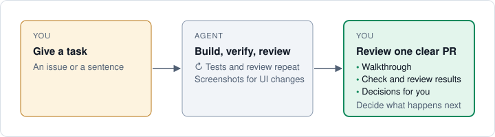

# Shaka in pictures

Do you build apps by chatting with an AI? This page shows what Shaka adds, using
pictures and plain words. You do not need to know Git or GitHub yet.

Your **coding agent** is the AI tool you chat with, such as Claude Code, Codex, or
Cursor. This page calls it **the agent**.

## What you will get from this page

After reading, you will know:

- what a **branch**, a **commit**, and a **pull request** are;
- what Shaka does while you wait;
- when Shaka needs your “yes.”

After the tutorial, you will have:

- a small playground website on GitHub with a working click counter;
- a pull request that Shaka built, tested, and reviewed;
- a change you approved yourself.

## Why use Shaka?

When you vibe code, the AI changes your project right away. That is fast, but
nobody checks the work unless you ask. Shaka gives the AI a careful routine. It
works on a practice copy, tests its work, gets a second opinion, and hands you
proof before anything goes in.


**The goal: changes you can trust, while you stay in charge of what goes in.**

## Eight words to start with

Programmers use these words every day. Each one has a simple meaning.
**GitHub** is the website where your project and its changes live.


People often shorten pull request to **PR**.

## How a change travels

This picture puts the words together. Follow the numbers.


The most important part: **main stays the same while the agent works.** If you
do not like the result, ask for changes, or do not merge it. Your real project
stays as it was.

## What Shaka does while you wait



You give the task as a sentence or as a GitHub **issue**, which is a to-do note
on GitHub. Then the agent does the gray box:

1. **Build.** It makes the change on a branch.
2. **Test.** It runs your project's tests. If the change shows on screen, it also
   takes before and after pictures when it can.
3. **Review.** A second AI reads the change and looks for mistakes. The agent
   fixes what it finds, then tests and reviews again.

Then it hands you the green box: a pull request with everything you need to decide.

Shaka gives the agent rules. A program checks some of them, and the agent follows
the others on its own. The PR lists what was checked, and also what could not be
checked. See [which rules a program checks](workflow.md#what-is-enforced).

## Read the permission slip

Shaka's PRs use the same layout every time, so you always know where to look.


A green ✓ means a check ran and passed. Letters and numbers such as `a1b2c3d`
name the exact commit it ran on. A ✓ is strong proof, but it does not promise
zero bugs.

Near the top of the PR page, the **Files changed** tab shows every line the agent
changed. Red lines were removed, and green lines were added.

## Who says yes?

Shaka has two merge choices. **Ask** is the default.


- **Ask:** the agent stops when the PR is ready. You press merge on GitHub, or you
  approve by telling the agent to merge.
- **Auto:** the agent merges once its checks and reviews pass. Big or risky
  changes still come back to you.

This page uses Ask. With Ask, Shaka adds nothing to main until you say yes.

## Tutorial: your first Shaka task

You will make a tiny playground website, ask Shaka to add a click counter, read
the PR, and merge it. Your real projects stay untouched.


### What you need

- A GitHub account.
- A coding agent that can run commands on your computer, such as Claude Code,
  Codex, or Cursor. See [coding agents](coding-agents.md).

The examples type `/shaka`, which works in Claude Code, Cursor, and OpenCode. In
Codex, type `$shaka` instead.

Shaka also needs a few tools on your computer: Ruby, Git, and GitHub's
command-line tool. In step 1, the agent checks for them and tells you what is missing.

### Step 1: Install Shaka

**Do:** paste this into a chat with your coding agent.

```text
Install Shaka from https://github.com/shakacode/shaka.
```

**You will see:** the agent checks your computer and installs Shaka in its own
folder, away from your projects. If GitHub asks you to sign in, follow the
agent's steps.

**Success looks like:** in a new chat, type `/shaka` by itself. A short welcome
means Shaka is ready.

### Step 2: Make a playground project

This step is ordinary work for your coding agent. It is not a Shaka task yet.

**Do:**

```text
Create a private GitHub repository named shaka-playground. Give it a
one-page website with a button and one automated test. Push it to main.
```

**Push** means upload your saved work to GitHub. The test matters: Shaka runs
your project's tests, so without one it has less to check and less to show you.

**Success looks like:** the agent gives you a link to the new repository. Open it
to see your project's files on GitHub.

**Then:** open your coding agent in the `shaka-playground` folder on your computer.
The agent told you where it saved the folder; ask again if you missed it.

### Step 3: Run a health check

**Do:**

```text
/shaka doctor
```

**Success looks like:** everything Shaka needs shows as ready. If something is
missing, ask the agent to help you install it.

The report also lists AI reviewer tools. Shaka likes a reviewer from another AI
company. One AI tool is fine too: Shaka then uses a fresh copy of it that has
not seen your chat, so the second look stays separate.

### Step 4: Give Shaka a task

**Do:**

```text
/shaka Add a counter that shows how many times the button was clicked.
Set up Shaka just for me. Go.
```

- **Set up Shaka just for me** saves Shaka's settings only on your computer.
- **Go** means: start now.

**You will see:** the agent starts working and shows its plan. Move on to step 5.

### Step 5: Watch it work

This takes longer than a normal chat, because the agent tests and reviews its own
work. Its messages use the words from this page.

| The agent… | It means… |
| --- | --- |
| Shows its plan: value, scope, risk, model, and effort | Why the work matters, how big and risky it is, and how hard the AI will think. |
| Names a branch | It made the practice copy. |
| Runs your tests | The robot checks are running. |
| Reports review findings | The second AI found something. The agent fixes it and checks again. |
| Pushes the branch | It uploaded the practice copy to GitHub. |
| Opens a pull request | Your permission slip is ready. |
| Publishes a walkthrough | A guided tour of the changed code. |
| Publishes a checkpoint | Its final look: did it build the right thing, and is it ready? |
| Adds the `awaiting-merge-approval` label | A tag on the PR that means: your turn to decide. |

**If it stops to ask you something,** answer in your own words. If a question is
confusing, reply “Explain that in simple words.” Your first run may pause for a
few questions while Shaka learns your project. Your coding agent may also ask
before it runs some commands. For this playground project, saying yes is fine.

**Success looks like:** the agent gives you a PR link and says the PR is ready
for your decision.

### Step 6: Read the pull request

**Do:** open the PR link. Then go on a treasure hunt:

- [ ] The summary: what changed and why.
- [ ] The check table: did the tests pass?
- [ ] The review: what did the second AI find, and what was fixed?
- [ ] Before and after pictures of the button, in a comment below the summary.
  They appear when your agent could open a browser.
- [ ] **Code Walkthrough:** a tour of the changed code.
- [ ] The **Files changed** tab: every changed line.
- [ ] **Usage and cost:** what the AI work cost, when your agent reports it.

**Success looks like:** you can say what changed and how it was checked, without
reading every line of code. If a check failed or something is missing, the PR
says so. Ask the agent about it.

### Step 7: Ask for a change

**Do:** in the same chat, say what you want to be different.

```text
Make the counter number bigger.
```

**You will see:** the agent updates the same PR. It saves a new commit, tests and
reviews again, and updates the PR. Reload the PR page to see the changes.

**What it means:** you can steer as often as you like. main still has not changed.

### Step 8: Merge

**Do:** when you are happy, choose one:

- Tell the agent `Merge this PR.` It merges the exact version it showed you.
- Or press the green merge button on the GitHub PR page.

**Success looks like:** the PR turns purple and says **Merged**. main now has the
counter.

Your playground repository has no GitHub rules that block merging, and the agent
may mention that. It is fine for practice.

### Step 9: See what you gained

**Do:** ask the agent to show you the result.

```text
Open the playground website so I can click the button.
```

Then look back at what happened:

- **You never ran a test yourself,** but tests ran before you saw each version.
- **A second AI checked the work** before it reached you.
- **main was safe the whole time.** Nothing joined it until you said yes.
- **You have a record.** The PR explains what changed and why, so anyone can
  understand it months later.
- **You can undo it.** On a merged PR, GitHub's **Revert** button opens a new PR
  that takes the change back out.

## When something seems wrong

- **A check failed.** That is the safety net working. The agent fixes the problem
  or tells you why it cannot.
- **You do not like the result.** Tell the agent what to change. Or close the PR
  on GitHub without merging; main stays as it was.
- **You closed the chat.** Open the PR page and expand **WIP Details** (WIP means
  work in progress). Copy its **Next action** into a new chat. See
  [resume unfinished work](working-with-shaka.md#resume-unfinished-work).
- **The agent asks about model and effort.** See
  [why it asks](faq.md#why-did-the-agent-stop-to-ask-about-model-and-effort).

## Next steps

- [Start here](getting-started.md): use Shaka on a real project, alone or with a team.
- [Working with Shaka](working-with-shaka.md): more prompts, and how to give feedback.
- [FAQ](faq.md): answers to common questions.
