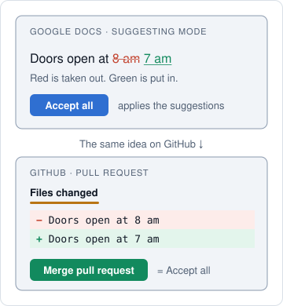

# Shaka in pictures

Build a small website with a button that counts clicks. Practice asking for a
change, checking the result, requesting a revision, and accepting the finished work.

You need a GitHub account and a coding agent that can edit files and run commands,
such as Claude Code, Codex, or Cursor.

A **pull request**, or PR, proposes a change to your project. To **merge** it is
to accept the change, like accepting suggested edits in a document.



Shaka asks your agent to test the change and get an independent review. You decide
whether to accept it. Tests and review can miss bugs.

<a id="what-you-will-get-from-this-page"></a>
<a id="why-use-shaka"></a>
<a id="it-works-like-suggesting-mode"></a>
<a id="what-shaka-does-while-you-wait"></a>
<a id="who-says-yes"></a>

## Tutorial: your first Shaka task

The examples use `/shaka`. In Codex, use `$shaka` instead.
For another tool, see [coding agents](coding-agents.md).

### What you need

Use a playground so you can experiment without changing a real project.
The agent checks the required tools during installation.

### Step 1: Install Shaka

Ask your coding agent:

```text
Install Shaka from https://github.com/shakacode/shaka.
```

Start a new chat and enter `/shaka`. Follow the agent's instructions if anything
is missing.

### Step 2: Make a playground project

```text
Create a private GitHub repository named shaka-playground, outside my other
projects. Give it a one-page website with a button and one automated test.
Upload it to GitHub.
```

Open the repository link to confirm the files arrived. A **repository** is the
project's home on GitHub; your agent edits a local copy in a project folder.

Then ask:

```text
Help me start a new chat in the shaka-playground folder.
```

In the new chat, ask:

```text
Which project folder are you using?
```

Confirm that it names `shaka-playground` before continuing.

### Step 3: Run a health check

```text
/shaka doctor
```

Missing project settings, labelled **Repository seam** in the report, are expected
here. The next step adds them. Ask the agent to help resolve other problems
before continuing.

### Step 4: Give Shaka a task

```text
/shaka Add a counter that shows how many times the button was clicked.
Set up Shaka just for me. Ask me before merging.
```

"Just for me" keeps Shaka's settings local, without adding them to the shared
repository. Answer any questions in your own words. If you don't understand a
permission request, ask the agent to explain it.

<a id="step-5-watch-it-work"></a>

### Watch it work

The agent makes the change, runs checks, gets an independent review, and opens a PR.

Continue when the agent gives you a PR link and says it is ready for your review.

<a id="step-6-read-the-pull-request"></a>

### Step 5: Check the result

Open the PR link. Read the summary to understand what changed. Look under
**Verification** for what was checked and what remains unverified.

Ask your agent:

```text
Open the updated playground website so I can try the counter.
```

Click the button several times. Confirm that each click increases the counter by
one. Ask about any failed checks or unresolved concerns before merging.

<a id="step-7-ask-for-a-change"></a>

### Step 6: Ask for a revision

In the same chat:

```text
Make the counter number bigger.
```

The agent updates the same PR. When it finishes, ask it to show the updated
website. Check that the number is easier to read and the counter still works.
You can keep asking for changes before merging.

<a id="step-8-merge"></a>

### Step 7: Accept the change

Confirm that the PR is the version you reviewed. When you're satisfied with the
counter and its checks, tell the agent in the same chat:

```text
You can merge.
```

The agent merges the PR when required checks and approvals allow it. Open the PR
link and look for the purple **Merged** status to confirm the change was accepted.

You can also merge through GitHub. If the PR has changed since you checked it,
review the latest changes first.

<a id="step-9-see-what-you-gained"></a>

### See what you gained

```text
Open the playground website so I can click the button.
```

Try a few clicks. You have practiced requesting a change, checking it, revising
it, and accepting it without running Git commands yourself.

<a id="when-something-seems-wrong"></a>

## When something goes wrong

- **The result isn't right:** explain what you want changed in the same chat.
- **A check fails:** ask the agent what failed and what needs fixing before merging.
- **The agent stops:** ask, "What do you need to continue?" For an interrupted or lost chat, see [Resume unfinished work](working-with-shaka.md#resume-unfinished-work).
- **You don't want the change:** ask the agent to close the PR without merging.
- **You regret a merged change:** ask the agent to open a new PR that undoes it.

<a id="next-steps"></a>

## Try a real task

Choose a small bug or improvement in a project you know. Describe the result you
want, or provide an issue link:

```text
/shaka <your task or issue link>
```

[Start here](getting-started.md) helps with setup.
[Working with Shaka](working-with-shaka.md) covers planning, feedback, and resuming work.
