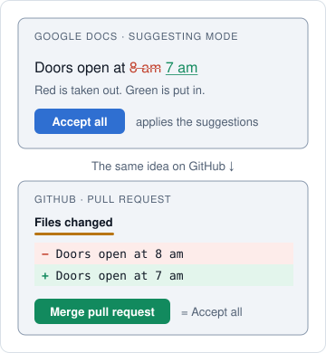

# Shaka in pictures

Do you build apps by chatting with an AI? This page shows what Shaka adds, using
pictures and plain words. You do not need to know Git or GitHub. If you have used
suggesting mode in Google Docs, you already know the main idea.

Your **coding agent** is the AI tool you chat with, such as Claude Code, Codex, or
Cursor. This page calls it **the agent**.

## What you will get from this page

After reading, you will know:

- what a **pull request** and a **merge** are;
- what Shaka does while you wait;
- when Shaka needs your “yes.”

After the tutorial, you will have:

- a small playground website on GitHub with a working click counter;
- a pull request that Shaka built, tested, and reviewed;
- a change you approved yourself.

## Why use Shaka?

When you vibe code, the AI changes your project right away. That is fast, but
nobody checks the work unless you ask. Shaka gives the AI a careful routine. It
tests its work, gets a second opinion, and shows you its changes as suggestions,
with proof, before anything goes in.


**The goal: changes you can trust, while you stay in charge of what goes in.**

## It works like suggesting mode

In Google Docs suggesting mode, edits show as suggestions: removed text is
crossed out, and new text appears in color. Nothing changes until someone clicks
**Accept all**. The agent hands you its work the same way, on **GitHub**, the
website where your project lives.



- A **pull request**, or **PR**, is the agent's suggestions, waiting for you. Its
  **Files changed** tab shows removed lines in red and new lines in green.
- To **merge** a PR is to click Accept all: the changes join your project.

Until you merge, your project stays as it was. The agent works on its own copy,
called a branch, and saves each step as a commit, like an entry in version
history. Shaka handles both.

## What Shaka does while you wait


You give the task as a sentence or as a GitHub issue, a to-do note on GitHub.
Then the agent does the gray box:

1. **Build.** It makes the change on its own copy.
2. **Test.** It runs your project's tests. If the change shows on screen, it also
   takes before and after pictures when it can.
3. **Review.** A second AI reads the change and looks for mistakes. The agent
   fixes real problems, then tests and reviews again.

Then it hands you the green box: a pull request with everything you need to decide.

Shaka gives the agent rules. A program checks some of them, and the agent follows
the others on its own. The PR lists what was checked, and also what could not be
checked. See [which rules a program checks](workflow.md#what-is-enforced).

## Who says yes?

Shaka has two merge choices. **Ask** is the default.


- **Ask:** the agent stops when the PR is ready. You press merge on GitHub, or you
  approve by telling the agent to merge.
- **Auto:** the agent merges once its checks and reviews pass. Big or risky
  changes still come back to you.

This page uses Ask. With Ask, Shaka's rules tell the agent to wait for your yes
before anything joins your project. See [choose a merge policy](working-with-shaka.md#choose-a-merge-policy).

## Tutorial: your first Shaka task

You will make a tiny playground website, ask Shaka to add a click counter, read
the PR, and merge it. Your real projects stay untouched.


### What you need

- A GitHub account.
- A coding agent that can run commands on your computer, such as Claude Code,
  Codex, or Cursor. See [coding agents](coding-agents.md).

The examples type `/shaka`, which works in Claude Code, Cursor, and OpenCode. In
Codex, type `$shaka` instead.

Shaka also needs a few tools on your computer: Ruby, Git, and GitHub's
command-line tool. In step 1, the agent checks for them and tells you what is missing.

### Step 1: Install Shaka

**Do:** paste this into a chat with your coding agent.

```text
Install Shaka from https://github.com/shakacode/shaka.
```

**You will see:** the agent checks your computer and installs Shaka in its own
folder, away from your projects. If GitHub asks you to sign in, follow the
agent's steps.

**Success looks like:** in a new chat, type `/shaka` by itself. A short welcome
means Shaka is ready.

### Step 2: Make a playground project

This step is ordinary work for your coding agent. It is not a Shaka task yet.

**Do:**

```text
Create a private GitHub repository named shaka-playground. Give it a
one-page website with a button and one automated test. Upload it to GitHub.
```

A **repository**, or repo, is your project's home on GitHub. The test matters:
Shaka runs your project's tests, so without one it has less to check and less to
show you.

**Success looks like:** the agent gives you a link to the new repository. Open it
to see your project's files on GitHub.

**Then:** open your coding agent in the `shaka-playground` folder on your computer.
The agent told you where it saved the folder; ask again if you missed it.

### Step 3: Run a health check

**Do:**

```text
/shaka doctor
```

**Success looks like:** the tools Shaka needs show HEALTHY. Expect one FAILED
row, **Repository seam**, and a few DEGRADED rows: Shaka is not set up in this
project until step 4, so skip their advice for now. If a tool is missing, ask the
agent to help you install it.

In this tutorial, the second look comes from a fresh copy of the same AI that has
not seen your chat. A reviewer from another AI company is optional; see
[add a second reviewer](settings.md#add-a-second-reviewer).

### Step 4: Give Shaka a task

**Do:**

```text
/shaka Add a counter that shows how many times the button was clicked.
Set up Shaka just for me. Go.
```

- **Set up Shaka just for me** saves Shaka's settings only on your computer.
- **Go** means: start now.

**You will see:** the agent starts working and shows its plan. Move on to step 5.

### Step 5: Watch it work

This takes about 10 minutes, because the agent tests and reviews its own work.
Its messages use the words from this page.

| The agent… | It means… |
| --- | --- |
| Shows its plan: value, scope, risk, model, and effort | Why the work matters, how big and risky it is, and how hard the AI will think. |
| Names a branch | It made its own copy to work in. Your real version, called **main**, stays as it was. |
| Runs your tests | The robot checks are running. |
| Reports review findings | The second AI found something. The agent fixes real problems and checks again; small suggestions are only noted. |
| Pushes the branch | It uploaded its copy to GitHub. |
| Opens a pull request | Its suggestions are ready for you. |
| Publishes a walkthrough | A guided tour of the changed code. |
| Publishes a checkpoint | Its final look: did it build the right thing, and is it ready? |
| Adds the `awaiting-merge-approval` label | A tag on the PR that means: your turn to decide. |

**If it stops to ask you something,** answer in your own words. If a question is
confusing, reply “Explain that in simple words.” On this first run, your coding
agent may ask your permission many times before it runs commands such as `git`,
`gh`, and `ruby`. For this playground project, saying yes is fine.

**Success looks like:** the agent gives you a PR link and says the PR is ready
for your decision.

### Step 6: Read the pull request

**Do:** open the PR link. Shaka's PRs use the same layout every time:


Find each numbered part on your PR. **Code Review** opens the second AI's
findings, in a comment titled Local Adversarial Review. Then open the **Files
changed** tab to see every changed line. If your agent could open a browser, a
comment below the summary also shows before and after pictures of the button.

The PR and its comments show your own GitHub account. A 🤖 line marks text the
AI wrote. A green ✓ means a check ran and passed. That is strong proof, but it
does not promise zero bugs.

**Success looks like:** you can say what changed and how it was checked, without
reading every line of code. If a check failed or something is missing, the PR
says so. Ask the agent about it.

### Step 7: Ask for a change

**Do:** in the same chat, say what you want to be different.

```text
Make the counter number bigger.
```

**You will see:** the agent updates the same PR. It saves a new commit, like a new
entry in version history, then tests and reviews again. Reload the PR page to see
the changes.

**What it means:** you can steer as often as you like, and main still has not
changed.

### Step 8: Merge

**Do:** when you are happy, choose one:

- Tell the agent `Merge this PR.` It merges the exact version it showed you.
- Or press the green merge button on the GitHub PR page.

**Success looks like:** the PR turns purple and says **Merged**, and main now has
the counter.

Your playground repository has no GitHub rules that block merging, and the agent
may mention that. It is fine for practice.

### Step 9: See what you gained

**Do:** ask the agent to show you the result.

```text
Open the playground website so I can click the button.
```

Then look back at what happened:

- **You never ran a test yourself,** but tests ran before you saw each version.
- **A second AI checked the work** before it reached you.
- **main was safe the whole time.** Nothing joined it until you said yes.
- **You have a record.** The PR explains what changed and why, so anyone can
  understand it months later.
- **You can undo it.** On a merged PR, GitHub's **Revert** button opens a new PR
  that takes the change back out.

## When something seems wrong

- **A check failed.** That is the safety net working. The agent fixes the problem
  or tells you why it cannot.
- **You do not like the result.** Tell the agent what to change. Or close the PR
  on GitHub without merging, like Reject all; main stays as it was.
- **You closed the chat.** Open the PR page and expand **WIP Details** (WIP means
  work in progress). Copy its **Next action** into a new chat. See
  [resume unfinished work](working-with-shaka.md#resume-unfinished-work).
- **The agent asks about model and effort.** See
  [why it asks](faq.md#why-did-the-agent-stop-to-ask-about-model-and-effort).

## Next steps

- [Start here](getting-started.md): use Shaka on a real project, alone or with a team.
- [Working with Shaka](working-with-shaka.md): more prompts, and how to give feedback.
- [FAQ](faq.md): answers to common questions.
