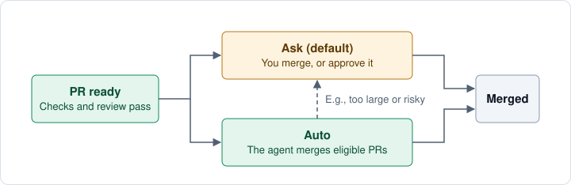

# Working with Shaka

Use Shaka to turn a task into a pull request (PR), give feedback, and decide when
it merges. For help reading the result, see
[Review the PR and improve the process](pr-verification.md).

Examples use `/shaka`. In Codex, use `$shaka` instead. For other tools, see
[coding agents](coding-agents.md).

<a id="what-you-get"></a>

## Give it an outcome

Describe the result or link an issue. Add what the agent cannot infer:

```text
/shaka Add CSV export to the orders page. Reuse the filters shown on screen.
```

The agent explains what it understands before coding. Correct any mismatch in
chat. It can proceed with a clear task and asks when it needs your decision.

## Choose a merge policy

| Choice | What happens |
| --- | --- |
| **Ask** (default) | You merge the ready PR on GitHub, or tell the agent, "You can merge." |
| **Auto** | The agent merges when the PR is ready. |



To use Auto for a task, add:

```text
Merge when ready.
```

Required checks, reviews, and approvals still apply. By default, Auto can merge
only PRs rated low risk. See [Risk and review](reference/pr-record.md#risk-and-review)
for the rating and reasons. Shaka asks for your approval if the rating is
missing, exceeds your [Auto risk limit](settings.md#mergeauto_merge_max_risk),
or the PR exceeds your [size limits](settings.md#mergelimits).

Auto can merge past an optional CI failure that the PR leaves unchanged. Shaka
verifies that the same check fails on the PR and on the latest commit of its
target branch. The agent compares the logs and confirms that the PR doesn’t
change anything the check uses. Handle the existing failure as a separate fix.

If your repository [waits for every CI review](settings.md#reviewci_review_wait),
Auto hands the PR back to you. A failed required check still blocks the merge.

## Give feedback

<a id="on-github-or-in-chat"></a>
<a id="in-your-editor"></a>

Say what you want changed in the same chat:

```text
Show dates as YYYY-MM-DD in the export.
```

You can also comment on GitHub and paste the comment link into the chat.
Comments reach the agent automatically only while follow-up is active; the PR
handoff says whether it is. Keep that chat available and wait for the agent's
response before merging. Otherwise, return to the chat.
Before editing files yourself, ask the agent to pause. Tell it when you finish
so you do not both edit the same files.

### Revise earlier guidance and try again

A **return point**, such as C1 or C2, records earlier guidance and recoverable
work. The PR description lists the available return points. To revisit one:

```text
Return to C2. Keep CSV export, but leave out the export settings screen.
First explain what you can restore and what would change.
```

Unsaved work may not be recoverable. Returning to earlier guidance does not undo
a merge or deployment. See [recovery details](reference/pr-record.md#recovery).

## Find PRs waiting on you

<a id="squash-with-a-useful-commit-message"></a>

Open your repository's **Pull requests** tab on GitHub and search:

| Search | What to do |
| --- | --- |
| `is:open label:awaiting-answer` | Answer **Decisions to make** in the PR description. |
| `is:open label:awaiting-merge-approval` | Review the PR, then merge on GitHub or tell the agent, "You can merge." |
| `is:open label:awaiting-resume` | Open **WIP Details → Chat link** and paste **Next action** there. |

A label does not wake the agent. See [merge and queue details](reference/pr-record.md#merge-messages).

## Resume unfinished work

Return to the original chat through **WIP Details → Chat link** in the PR
description. If you need a new chat, make sure the previous agent has stopped,
then give Shaka the PR:

```text
/shaka take over https://github.com/OWNER/REPO/pull/N
```

The agent checks the current state and explains what remains. It records the
handover on the PR and rechecks merge authority before continuing.

Before a PR exists, return to the original chat and checkout. An issue's start
comment may identify the machine holding the work. See
[interrupted work](expected-experience.md#resume-or-change-your-checkout) for recovery limits.

## Choose the outcome you need

### Get a plan before implementing

```text
/shaka Plan CSV export for the orders page. Planning only.
```

Read the plan and give feedback. When ready, say, "Implement the plan."

<a id="keep-a-plan-across-chats"></a>

For work needing several PRs, the agent keeps the plan in the issue or another
authorized document. Private planning stays out of public repositories.

### Agree on a design before implementing

```text
/shaka https://github.com/OWNER/REPO/issues/N
Agree on the design first. Wait for my approval before implementing.
```

The agent recommends an approach and records the design in the issue or a design
PR. You can request a design PR explicitly. Approving the design authorizes
implementation; the finished work still follows your merge choice.

### Review an existing PR

```text
/shaka Review https://github.com/OWNER/REPO/pull/N. Review only.
```

The agent reports findings and verification gaps without changing or merging the PR.

### Review documentation together

```text
/shaka Review docs with me: https://github.com/OWNER/REPO/pull/N
Keep it simple and useful for a new reader. Go one topic at a time.
```

Discuss each topic, then say "next." The agent keeps the agreed wording and
summarizes it at the end. Ask separately to apply the changes.

<a id="resume-a-pr-you-already-started"></a>

To continue an existing PR, use [Resume unfinished work](#resume-unfinished-work).

<a id="configure-a-repository-for-your-team"></a>

### Split a large change

```text
/shaka Add CSV export first. Keep scheduled export emails in a separate PR.
```

Each PR gets its own checks and review. When one depends on another, merge the
first before opening the next.

## Useful tips

You can ask the agent which model and effort fit the task. Change them in your
coding tool; a prompt cannot switch the running model. See
[coding agents](coding-agents.md) for tool setup and naming your machines, or
[settings](settings-guide.md) to hide the checkout path in PRs.

<a id="try-a-new-skill-pack-with-shaka"></a>

## Combine Shaka with other skills

Name an installed skill when it helps your task:

```text
/shaka Improve checkout error messages. Use pstack's technical-writing skill for wording.
```

Shaka still owns checks, review, the PR, and your merge choice. Try a new skill
pack on a small task, then ask which skills helped and where their instructions
conflicted with Shaka. [pstack](pstack.md),
[Addy Osmani's skills](https://github.com/addyosmani/agent-skills), and
[Ponytail](https://github.com/DietrichGebert/ponytail) offer techniques you can explore.
Compatibility varies by skill and coding tool.

<a id="hand-over-a-spec-and-tickets"></a>
<a id="what-each-kind-of-skill-can-do"></a>

### Use AI Hero's skills for a spec and tickets

[AI Hero's skills](https://www.aihero.dev/skills-changelog-v13-implement-spec-pr-retro-and-glossary-md)
can turn an idea into a spec describing the intended result and tickets for
individual pieces of work. Give Shaka the spec or a ticket:

```text
/shaka Deliver the spec in https://github.com/OWNER/REPO/issues/N.
```

The agent checks dependencies before implementing. GitHub issues can close
when their linked PR merges. For Linear or Shortcut, ask the agent to check your
tracker's completion rules.

<a id="use-a-technique-skill-during-delivery"></a>
<a id="use-pstack-for-a-bounded-part-of-delivery"></a>
<a id="hand-verification-evidence-back-to-shaka"></a>

### Use pstack for verification

[pstack](pstack.md) can help the agent exercise your running app:

```text
/shaka Fix https://github.com/OWNER/REPO/issues/N. Use pstack's
create-verification-skill to check that searching for O'Brien finds the order.
```

Shaka uses the results in the PR's evidence: what ran, which version was checked,
what it showed, and what remains unverified. After a change, the agent reruns
affected checks. Shaka keeps control of delivery; pstack's separate delivery
playbooks are not part of this flow.

## Review a session for improvements

```text
/shaka retrospective
```

The agent reviews the session and evidence for improvements, then waits for you
to choose what to change. Use completed PRs for regular retrospectives on
quality, token use, cost, and timing. See [PR timings](reference/timings.md) for
timing records and local logging controls.

## Suggest improvements to Shaka

Tell your agent what happened and what you expected:

```text
Shaka repeated the same setup question after I answered it. Help me report this.
```

The agent checks the problem and drafts an issue for your review. It asks before
posting and keeps private information out of the public report.
