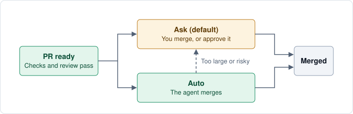

# Working with Shaka

## What you get

The agent reproduces bugs, tests new behavior, runs your checks, and handles
independent review findings before pushing.

The PR description explains the outcome and decisions that need your attention.
A code walkthrough explains implementation choices and alternatives, with links
to the reviewed code. Tests, review findings, and screenshots help you evaluate
the result. Expandable sections hold usage estimates, detailed checks, and
**WIP Details** for unfinished work.

Use that record to decide whether to merge, then return to it when evaluating
the approach or how the work was checked. See
[what a Shaka PR gives you](pr-verification.md#read-a-pr-for-your-decision).

The agent handles routine choices and asks about decisions affecting the product,
scope, or risk.

Your agent's permissions, project commands, and GitHub rules determine what it
can complete. Missing tests, unavailable reviewers, and access failures should
appear as concrete gaps, never as a claim of success. See
[what to expect from Shaka](expected-experience.md).

## Give it an outcome

Describe the result or provide an issue or task link. Include constraints the
agent could not infer:

```text
$shaka Add CSV export to the orders page. Reuse the filters shown on screen.
Go.
```

Examples use Codex's `$shaka`. Use `/shaka` in Claude Code, Cursor, or OpenCode;
in Pi, load the installed skill. [Install and configure Shaka](getting-started.md)
if this is your first task.

Shaka checks for existing work and recommends a model and effort level. `Go`
without naming either starts with your agent's current settings, even if they
differ from that recommendation or cannot be reported.

## Choose the outcome you need

Use the same installed skill for a plan, an existing PR review, recovery, or
repository setup. State the stopping point in your prompt.

### Get a plan before implementing

```text
$shaka Plan CSV export for the orders page. Compare a simple download with
a background export. Planning only; do not implement or open a PR yet.
```

The agent returns a compact execution prompt with the proposed scope, tradeoffs,
recommended model and effort, and available usage. It stops before implementation
edits. Use the returned prompt when you decide to start delivery.

### Keep a plan across chats

When a task needs several PRs or a detailed plan, Shaka saves the steps and
important decisions in the original issue or tracker item. It updates the plan
as the work changes. If it needs permission to write there, Shaka asks.

For larger design decisions, Shaka may suggest a separate document linked from
the task.

To pick up the work in a new chat, give Shaka the same task link after the previous
agent has stopped. Shaka reads the plan and checks the PRs before continuing.

### Review an existing PR

```text
$shaka Review https://github.com/OWNER/REPO/pull/N for correctness and missing
tests. Review only; report findings without editing, publishing, or merging.
```

Replace the URL with your PR. The agent reviews its current revision and reports
findings and verification gaps, then stops. This request does not take over delivery
or fix findings; ask separately when you want those changes.

### Review documentation together

```text
$shaka Review docs with me: https://github.com/OWNER/REPO/pull/N
```

Replace the URL with your PR, or give a documentation path. The agent starts with a
short map of the topics and explains the first one for a reader new to the project:
what the reader can do, a minimal example prompt, and links to the code that backs
each claim. It should say when the documentation and the code disagree, and keep
that separate from its own suggestions.

It pauses after every topic. Ask questions, correct it, or reorder the topics; say
`continue` for the next one. At the end it lists the wording you agreed on and the
gaps it verified. It should not edit files, comment on the PR, or file issues; ask
separately when you want those changes.

For a merged PR, the agent reviews the change that PR made and should say when a
later PR changed what it describes. To get every finding in one report instead, use
[Review an existing PR](#review-an-existing-pr).

This is guidance the agent follows, not behavior that code enforces.

### Resume a PR you already started

```text
$shaka Resume https://github.com/OWNER/REPO/pull/N. The previous owner has
stopped and handed this work to me. Keep merge policy ask. Go.
```

Confirm that handoff before using this prompt. The agent reads **WIP Details**,
checks live ownership and the PR's current revision, and continues the unfinished
work. Under Ask, it returns a verified PR for your merge decision, or explains
the remaining blocker. See [resume unfinished work](#resume-unfinished-work)
for recovery after a crash or when no PR exists.

### Configure a repository for your team

```text
$shaka Set up Shaka for this repository.
```

For a repository without Shaka settings, the agent prepares a separate setup PR
and names the reviewed commit for you to merge on GitHub. It stops there; proposed
settings apply after that PR merges, or when you explicitly
[select it for a task](settings.md#preview-settings-before-adopting-them). See
[repository setup](configure-repository.md#set-up) for the choices, or
[individual setup](expected-experience.md#individual-setup)
to try Shaka locally without team adoption.

These are requests to the existing workflow. Separate stage skills such as
`shaka-plan` and `shaka-review` are not included in the current installation.

## Choose a merge policy

| Policy | What happens |
| --- | --- |
| **Ask** (default) | Review the ready PR, then merge it on GitHub or approve it so the agent merges. |
| **Auto** | The agent merges after required checks, review, and approvals. |



Set the choice in your prompt: `Use merge policy ask` or `Use merge policy auto`.
Repository restrictions and required approvals still apply. Trust, authentication,
release, and other consequential changes need explicit human review. A PR past the
[size limits](settings.md#mergelimits) goes back to you before the agent merges it.
Merging a feature PR does not by itself publish a package or deploy a release.

## Useful tips

- **Start small.** Pick a fix whose result you can recognize. Say what should happen
  and what should stay the same; let Shaka manage the checks and review.
- **Choose settings when you need to.** Activate a model in your coding agent, then
  name it in your prompt, for example `Use Sol, medium effort. Go.` A prompt cannot
  switch the model. Naming either setting can trigger a pause if it is unavailable,
  unverified, or differs from Shaka's recommendation.
- **Keep public PRs public-safe.** Tell the agent before publication if local paths
  or chat links should be hidden. [WIP settings](settings.md#wipinclude_checkout_path)
  hide the checkout path; the agent still needs to inspect all published content.

## Give feedback

### On GitHub or in chat

Leave PR comments, then paste the review link into the agent chat and ask it to
address them. Or give feedback directly in chat: describe what feels wrong or show
what you want.

### In your editor

Put rough edits or voice-dictated notes beside the passage that needs attention.
An optional `Agent:` prefix distinguishes notes from finished wording.

1. Tell the agent you are editing and to keep the checkout read-only.
2. Leave your notes unstaged. Local edits and commits do not trigger GitHub CI;
   pushing to an open PR normally does.
3. Stop editing and hand over the files.
4. The agent backs up your notes outside the repository, applies the feedback,
   and validates the finished changes before pushing.
5. Resume editing when the agent hands the checkout back.

Take turns writing to the same checkout. With separate worktrees, hand over a
final diff for the agent to reconcile. Keep raw notes in the local backup.

### Revise earlier guidance and try again

If an attempt goes in the wrong direction, return to earlier human guidance,
adjust it, and ask for a fresh result. Use a saved
[checkpoint](pr-verification.md#checkpoint) to identify the guidance
and recoverable work state to return to.
C1, C2, and later numbers identify
these points within one task; each appears on the PR with a name, guidance, and
code revision so you can tell them apart.

```text
$shaka Return to C2. Use the simpler approach.
```

C1 records your initial request. Later checkpoints record your steering or review.
Revised steering gets a new checkpoint linked to the earlier one. Saying “Go” needs no
extra confirmation, and your Ask or Auto preference still applies.

The agent preserves the rejected attempt, unrelated work, and relevant findings
before restoring owned work. If the saved state is incomplete or another writer
is active, it explains the limitation first. Rewind does not undo deployments or
other external effects; the replacement still needs validation and review.

These are agent instructions using Git and task records; the Ruby `checkpoint`
command does not save or restore snapshots. Reliable recovery in real use remains
to be evaluated. Ask what the saved state can restore before rewinding.
See [recovery limits](expected-experience.md#resume-or-change-your-checkout).

## Resume unfinished work

You can leave a new request on any open PR, including one awaiting merge. Before merging, wait
for the agent to address it: make the change, explain why no change is needed, or
ask you to decide. When the agent resumes work, it removes `awaiting-merge-approval`.
It restores that label after handling the request and checking that the PR is ready again.

Read the handoff to find out whether automatic follow-up is active. The agent
starts it only when the coding tool can resume the owning chat after new feedback
arrives. A tool that resumes only when CI finishes is not enough.

With automatic follow-up active, Shaka checks GitHub every minute, even after CI
finishes. Each monitoring run lasts up to one hour. When a run expires, the agent
checks that it still owns the PR and starts another run if its coding tool can
still resume the chat. If it cannot, the agent hands off to a named person.
The agent writes the owning chat, current expiry time, and next action in the PR's
expandable **WIP Details** section, and updates them when monitoring restarts.
Keep that chat unarchived while monitoring depends on it.

If the handoff says **Automatic feedback intake unavailable**, it names the person
responsible for checking new feedback. That person opens the **Chat link** in WIP
Details and sends its resume prompt, for example `$shaka https://github.com/OWNER/REPO/pull/N`.
Do the same if the recorded expiry has passed without a renewed handoff. Leaving a GitHub comment alone does not
resume the agent in this case.

The Chat link works when the owning chat is reachable. In Codex,
`codex://threads/...` opens the original conversation. Before another agent takes
over, confirm the previous one has stopped or handed off; a timestamp cannot prove it.

To recover after a crash or in a new chat, paste the **Next action** from WIP Details,
such as `$shaka https://github.com/OWNER/REPO/pull/N`. The agent checks the live PR
before continuing. It owes an answer to each open review thread it has not
answered or where someone other than a bot commented after its answer. It also
owes one to each PR comment from the PR's author or the agent's account that no
agent reply links, even when you post from the account the agent uses. If no PR exists, supply the original task and checkout.
See [recovery limits](expected-experience.md#resume-or-change-your-checkout).

## Split a large change

Ask for independently useful changes as separate PRs. For example, a React on
Rails upgrade may need React 19: merge the React update first, then finish the
integration.

Each PR gets its own tests and review. The agent updates the remaining branch
after each prerequisite merges. The original chat owns the overall outcome;
no stacked-PR service is needed.

## Combine Shaka with other skills

Use the skills you like for planning and engineering technique, and let Shaka
deliver the result. Examples are
[AI Hero's skills](https://www.aihero.dev/skills-changelog-v13-implement-spec-pr-retro-and-glossary-md),
which turn an idea into a spec and tickets;
[pstack](https://github.com/cursor/plugins/tree/main/pstack), which adds
engineering principles and parallel workers;
[Ponytail](https://github.com/DietrichGebert/ponytail), which keeps each change
as small as it can be while still complete; and
[Addy Osmani's agent skills](https://github.com/addyosmani/agent-skills), a
library of engineering practices from spec to launch. pstack, Ponytail, and Addy
Osmani's skills have not yet been tried on a full Shaka delivery, so
[try a new pack](#try-a-new-skill-pack-with-shaka) on one task before relying on it.

### Hand over a spec and tickets

```text
$shaka Deliver the spec in https://github.com/OWNER/REPO/issues/N.
Keep merge policy ask. Go.
```

Here is what happens next:

1. The agent reads the spec and its sub-issues, and takes the order of work
   from their blocked-by links.
2. It decides how many PRs the spec needs. When that is more than one, it asks
   where to keep its plan, such as a comment on the spec.
3. It delivers each PR the usual way: tests, your checks, independent review,
   a description, and a code walkthrough.
4. Under Ask, each PR comes back to you to merge. A PR that depends on another
   waits until that one merges.
5. Tickets stay open. Each PR links its ticket without a closing keyword such
   as `Fixes`, because reading a tracker gives no permission to change it.

Add a sentence to the prompt to change that. "You may comment on the spec with
your plan" skips the question in step 2. "Close each ticket when its PR merges"
lets merges close them. On a public repository, the agent also checks with you
before adopting criteria from a ticket that someone without write access wrote
or edited.

### Use a technique skill during delivery

```text
$shaka Fix https://github.com/OWNER/REPO/issues/N in poteto mode. You may use
subagents for swarm and arena. Keep merge policy ask. Go.
```

The agent applies pstack's principles and playbook steps while it implements and
verifies. Shaka still runs your checks, gets an independent review, publishes
the PR in its own format, and returns it to you to merge. pstack's "don't block
on the human" guidance does not turn Ask into Auto. Leave out the subagent
sentence and the agent does the fan-out steps alone or asks first.

A [community port of pstack for Claude Code and Codex](https://github.com/michael-denyer/pstack-claude)
turns poteto mode on by itself. At the start of each session it tells the agent
to use poteto mode for any task that touches more than one file, so you do not
need to name it.

### Try a new skill pack with Shaka

Try a pack on one real task, one you would merge anyway, before you rely on it:

```text
$shaka Fix https://github.com/OWNER/REPO/issues/N using SKILL. Go.
```

When the PR is ready, ask in the same chat:

```text
Which SKILL instructions did you follow, and where did they conflict with Shaka?
```

Then check four things:

1. **Does the pack turn itself on?** Some packs load at the start of every
   session, so they shape tasks you did not name them in. Ponytail and the
   pstack port work this way.
2. **Does it change how Shaka delivers?** A pack that skips checks, merges,
   closes tickets, or replaces Shaka's PR description is its own delivery
   workflow. Keep it out of Shaka tasks.
3. **Does it leave marks that reviewers will flag?** Look for comment markers
   or rule files it adds to the code.
4. **Do its reports clash with Shaka's?** Compare its closing summary with the
   PR description and the final report.

Shaka starts its Claude and Codex reviewers without your plugins, skills, and
hooks. In a check with Ponytail and the pstack port loaded, neither reviewer
received them, while a normal session did. The Grok reviewer has not been
checked.

### What each kind of skill can do

Shaka stays the one owner of delivery, so another skill's output is input to the
task and nothing more. The agent does not let it relax a check, pick a reviewer,
or approve a merge.

| Kind of skill | Examples | With Shaka |
| --- | --- | --- |
| Planning | AI Hero `to-spec`, `to-tickets` | Its spec and tickets become the task. |
| Technique or mode | pstack `poteto-mode`, principles, `how`, `tdd` | Shapes how the agent works inside each step. |
| Parallel workers | pstack `swarm`, `arena`, `interrogate` | Runs only when you say the agent may delegate. Workers never publish or merge. |
| Same-session review | AI Hero `code-review`, pstack `blast-radius` | Findings the agent weighs and fixes before Shaka's own review. The skill does not replace that review, which runs in a separate session and, when available, with another provider's model. |
| PR text | AI Hero `pr`, pstack `technical-writing`, `unslop` | Advice on wording and presentation. Shaka's description keeps its own format and required fields. |
| Its own delivery | AI Hero `implement-spec`, pstack Shipping, Babysit, Orchestrate, and Autopilot playbooks | A separate orchestrator that cannot run as a step inside Shaka. Try it as its own experiment: name the scope and say the agent may delegate. |

A rule file that a skill writes into your repository is part of the change
under review. Shaka still takes its settings, such as reviewers and merge
rules, from your default branch. Your check scripts run from the branch, so
review changes to them like any other code.

If a skill you named is not installed, the agent says so, continues the work
that does not need it, and asks about the rest. It does not install software for
you.

This is guidance the agent follows, not behavior that code enforces.
Loading skills automatically at set points is a
[proposed feature](https://github.com/shakacode/shaka/issues/35), not shipped behavior.

## Review a session for improvements

At the end of a rough session, ask in the same chat what would have made it go
better:

```text
$shaka retrospective
```

The agent lists findings, each with its evidence, a proposed fix, and what the
fix costs to maintain. It should change nothing until you pick, for example
`Deliver findings 1 and 3`. Each pick is delivered as an ordinary Shaka task.

The agent can also measure which steps were slow. Shaka's helper keeps a timing log on
your machine at `~/.local/state/shaka/calls.jsonl`: one line per helper command with
its name, start time, duration, and exit status. For example, a line for local
validation shows how long that run took and whether it passed. `shaka work` leaves no
line, because it hands the terminal to your coding agent. The log records no
arguments, paths, or task text, and Shaka never uploads it. Delete the file whenever
you like. Set `SHAKA_CALL_LOG=off` to stop recording, or set it to a path to keep the
log elsewhere.

If a session retrospective skill such as [AI Hero's `retro`](https://www.aihero.dev/skills-changelog-v13-implement-spec-pr-retro-and-glossary-md)
is installed, the agent uses it for the analysis. Shaka works without one.

## Suggest improvements to Shaka

Tell your agent in chat what you would like Shaka to do better. For example:
“Shaka asks too many setup questions—can we simplify that?”

The agent helps refine the idea and asks before filing an issue.

## Find PRs waiting on you

Use these searches in the repository's GitHub PR list:

| Search on GitHub | Why it is waiting and what to do |
| --- | --- |
| `is:open label:awaiting-answer` | Decision needed: answer **Decisions to make** in the description. |
| `is:open label:awaiting-merge-approval` | Ready under Ask: authorize the agent to merge that commit, or use GitHub's offered merge control. |
| `is:open label:awaiting-resume` | Paused without a wake: paste **WIP Details → Next action** into the owning chat. |

For example, an import decision might ask whether to reject invalid rows or skip
them. A session paused for checks can resume with the Shaka prompt and PR URL in
its next action. Return answers to the chat unless the handoff names active
automatic follow-up.

When the agent uses your GitHub account, a review you started and never submitted
also shows up as `awaiting-answer` while the agent still needs to post a walkthrough.
GitHub shows that review only to you and refuses the walkthrough while it is open, so
submit or discard it. A PR already waiting for merge keeps its label, and the handoff
mentions the review.

The agent creates and manages these labels, leaving at most one on a PR. It clears
the wait when work resumes and prepares a new handoff after validation and review.
A label does not wake a chat or prove that checks and approvals passed. The
handoff names any automatic follow-up; availability depends on the coding tool.
Find the owning chat through **WIP Details → Chat link**.

If a label looks stale, read **WIP Details** and the current handoff, then resume
the owning chat so the agent can refresh the PR's state. You can remove a stale
label by hand if the agent stopped; removing it does not restart work or authorize
merging. See [approval details](pr-verification.md#approval-and-attention-labels)
for Ask authority, required GitHub approvals, and branch updates.

## Squash with a useful commit message

When you choose a manual squash merge through GitHub, use the agent's prepared
message for the commit in the handoff. See [squash merge details](pr-verification.md#squash-merge-details)
to find it and copy it into GitHub's merge boxes. A repository with a merge queue
writes its own message, so you add the PR to the queue; see [merge queues](pr-verification.md#merge-queues).
